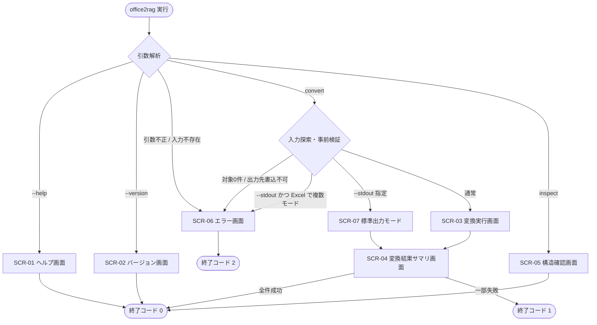

# P001 システム要件定義書 — Office2RAGKnowledge

| 項目 | 内容 |
| --- | --- |
| プロジェクト名 | Office2RAGKnowledge |
| 配布パッケージ名 | `office2ragknowledge` |
| CLIコマンド名 | `office2rag` |
| 版 | 1.4 |
| 作成日 | 2026-08-24 |
| 最終更新 | 2026-10-14 (CR-001: PDF 入力の追加、CR-002: PDF のヘッダー・フッター除去と段組みの読み順補正、CR-003: PDF 読み取りライブラリの MIT 互換への差し替えを反映) |
| ライセンス | MIT (© 2026 HONDOH Atsushi) |

## 改訂履歴

| 版 | 日付 | 内容 |
| --- | --- | --- |
| 1.0 | 2026-08-24 | 初版 |
| 1.1 | 2026-08-24 | Excel 関連要求を修正。① 1シート内の複数表領域の分割検出を追加 (REQ-F-053〜056)、② 数式のキャッシュ値が存在しない場合の扱いを定義 (REQ-F-051〜052)、③ 表計算モード／方眼紙モードの二重出力を追加 (REQ-F-057〜065)。これに伴い §1.1・§1.3・§3.2・§4.3・§4.4・§4.7・§6.3・§7.1・§7.2・§9・§10・§11 を更新 |
| 1.2 | 2026-10-14 | ※CR-001により追加。PDF (`.pdf`) を入力形式に追加 (§4.9 REQ-F-110〜121、REQ-NF-020)。タグ付き PDF は論理構造にもとづき見出し・リスト・表に変換し、タグなし PDF は単純なテキストの羅列として出力する。図表内のテキストは図形テキストと同様に扱う。これに伴い §1.1・§1.3・§1.4・§3.1・§3.2・§4.7・§6.3・§7.1・§7.2・§8.3・§9・§10・§11 を更新。更新前の原本は `P001-requirement_20261014_CR-001.md` |
| 1.3 | 2026-10-14 | ※CR-002により追加。PDF のページヘッダー・フッターの除去 (REQ-F-122〜124) と、タグなし PDF の段組みの読み順補正 (REQ-F-125〜127)、およびその記録 (REQ-F-128) を追加 (§4.10)。これに伴い §1.3・§1.4・§4.7・§6.3・§7.1・§10・§11 を更新。更新前の原本は `P001-requirement_20261014_CR-002.md` |
| 1.4 | 2026-10-14 | ※CR-003により変更。PDF 読み取りライブラリを PyMuPDF (AGPL-3.0) から pdfminer.six (MIT) に差し替え (§8.3)、実行時依存のライセンスの要件 REQ-NF-021 を追加 (§5)、§10 にライセンス検査のテスト方針を追加。更新前の原本は `P001-requirement_20261014_CR-003.md` |

---

## 1. アプリケーションの概要

### 1.1 何のためのアプリか

Office文書 (Word `.docx` / Excel `.xlsx` / PowerPoint `.pptx`) および **PDF (`.pdf`)** (※CR-001により追加) を、**AIのRAG (Retrieval-Augmented Generation) パイプラインが取り込むための Markdown** に変換するツールである。

出力先の読み手は人間ではなく、チャンク分割器と埋め込みモデルである。したがって本アプリは**視覚的忠実性 (フォント・色・配置の再現) を目的とせず、構造的忠実性 (見出し階層・表・リスト・シート境界・スライド境界・図形内の文言) を目的とする**。

本アプリが他の変換ツールと明確に異なる点は次の2点である。

1. **オートシェープ (図形) 内のテキストを取りこぼさない** — 図形内に書かれた要点・注意事項・構成図の説明を、OCR を用いずに OOXML から回収して Markdown に追記する (§4.4)。
2. **Excel の二面性に、判別を行わずに両対応する** — Excel が「表計算」として使われているか「方眼紙」として使われているかを判別せず、両方の Markdown 表現を常に生成する (§4.3)。

PDF は、アクセシビリティ対応 (タグ付き PDF) の論理構造があればそれを Office 文書と同等の構造 (見出し・リスト・表) に変換し、論理構造が無ければ単純なテキストの羅列として出力する (§4.9)。※CR-001により追加。アプリの名称 (Office2RAGKnowledge) と位置づけは PDF 追加後も変えない (CR-001 備考、依頼者承認済み)。

### 1.2 誰が使うか

| 利用者 | 利用シーン |
| --- | --- |
| RAGパイプライン構築者 (主) | 社内文書群をバッチで Markdown 化し、チャンク化・埋め込み処理の前段に組み込む |
| ナレッジ整備担当者 | 手元の Office 文書を単発で変換し、出力内容を目視確認する |
| 開発者 | 自作の Python アプリから本アプリをライブラリとして `import` して変換機能を組み込む |

### 1.3 解決する課題

| # | 課題 | 本アプリでの解決 |
| --- | --- | --- |
| 課題1 | Office のバイナリ形式はそのまま埋め込みモデルに渡せず、テキスト抽出が必須 | 3形式を統一的に Markdown へ変換する |
| 課題2 | 素朴なテキスト抽出は見出し階層や表構造を失い、チャンク分割の手掛かりが消える | 見出しレベル・表・リスト・シート/スライド境界を Markdown の構造として保持する |
| 課題3 | **既存の変換ツールの多くは、オートシェープ (テキストボックス・図形・SmartArt 等) の中に書かれた文言を取りこぼす。** 日本のビジネス文書では、要点・注意事項・構成図の説明が図形内に書かれていることが多く、これが欠落すると RAG の検索対象から重要な情報が丸ごと外れる | **オートシェープ内テキストの抽出を本アプリの中核要件とする (REQ-F-031〜040)。** OOXML を直接走査し、Word/Excel/PowerPoint いずれについても図形内テキストを回収して Markdown に追記する |
| 課題4 | 変換結果の出自 (どのファイルのどのシート/スライド由来か) が失われ、RAG の回答根拠を示せない | YAML front matter と見出しに出典情報を埋め込む |
| 課題5 | **Excel には「表計算として使う」用法と「方眼紙として使う」用法があり、適切な Markdown 表現がまったく異なる。** 用法を機械的に判別しようとすると、誤判定時に情報が失われ、しかも失われたことを後段から検知できない | **判別を放棄し、両方の表現を常に出力する** (§4.3.0、REQ-F-064)。どちらを採用するかは後段の RAG パイプラインに委ねる |
| 課題6 | **1つのシートに複数の表が並んでいる場合**、使用範囲を丸ごと1つの表として出力すると、列がずれて各表の意味が失われる | 空行・空列を境界として表領域を検出し、領域ごとに独立したテーブルとして出力する (REQ-F-054〜057) |
| 課題7 | **Excel で開かずに機械生成されたファイルは数式の計算結果を保持していない**ため、値だけを取り出すと該当セルが空になり、情報が黙って失われる | キャッシュ値が無い場合は数式そのものを出力し、警告として記録する (REQ-F-051〜052) |
| 課題8 | **PDF で流通・保管されている文書は、現行の対応形式 (OOXML) に含まれず RAG に取り込めない。** 別ツールで変換すると出力形式が揃わず、RAG パイプライン側でチャンク分割の規則を分けなければならない ※CR-001により追加 | PDF を入力形式に加え、Office 文書と同じ front matter・見出し構造・図形テキストブロックの体裁で出力する (§4.9)。タグ付き PDF の論理構造を見出し・リスト・表に写す |
| 課題9 | **PDF からページ上の位置順に文字を拾うだけでは、全ページに繰り返し現れるヘッダー・フッター (文書名・ページ番号等) が本文の途中に何度も挟まり、2段組みの文書では左右の段の行が交互に混ざって文が途中で切れる。** いずれもチャンクの意味の一貫性を壊し、埋め込みと検索の品質を落とす ※CR-002により追加 | ページ上端・下端の繰り返しテキストを既定で除去し (REQ-F-122)、タグなし PDF では段組みを検出して段ごとに読み順を補正する (REQ-F-125)。タグ付き PDF では `Artifact` の除外と構造ツリーの順序で同じ目的を果たす (REQ-F-123・REQ-F-127) |

### 1.4 スコープ外 (やらないこと)

* **画像の文字認識 (OCR) は行わない。** ラスター画像 (写真・スクリーンショット・貼り付けられた画像) の中に描かれた文字は抽出対象としない。抽出するのは、OOXML 上にテキストとして格納されている図形テキストのみである。**PDF についても同様で、スキャンした PDF (ページがラスター画像のみで構成されるもの) からは文字を抽出しない** (REQ-F-119)。※CR-001により追加
  ★ACCEPTED★ 検討: OCR エンジン (Tesseract 等) の同梱も検討したが、(a) 利用者からの明示要件として不要と示されていること、(b) 外部バイナリ依存とモデルデータ (数百MB) が配布を著しく重くすること、(c) 日本語 OCR の誤認識が RAG の検索ノイズになること、から不採用とした。残存リスク: 画像として貼り込まれた図表内の文言は Markdown に現れない。この場合は代替テキスト (REQ-F-048) のみが手掛かりとなる。
* **Excel の用法 (表計算か方眼紙か) の自動判別は行わない。** 両方を出力する方針を採るため、判別自体を機能として持たない (§4.3.0)。
* 旧バイナリ形式 (`.doc` / `.xls` / `.ppt`) の変換は行わない。
  ★ACCEPTED★ 検討: LibreOffice をヘッドレス起動して OOXML に変換する前処理を検討したが、外部アプリケーションへの依存が発生し、オフライン動作要件 (REQ-NF-010) とコンテナ肥大化の観点で不採用。残存リスク: 旧形式の文書は利用者が事前に変換する必要がある。この制約は CLI が明示的なエラーメッセージで案内する (REQ-F-093)。
* **数式の再計算は行わない。** キャッシュ値が無い場合に本アプリが数式を評価して値を求めることはしない (REQ-F-053)。
  ★ACCEPTED★ 検討: 数式評価ライブラリの導入を検討したが、Excel の関数仕様は膨大で、部分的な実装は誤った値を「正しい計算結果」として出力する危険がある。誤った値が RAG に取り込まれることは、値が欠けることより有害と判断した。残存リスク: キャッシュ値の無いファイルでは数値そのものが得られず、数式文字列のみが残る。
* Markdown から Office への逆変換は行わない。
* **タグなし PDF の構造推定 (フォントサイズ等からの見出しの推定) は行わない。** ※CR-001により追加
  ★ACCEPTED★ 検討: フォントサイズ・太字・行間から見出しを推定する案を検討したが、依頼者が「論理構造が無ければ単純なテキストの羅列とする」と明示し、見出しの推定は不要と明言した (2026-10-14)。推定は誤判定時に誤った章立てを作り、チャンク境界を誤らせる。残存リスク: タグなし PDF の出力には見出しが付かず、チャンク分割の手掛かりが段落境界のみとなる。
* **縦書きの段組みの読み順補正は行わない。** 段組みの補正 (REQ-F-125) は横書きの段組みのみを対象とする。依頼者が縦書きへの対応は不要と明言した (2026-10-14)。※CR-002により追加
* **PDF の画像バイナリは書き出さない。** `--images extract` を指定しても、PDF については画像の代替テキストのみを出力し、画像ファイルは書き出さない (REQ-F-118)。※CR-001により追加
  ★ACCEPTED★ 検討: PDF 内の画像ストリームを復号して書き出す案を検討したが、CR-001 の要求に含まれず、PDF の画像は色空間・フィルタの組合せが多様で (DCT 以外は画素データからの画像ファイル再構成が必要)、実装量に見合わない。RAG の用途では画像バイナリより代替テキストが有用である。残存リスク: PDF の画像を Markdown と一緒に取り出したい用途には応えられない。
* 文書の要約・翻訳・チャンク分割・ベクトル埋め込みは行わない (本アプリは前処理までを担当し、チャンク分割以降は利用者の RAG パイプライン側の責務とする)。
* Web UI は提供しない。
  ★ACCEPTED★ 検討: FastAPI + ブラウザ UI も検討したが、主用途がパイプラインへの組み込みであり、CLI とライブラリ API で充足する。残存リスク: 非エンジニアが単独で使うにはコマンドライン操作の習得が必要。

---

## 2. システムの前提

| 項目 | 内容 |
| --- | --- |
| 実行形態 | ローカル実行のコマンドラインアプリケーション (単一プロセス)。常駐サーバーを持たない |
| 二次的な実行形態 | Python ライブラリとして `import` し、公開 API 経由で変換を呼び出せる (REQ-F-100 系) |
| 認証・認可 | 不要。ネットワーク経由の利用者を持たず、実行者のOS権限がそのままファイルアクセス権限となる |
| ネットワーク | **不要。実行時に外部通信を一切行わない** (REQ-NF-010) |
| 想定利用規模 | 1回の実行あたり入力ファイル数 最大 1,000 件 / 1ファイルあたり最大 50 MB ★FIXME★ (実測値ではなく想定値。利用者の実データで見直しの余地あり) |
| 想定同時利用者数 | 1 (ローカル実行のため同時実行制御を持たない)。同一マシンで複数プロセスを起動することは可能だが、同一の出力先への同時書き込みは利用者責任とする |
| 対応OS | Windows 11 / macOS / Linux (Python が動作する環境。パス区切り・文字コードの差異は `pathlib` と明示的な UTF-8 指定で吸収する) |
| 開発・検証環境 | Windows 11 Pro (10.0.26200) / Python 3.14.2 |
| 配布方法 | (1) `pip install` 可能な Python パッケージ、(2) Docker イメージ (`docker compose` で実行できる形。P302 で整備) |
| 連携・参考にする既存システム | 特定の既存システムとの連携なし。設計の参考として Microsoft MarkItDown / Docling の出力形式を調査対象とするが、コードの流用は行わない |

---

## 3. 対応フォーマットと変換方針

### 3.1 入力

| 拡張子 | 形式 | 対応 |
| --- | --- | --- |
| `.docx` | Word (OOXML) | ○ |
| `.docm` | Word (マクロ有効) | ○ (マクロは無視して本文のみ変換) |
| `.xlsx` | Excel (OOXML) | ○ |
| `.xlsm` | Excel (マクロ有効) | ○ (マクロは無視) |
| `.pptx` | PowerPoint (OOXML) | ○ |
| `.pptm` | PowerPoint (マクロ有効) | ○ (マクロは無視) |
| `.pdf` | PDF | ○ (タグ付き PDF は論理構造にもとづいて構造化。JavaScript・埋め込みファイルは無視) ※CR-001により追加 |
| `.doc` / `.xls` / `.ppt` | 旧バイナリ形式 | × (明示的なエラーで非対応を案内) |
| その他 | — | × (スキップし、警告として記録) |

### 3.2 出力

| 入力形式 | 出力ファイル | 備考 |
| --- | --- | --- |
| Word | `{入力ファイルのステム}.md` (1ファイル) | — |
| PowerPoint | `{入力ファイルのステム}.md` (1ファイル) | — |
| PDF | `{入力ファイルのステム}.md` (1ファイル) | ※CR-001により追加 |
| **Excel** | **`{ステム}.table.md` と `{ステム}.grid.md` の2ファイル** | 表計算モードと方眼紙モードの二重出力 (REQ-F-064)。`--excel-modes` で片方に限定できる (REQ-F-067) |

★FIXME★ Excel の出力ファイル名を `.table.md` / `.grid.md` の対称形とした。片方を `{ステム}.md` (無印) とする案もあるが、無印の側が「正」であるかのように読めるため、どちらも「正」ではないことを示す対称命名を採った。命名の最終確認を要する。

* 文書冒頭に YAML front matter を置き、出典メタデータと**出力モード** (`output_mode`) を記録する (REQ-F-066)。
* 画像を抽出する場合は、Markdown と同階層の `{入力ファイルのステム}_assets/` に保存する。Excel の二重出力では、2つの Markdown が**同一の画像ディレクトリを共有**する (同じ画像を二重に書き出さない)。
* 文字コードは UTF-8 (BOMなし)、改行コードは LF に統一する。

---

## 4. 機能要件

要求ID体系: `REQ-F-NNN` (機能要件) / `REQ-NF-NNN` (非機能要件)。P004 要求トレーサビリティマトリクスはこのIDを用いる。

### 4.1 共通変換機能

| 要求ID | 要求事項 |
| --- | --- |
| REQ-F-001 | 入力ファイルの拡張子から形式を判定し、対応するコンバータに振り分けること。拡張子が偽装されている場合に備え、ZIP コンテナ内の `[Content_Types].xml` による実形式の確認も行うこと。**PDF はファイル先頭の `%PDF-` シグネチャで実形式を確認すること** (※CR-001により追加) |
| REQ-F-002 | 単一ファイル・複数ファイル・ディレクトリのいずれも入力として受け付けること |
| REQ-F-003 | ディレクトリ入力時、再帰的に配下を探索するか否かを指定できること |
| REQ-F-004 | 出力先ディレクトリを指定できること。省略時は入力ファイルと同じ階層に出力すること |
| REQ-F-005 | 出力先に同名ファイルが既に存在する場合の挙動 (上書き / スキップ / 中断) を指定できること。既定はスキップとし、意図しない上書きを防ぐこと。**Excel の二重出力では、2つの出力ファイルそれぞれについて個別に判定すること** |
| REQ-F-006 | 1ファイルの変換が失敗しても、バッチ全体を中断せず後続ファイルの処理を継続すること。失敗内容はサマリとして報告すること |
| REQ-F-007 | 変換結果の Markdown 冒頭に YAML front matter を出力すること。含める項目は §7.1 に定める |
| REQ-F-008 | 出力 Markdown は UTF-8 (BOMなし) / LF 改行で書き出すこと |
| REQ-F-009 | Markdown の構造を壊す特殊文字 (パイプ・アスタリスク・アンダースコア・バッククォート・シャープ・角括弧など) が本文テキストに含まれる場合、構造を壊さないようエスケープすること。ただし過剰エスケープにより可読性と埋め込み品質が落ちないよう、エスケープ対象は構造を壊すものに限定すること |
| REQ-F-010 | 出力する Markdown は CommonMark + GFM table を基本方言とすること |

### 4.2 Word (.docx) 変換

| 要求ID | 要求事項 |
| --- | --- |
| REQ-F-011 | 段落スタイル (見出し1〜9) を Markdown 見出し (H1〜H6、7以上は6に丸める) に変換すること |
| REQ-F-012 | 箇条書き・番号付きリストを、ネスト階層を保ったまま Markdown リストに変換すること |
| REQ-F-013 | 表を GFM テーブルに変換すること。結合セルは値を複製して矩形を保つこと (RAG では行単位の意味が保たれることを優先する) |
| REQ-F-014 | 太字・斜体・取り消し線・インラインコードを対応する Markdown 記法に変換すること |
| REQ-F-015 | ハイパーリンクを `[表示文字](URL)` 形式に変換すること |
| REQ-F-016 | 脚注・文末脚注の本文を、文書末尾に脚注セクションとして出力すること |
| REQ-F-017 | ヘッダー・フッターの内容を、既定では出力しないこと (ページ番号等の反復ノイズが RAG の検索品質を下げるため)。オプションで出力を有効化できること |
| REQ-F-018 | 変更履歴 (改訂) が残っている場合、既定では変更を反映した後の状態 (挿入は採用・削除は除外) を出力すること |
| REQ-F-019 | コメント (注釈) を、既定では出力しないこと。オプションで出力を有効化できること |
| REQ-F-020 | セクション区切り・改ページを Markdown 上の水平線として保持しないこと (チャンク境界の判断は見出し構造に委ねる) ★ACCEPTED★ 検討: 改ページを水平線にする案もあったが、front matter の区切り記号と紛らわしく、かつ物理ページは RAG において意味単位ではないため不採用。残存リスク: ページ単位で参照したい用途には応えられない |

### 4.3 Excel (.xlsx) 変換

#### 4.3.0 Excel の二面性と、判別を放棄する方針 (要求③)

Excel は実務上、次の2通りの使われ方をする。

| 用法 | 説明 | 適した Markdown 表現 |
| --- | --- | --- |
| **表計算として使う** (正規の用法) | 行がレコード、列が項目を表す。1行が1件の意味を持ち、列見出しとの対応に意味がある | シートごとの章 + Markdown テーブル (**表計算モード**) |
| **方眼紙として使う** | セル幅を狭めて方眼状にし、そのマス目の上に文書・帳票・申請書・体制図を組み立てる。1つの文が複数セルに分割されており、行と列に表としての意味がない | シートごとの章 + セル内容を出現順に連結した本文 (**方眼紙モード**) |

同じ `.xlsx` でも用法によって適切な表現がまったく異なり、しかも1つのブックの中に両方のシートが混在することもある。

**本アプリは、どちらの用法であるかの判別を行わない。判別を試みず、常に両方の Markdown 表現を生成する** (REQ-F-064)。

★ACCEPTED★ 検討: セルの結合率・列幅・数値セルの比率・罫線の引かれ方などから用法を自動判別し、片方だけを出力する案を検討した。不採用の理由は3点ある。(a) 判別を誤ると、本来得られたはずの情報が完全に失われ、しかも失われたことを後段のRAGパイプラインから検知できない (誤った表が1つ出力されるだけで、欠落が見えない)。(b) 判別ロジックの閾値は組織ごとの文書作法に強く依存し、汎用的な正解値が存在しない。(c) 1ブック内でシートごとに用法が異なる場合、シート単位の判別が必要になり、判別の誤りが局所的に散在して発見がさらに困難になる。したがって**判別そのものを放棄**し、両方を出力して選択を後段に委ねる。残存リスク: Excel については出力ファイル数と総文字数が約2倍になる。この重複は REQ-F-066 の `output_mode` フィールドにより後段が識別・選別できるようにする。また `--excel-modes` (REQ-F-067) で片方に限定する逃げ道を用意する。

#### 4.3.1 両モード共通の要求

| 要求ID | 要求事項 |
| --- | --- |
| REQ-F-021 | **シートごとに章見出し (`## {シート名}`) を出力し、シート境界を明示すること。** この見出し形式は表計算モード・方眼紙モードの両方で共通とすること。シートはブック内の並び順で出力すること |
| REQ-F-022 | 空のシート (非空白セルが1つもないシート) についても章見出しを出力し、本文にその旨を明記すること。シートが存在すること自体が情報であるため、章ごと省略しないこと |
| REQ-F-024 | 数式セルは、既定で**計算結果のキャッシュ値**を出力すること。オプションで数式そのものを併記できること。この扱いは両モードで共通とすること |
| REQ-F-026 | セルの表示形式 (日付・パーセント・通貨) を、可能な範囲で人間可読な文字列に整形すること。この扱いは両モードで共通とすること |
| REQ-F-027 | 非表示シート・非表示行/列を、既定では出力しないこと。オプションで含められること。この扱いは両モードで共通とすること |
| REQ-F-028 | セル内改行を、テーブルセル内 (表計算モード) では `<br>` に、それ以外 (方眼紙モード) では改行として保持すること |
| REQ-F-029 | 1シートが極端に大きい場合 (既定: 10,000行超) は、既定の上限まで出力し、打ち切った旨を明記すること。上限は指定変更できること。打ち切りの行数上限は両モードで同一の値を用いること |
| REQ-F-050 | オートシェープ内テキストの抽出は §4.4 に定める。**両モードとも、シートの章の末尾に図形テキストを追記すること** (REQ-F-035) |

#### 4.3.2 数式のキャッシュ値が存在しない場合の扱い (要求②)

Excel の `.xlsx` は、数式セルについて「数式そのもの」と「最後に Excel が計算した結果 (キャッシュ値)」の両方を保持する。ただし**プログラムで機械生成されたファイルや、Excel で一度も開かれずに保存されたファイルは、キャッシュ値を持たない**。この場合に値だけを取り出すと、該当セルが黙って空になる。

| 要求ID | 要求事項 |
| --- | --- |
| REQ-F-051 | 数式セルのキャッシュ値が存在しない場合、そのセルを空として出力せず、**数式そのもの (`=SUM(A1:A10)` 等) を出力すること**。値が得られないことと、そこに何も無いことは意味が異なるため、区別できる出力とすること |
| REQ-F-052 | キャッシュ値の無い数式セルが1つ以上あった場合、**シート単位で警告を1件記録すること** (該当セル数を含める)。セル単位で警告を出すと、大規模シートで警告が数千件に達し、警告一覧が機能しなくなるため |
| REQ-F-053 | 本アプリは**数式の再計算を行わないこと** (§1.4 のスコープ外事項)。部分的な数式評価の実装は、誤った値を正しい計算結果として出力する危険があるため |

#### 4.3.3 表計算モードの出力 (要求③-1 および要求①)

シートごとに章 (`## {シート名}`) を作り、その配下に Markdown のテーブルを構成する。

| 要求ID | 要求事項 |
| --- | --- |
| REQ-F-023 | 各シートの使用範囲を検出し、GFM テーブルとして出力すること。空行・空列が続く末尾は使用範囲から除外すること |
| REQ-F-025 | 先頭行をヘッダー行として扱うか否かを判定・指定できること。表領域が複数ある場合 (REQ-F-054) は、領域ごとにその先頭行を対象とすること |
| REQ-F-030 | 結合セルは、結合範囲の左上の値を範囲内の全セルに複製して出力すること。**この複製は表計算モードでのみ行う** (テーブルの矩形を保つため)。方眼紙モードでは複製しない (REQ-F-062) |
| REQ-F-054 | **1つのシート内に複数の表が並んでいる場合に対応するため、使用範囲内の「完全に空の行」および「完全に空の列」を境界として、独立した表領域を検出すること。** 検出した各領域を、それぞれ独立した GFM テーブルとして、シートの章の配下に出現順 (上から下、左から右) に出力すること |
| REQ-F-055 | 検出した表領域が2つ以上ある場合に限り、各テーブルの直前に領域を識別する小見出し (`### 表 {連番} ({左上セル参照}:{右下セル参照})`) を出力すること。領域が1つだけの場合は小見出しを出力しないこと (不要な階層を増やさないため) |
| REQ-F-056 | 表領域の分割検出はオプションで無効化できること。無効時は使用範囲全体を1つのテーブルとして出力すること |
| REQ-F-057 | **検出された表領域の数が上限 (既定: 100) を超える場合、領域分割を行わず、使用範囲全体を1つのテーブルとして出力し、警告を記録すること。** 方眼紙として使われているシートを表計算モードで処理すると、微細な領域が大量に検出されて出力が破綻するため、その暴発を防ぐ安全弁とする |

#### 4.3.4 方眼紙モードの出力 (要求③-2)

シートごとに章 (`## {シート名}`) を作り、その配下に、セルの内容を出現順に連結した本文を構成する。表としての構造化を行わない。

| 要求ID | 要求事項 |
| --- | --- |
| REQ-F-058 | シートの **A1 セルを起点に、行順 (上から下)・列順 (左から右) に全セルを走査し、非空白セルの内容を出現順に取り出すこと** |
| REQ-F-059 | 同一行内の非空白セルの内容は、**区切り文字を挟まずに直結**すること (既定)。方眼紙用法では1つの文が複数セルに分割されて格納されているため、区切り文字を挟むと文が分断され、埋め込み品質を落とすためである。区切り文字はオプションで指定できること |
| REQ-F-060 | 非空白セルを1つ以上含む行は、連結した内容を Markdown の1行として出力すること |
| REQ-F-061 | **非空白セルを1つも含まない行 (空行) は、空行として出力すること。** これにより、後段の RAG パイプラインから見て段落境界 = チャンク区切りとして機能する。**連続する空行は1つの空行に畳むこと** (方眼紙用法では装飾目的の空行が多数連続することがあり、そのまま出力すると空白が肥大するため) |
| REQ-F-062 | 結合セルは、結合範囲の左上の値を**1回だけ**出力すること (表計算モードのような範囲内への複製を行わないこと)。方眼紙用法では結合セルが1つの文を保持しているため、複製すると同じ文言が反復出力され、RAG の検索ノイズとなる |
| REQ-F-063 | 方眼紙モードでは Markdown のテーブル記法を用いないこと。シート上に罫線が引かれていても表として構造化しないこと。表としての解釈は表計算モードの出力が担う |

#### 4.3.5 二重出力の要求 (要求③)

| 要求ID | 要求事項 |
| --- | --- |
| REQ-F-064 | Excel 入力に対しては、**用法の判別を行わず、表計算モードの Markdown と方眼紙モードの Markdown の両方を常に生成すること** |
| REQ-F-065 | 2つの出力は**別々のファイル**として書き出すこと (ファイル名は §3.2)。1つのファイルに両方の表現を並べて格納しないこと。同一文書内に同じ内容が二重に現れると、チャンク分割時に近似重複が生じ、検索結果が同じ内容で占められるため |
| REQ-F-066 | 生成した各 Markdown の front matter に、それがどちらのモードの出力かを示すフィールド (`output_mode: table` / `output_mode: grid`) を含めること。後段の RAG パイプラインが両出力を識別・選別できるようにするため |
| REQ-F-067 | オプションにより、生成するモードを片方のみに限定できること (既定は両方)。RAG パイプラインの構成上どちらか一方で足りることが判っている場合に、出力量を半減できるようにするため |
| REQ-F-068 | 二重出力の際、入力ファイルの読み取り・解析は**1回のみ**行うこと。同じファイルを2回パースしないこと (性能要件 REQ-NF-001 を満たすため) |

### 4.4 オートシェープ内テキストの抽出 (本アプリの中核要件)

| 要求ID | 要求事項 |
| --- | --- |
| REQ-F-031 | Word / Excel / PowerPoint のいずれについても、**オートシェープ (図形) 内に格納されたテキストを抽出し、Markdown に出力すること**。OCR は行わず、OOXML 上にテキストとして存在するもののみを対象とする |
| REQ-F-032 | 抽出対象とする図形の種類は次を含むこと: テキストボックス、四角形・円・矢印等の基本図形、吹き出し、コネクタに付与されたラベル、WordArt、グループ化された図形 |
| REQ-F-033 | **グループ化された図形は再帰的に走査し、入れ子の深さによらず内部のテキストを取りこぼさないこと** |
| REQ-F-034 | SmartArt (ダイアグラム) 内のテキストを抽出すること。SmartArt はデータモデル (`diagrams/data*.xml`) と描画結果 (`diagrams/drawing*.xml`) の双方にテキストを持つため、重複出力しないこと |
| REQ-F-035 | **Excel: 図形テキストは、その図形が属するシートの章の末尾に「図形テキストブロック」として追記すること** (Word・PowerPoint と同様の扱い)。アンカーセル位置が判る場合は併記すること。**表計算モード・方眼紙モードの両方で、同じ内容を同じ位置 (章の末尾) に出力すること** |
| REQ-F-036 | Word: 図形テキストは、その図形がアンカーされている段落の直後に「図形テキストブロック」として追記すること。アンカー位置を特定できない図形は、文書末尾の「図形テキスト」セクションにまとめること |
| REQ-F-037 | PowerPoint: プレースホルダ (タイトル・本文) 以外の図形テキストを、スライド本文に続けて出力すること。プレースホルダ由来のテキストと二重に出力しないこと |
| REQ-F-038 | 図形テキストブロックは、本文と区別できるマークアップで出力すること (既定: `> **[図形]**` を接頭とする引用ブロック)。この体裁はオプションで変更できること ★FIXME★ (体裁の最終決定は P002 で行う) |
| REQ-F-039 | 図形内に表 (テーブル) が含まれる場合、その内容もテキストとして抽出すること |
| REQ-F-040 | 1つの図形内の複数段落は、段落の区切りを保って出力すること |

### 4.5 PowerPoint (.pptx) 変換

| 要求ID | 要求事項 |
| --- | --- |
| REQ-F-041 | スライドごとに見出し (`## スライド {番号}: {タイトル}`) を出力し、スライド境界を明示すること。タイトルプレースホルダが無い場合は番号のみとすること |
| REQ-F-042 | 本文プレースホルダの箇条書きを、階層を保ったまま Markdown リストに変換すること |
| REQ-F-043 | スライド上の表を GFM テーブルに変換すること |
| REQ-F-044 | 発表者ノートを、既定で出力すること (ノートには本文にない補足説明が書かれていることが多く、RAG にとって価値が高い)。オプションで抑止できること |
| REQ-F-045 | 非表示スライドを、既定では出力しないこと。オプションで含められること |
| REQ-F-046 | スライドマスター・レイアウト由来の定型文言 (会社名・ページ番号等) を、既定では出力しないこと |
| REQ-F-047 | グラフ (chart) が存在する場合、そのタイトルと系列名・カテゴリ名をテキストとして抽出すること (グラフの数値データ全体の再現は行わない) ★ACCEPTED★ 検討: グラフのデータ系列を丸ごとテーブル化する案もあったが、RAG の検索単位としては系列名・カテゴリ名までで十分に索けること、および出力量が肥大することから範囲を限定した。残存リスク: グラフ中の具体的な数値は Markdown に現れない |

### 4.6 画像の扱い

| 要求ID | 要求事項 |
| --- | --- |
| REQ-F-048 | 画像に設定された代替テキスト (alt text) を抽出し、Markdown の画像記法の alt に用いること。代替テキストが無い場合は図表番号等の識別子を用いること |
| REQ-F-049 | 画像バイナリの出力有無を指定できること。既定は「出力しない (プレースホルダのみ)」とし、RAG 用途で不要なファイル生成を避けること |
| REQ-F-069 | 画像を出力する場合、`{入力ファイルのステム}_assets/` 配下に元の拡張子で保存し、Markdown からは相対パスで参照すること。**Excel の二重出力では、2つの Markdown が同一の画像ディレクトリを共有し、同じ画像を二重に書き出さないこと** |
| REQ-F-070 | 画像に対する OCR は行わないこと (§1.4 のスコープ外事項) |

### 4.7 CLI 機能

| 要求ID | 要求事項 |
| --- | --- |
| REQ-F-090 | `convert` サブコマンドで変換を実行できること |
| REQ-F-091 | `inspect` サブコマンドで、変換せずに入力文書の構造 (シート数・スライド数・図形数・**検出される表領域の数**・推定出力規模) を確認できること。**PDF ではページ数と論理構造の有無 (タグ付きか否か) を表示すること** (※CR-001により追加) |
| REQ-F-092 | `--version` / `--help` を提供すること |
| REQ-F-093 | エラー発生時、原因と対処方法が判るメッセージを出力すること (非対応形式・パスワード保護・破損ファイル・書き込み権限不足を区別すること) |
| REQ-F-094 | 変換の進捗と結果サマリ (成功件数 / スキップ件数 / 失敗件数) を表示すること。**Excel の二重出力は「1ファイルの成功」として1件で数え、出力ファイル数は別途表示すること** (件数が実態と食い違わないようにするため) |
| REQ-F-095 | `--quiet` で進捗表示を抑止し、`--verbose` で詳細ログを出力できること |
| REQ-F-096 | 単一ファイル変換時、`--stdout` で標準出力に Markdown を書き出せること (パイプ処理のため)。**Excel で2モードが有効な場合は標準出力に2文書を混在させられないため、`--excel-modes` による単一モードの指定を必須とすること** |
| REQ-F-097 | 終了コードで結果を区別すること (0: 全件成功 / 1: 一部失敗 / 2: 引数エラー等の実行前異常) |
| REQ-F-098 | 設定を設定ファイル (TOML) からも読み込めること。優先順位はコマンドライン引数 > 設定ファイル > 既定値とすること |
| REQ-F-099 | 次の Excel 関連オプションを提供すること: 出力モードの選択 (`--excel-modes {both,table,grid}`、既定 `both`)、方眼紙モードの区切り文字 (`--grid-separator`、既定は空文字)、表領域分割の有効/無効 (`--table-regions / --no-table-regions`、既定は有効)、表領域数の上限 (`--max-table-regions`、既定 100) |

### 4.8 ライブラリ API 機能

| 要求ID | 要求事項 |
| --- | --- |
| REQ-F-100 | Python から `import` して変換を呼び出せる公開 API を提供すること (§9 参照) |
| REQ-F-101 | 公開 API は、ファイルパスだけでなくバイト列 (メモリ上の文書) も入力として受け付けること (Webアプリ等からの利用を想定) |
| REQ-F-102 | 公開 API は、Markdown 文字列とメタデータを含む結果オブジェクトを返すこと (ファイル出力を強制しないこと)。**1つの入力から複数の出力 (Excel の二重出力) が生じうるため、結果オブジェクトは複数の Markdown 出力を保持できる形とすること** |
| REQ-F-103 | 公開 API は型ヒントを完備し、`py.typed` を同梱すること |

### 4.9 PDF (.pdf) 変換 ※CR-001により追加

#### 4.9.0 前提: 論理構造の有無で変換方法を切り替える

PDF には、文書の論理構造 (見出し・段落・リスト・表・図の別と、その読み順) を「構造ツリー」として格納したもの (**タグ付き PDF**。アクセシビリティ対応の PDF) と、ページ上の文字の配置しか持たないもの (**タグなし PDF**) がある。本アプリは前者では構造ツリーを Word と同等の構造に写し、後者では構造を推定せずにテキストを出力する。

| 要求ID | 要求事項 |
| --- | --- |
| REQ-F-110 | `.pdf` ファイルを入力として受け付け、`{ステム}.md` の1ファイルを出力すること。ディレクトリ入力時は `.pdf` も変換対象として列挙すること |
| REQ-F-111 | PDF が論理構造 (構造ツリー) を持つかを判定し、持つ場合は §4.9.1 (タグ付き)、持たない場合は §4.9.2 (タグなし) の方法で変換すること。構造ツリーを持っていても、本文テキストの大部分が構造ツリーから参照されていない (タグ付けが不完全な) 場合はタグなしとして扱い、その旨を警告として記録すること (判定の閾値は P003 で定める) |

#### 4.9.1 タグ付き PDF

| 要求ID | 要求事項 |
| --- | --- |
| REQ-F-112 | 見出しタグ (`H1`〜`H6`) を Markdown 見出し (`#`〜`######`) に変換すること。レベルを持たない見出しタグ (`H`) のレベルは、入れ子の深さから決めること (P003 で詳細化)。Word の REQ-F-011 に相当する |
| REQ-F-113 | リストタグ (`L` / `LI` / `Lbl` / `LBody`) を、ネストの深さを保った Markdown リストに変換すること。出力は既存のリストと同じく `-` (番号付きは `1.`) とインデントでネストを表す (例: `- 項目` / `  - 子項目`)。Word の REQ-F-012 に相当する |
| REQ-F-114 | 表タグ (`Table` / `TR` / `TH` / `TD`) を GFM テーブルに変換すること。結合セル (行・列の結合属性) は値を複製して矩形を保つこと。Word の REQ-F-013 に相当する |
| REQ-F-115 | 段落タグ (`P` 等) を段落に変換すること。出力の順序は構造ツリーの順序 (タグ付けで定められた読み順) とすること |

#### 4.9.2 タグなし PDF

| 要求ID | 要求事項 |
| --- | --- |
| REQ-F-116 | ページ順にテキストを抽出し、見出し記号・リスト記号を付けずに段落の並びとして出力すること。フォントサイズ等による見出しの推定は行わないこと (§1.4) |

#### 4.9.3 図表・画像・メタデータ・異常系

| 要求ID | 要求事項 |
| --- | --- |
| REQ-F-117 | **PDF の図表 (ベクター描画の図・表) の中に、テキストとして描画された文字があれば抽出し、Word・Excel・PowerPoint の図形テキスト (§4.4) と同じ「図形テキストブロック」の体裁で出力すること。** タグ付き PDF では `Figure` 要素の内側のテキストを、タグなし PDF ではベクター図形に囲まれた領域内のテキストを対象とする (領域の判定方法は P003 で定める)。`--no-shapes` 指定時は図形テキストブロックを出力しない (REQ-F-031 と同じ扱い) |
| REQ-F-118 | タグ付き PDF の `Figure` 要素に代替テキスト (`/Alt`) がある場合、その代替テキストを Markdown の画像記法の alt として出力すること (REQ-F-048 に相当)。PDF の画像バイナリは書き出さないこと (§1.4) |
| REQ-F-119 | テキストを持たない (ラスター画像のみの) ページについて OCR を行わないこと。文書全体または一部のページからテキストが得られなかった場合は、その旨を警告として front matter の `warnings` に記録すること |
| REQ-F-120 | front matter の `source_format` を `pdf` とし、入力 PDF が論理構造を持っていたかを front matter から判別できるようにすること (項目名は P003 で定める)。`title`・`author`・`created_at`・`modified_at` は PDF の文書情報辞書から取り、無ければ XMP メタデータから取ること |
| REQ-F-121 | パスワードで保護 (暗号化) された PDF は E-005 (パスワード保護)、PDF として読み取れないファイルは E-007 (破損) として、既存形式と同じく原因と対処が判るメッセージで失敗させ、バッチを止めないこと (REQ-F-006・REQ-F-093)。開くためのパスワードを要さず権限 (印刷・コピー等の制限) のみが設定された PDF は、通常どおり変換すること (P003 で詳細化) |

### 4.10 PDF のレイアウト補正 (ヘッダー・フッター除去と段組み) ※CR-002により追加

§4.9 の変換に加えて、ページ上の文字の座標を使ったレイアウト補正を行う。補正は**タグなし PDF を主な対象とする**。タグ付き PDF では、ヘッダー・フッターは `Artifact` として構造ツリーの外に置かれ、読み順は構造ツリーの順序で決まるため、同じ目的を構造情報で果たす。

| 要求ID | 要求事項 |
| --- | --- |
| REQ-F-122 | **タグなし PDF のヘッダー・フッター除去**: ページの上端・下端の領域で、複数のページに繰り返し現れるテキストをページのヘッダー・フッターと判定し、既定で出力しないこと。数字だけが変わるテキスト (ページ番号 `1`・`- 2 -`・`3 / 10` 等) も繰り返しとみなすこと。**繰り返しを判定できない場合 (1ページだけの文書、1ページにしか現れないテキスト) は除去しないこと** (本文を誤って消すほうがノイズが残るより有害なため)。領域の大きさと出現ページ数の閾値は P003 で定める |
| REQ-F-123 | **タグ付き PDF のヘッダー・フッター**: `Artifact` として印付けされた内容 (ヘッダー・フッター・ページ番号を含む) を出力しないこと。構造ツリーに含まれるテキストには REQ-F-122 の繰り返し判定を適用しないこと (P003 で詳細化) |
| REQ-F-124 | ヘッダー・フッターの除去を無効にし、ヘッダー・フッターも本文として出力するオプションを提供すること。Word のヘッダー・フッターの出力オプション (REQ-F-017、`--headers-footers`) と同一のオプションとし、既定は「出力しない (= 除去する)」とすること |
| REQ-F-125 | **タグなし PDF の段組みの読み順補正**: ページ上のテキストの配置から段組み (2段・3段等) を検出し、各段を上から下へ読み、左の段から右の段へ進む順に並べ替えること。段組みの無いページの出力順 (上から下) は変えないこと。縦書きの段組みは対象外とする (§1.4) |
| REQ-F-126 | 段の幅をまたぐ要素 (表題・段抜きの見出し・全幅の図表等) は、ページ上の縦の位置に応じて、段の前後の正しい位置に出力すること (例: 全幅の表題 → 左の段 → 右の段) |
| REQ-F-127 | **タグ付き PDF の読み順**: 構造ツリーの順序を読み順の正とし、座標による並べ替えは行わないこと (REQ-F-115) |
| REQ-F-128 | ヘッダー・フッターを除去したこと、および段組みを検出したことを、front matter (`stats` 等) から判別できるようにすること (項目名は P003 で定める)。補正の判定には非決定的な要素を含めず、同一入力・同一オプションに対して同一の出力とすること (REQ-NF-018) |

---

## 5. 非機能要件

| 要求ID | 分類 | 要求事項 |
| --- | --- | --- |
| REQ-NF-001 | 性能 | 一般的な業務文書 (Word 50ページ / Excel 10シート・各1,000行 / PowerPoint 50スライド) 1ファイルを、標準的なノートPC (4コア) で **10秒以内**に変換できること。**Excel の二重出力を含めてこの時間内とすること** (REQ-F-068 により解析は1回のみのため、2倍の時間を要さないこと) ★FIXME★ (目標値。P006 で計測方法を定義し、実測で妥当性を確認する) |
| REQ-NF-002 | 性能 | 100ファイルのバッチ変換において、1ファイルあたりの平均処理時間が単独実行時の 1.5 倍を超えないこと (メモリ解放漏れ等による劣化がないこと) |
| REQ-NF-003 | 性能 | 50MB の入力ファイル変換時、プロセスの最大常駐メモリが 2GB を超えないこと ★FIXME★ (目標値) |
| REQ-NF-004 | 可用性 | 常駐サービスを持たないため、稼働率の目標値は定義しない。代わりに「異常な入力に対してプロセスがクラッシュせず、必ずエラーとして報告して終了すること」を可用性の要件とする |
| REQ-NF-005 | 堅牢性 | 破損ファイル・パスワード保護ファイル・巨大ファイル・想定外の OOXML 構造に対して、スタックトレースを利用者に露出させず、意味のあるエラーメッセージで終了すること (`--verbose` 時のみスタックトレースを出す) |
| REQ-NF-006 | 堅牢性 | ZIP 爆弾 (展開後サイズが極端に大きい細工ファイル) に対する上限チェックを行うこと |
| REQ-NF-007 | セキュリティ | XML 外部実体参照 (XXE) を無効化して OOXML をパースすること |
| REQ-NF-008 | セキュリティ | ZIP 内エントリのパストラバーサル (親ディレクトリ参照を含むパス) を検出し、出力先ディレクトリ外への書き込みを行わないこと |
| REQ-NF-009 | セキュリティ | マクロ (VBA) を実行しないこと。マクロ有効形式は本文のみを読み取ること |
| REQ-NF-010 | セキュリティ | 変換処理中に外部ネットワーク通信を行わないこと (文書内のリモート参照を解決しない) |
| REQ-NF-011 | 保守性 | 形式別コンバータをプラグイン的に追加できる構造とし、共通の中間表現を経由して Markdown へレンダリングすること (P003 で詳細化)。**Excel の2モードは、同一の中間表現に対する2つのレンダラとして実装できる構造とすること** (パーサを2本持たないこと。REQ-F-068 と整合させる) |
| REQ-NF-012 | 保守性 | 静的解析 (ruff) と型検査 (mypy strict) を通すこと。テストカバレッジは行カバレッジ 80% 以上を目標とすること |
| REQ-NF-013 | ログ | ログは標準エラー出力に出すこと (標準出力は変換結果と結果サマリのために空けておく)。`--log-file` 指定時はファイルにも出力すること。形式は既定でテキスト、`--log-format json` で構造化ログとすること。**ログ集約基盤への転送は本アプリの責務としない (ローカル実行のため)** |
| REQ-NF-014 | ログ | ログにファイルの本文テキストを出力しないこと (機微情報の漏洩防止)。出力してよいのはファイルパス・件数・エラー種別に限ること |
| REQ-NF-015 | スケーラビリティ | 複数ファイルのバッチ変換を、プロセス内の並列実行 (ワーカー数指定可) で処理できること。既定のワーカー数は CPU コア数とし、`--jobs 1` で逐次実行できること |
| REQ-NF-016 | 国際化 | 日本語 (全角文字・機種依存文字・サロゲートペア) を含む文書名・本文を正しく扱えること。CLI のメッセージは日本語とすること ★FIXME★ (英語メッセージへの切替は将来要件とし、1.0 では日本語固定とする) |
| REQ-NF-017 | 互換性 | Python 3.11 以上で動作すること (開発・検証は 3.14 系で行う) |
| REQ-NF-018 | 冪等性 | 同一の入力ファイルと同一のオプションに対して、何度実行しても同一の Markdown を出力すること。ただし front matter の変換日時フィールドはこの限りでない (差分比較のため、日時を除外して比較できる手段を用意すること) |
| REQ-NF-019 | 配布 | `pip install` で導入でき、追加の外部バイナリ (LibreOffice・OCRエンジン等) を必要としないこと |
| REQ-NF-020 | セキュリティ | **PDF の安全な読み取り** (※CR-001により追加): PDF 内の JavaScript・アクションを実行しないこと、埋め込みファイル・外部参照を解決しないこと (REQ-NF-009・REQ-NF-010 の PDF 版)。圧縮ストリームの展開後サイズに上限を設け、超過時は E-008 (サイズ超過) として失敗させること (REQ-NF-006 の PDF 版) |
| REQ-NF-021 | 配布 | **実行時依存のライセンス** (※CR-003により追加): 配布物の実行時依存 (推移的な依存を含む) は、本アプリの MIT ライセンスと両立するもの (MIT・BSD・Apache-2.0・PSF 等の非コピーレフトのライセンス) に限ること。AGPL・GPL のライセンスのパッケージを実行時依存に含めないこと。この条件をテストで検査できるようにすること |

**インフラ寄りの非機能要件の扱い**: 本アプリは常駐サーバーを持たないローカル実行ツールであるため、可用性 (冗長化)・TLS・水平スケーラビリティ・ログ集約基盤に関する要件は原則として適用対象外である。コンテナ配布 (Docker) に関する事項は P302 (納品物作成) が担当する。

---

## 6. 画面一覧・画面遷移

本アプリの利用者インタフェースは CLI である。以下では 1 サブコマンド (またはその出力画面) を 1「画面」として扱う。詳細な画面設計は P002 で行う。

### 6.1 画面一覧

| 画面ID | 画面名 | 概要 |
| --- | --- | --- |
| SCR-01 | ヘルプ画面 | `office2rag --help` / `office2rag {サブコマンド} --help` の出力。コマンド体系とオプション一覧を示す |
| SCR-02 | バージョン画面 | `office2rag --version` の出力 |
| SCR-03 | 変換実行画面 | `office2rag convert` 実行中の進捗表示 (処理中ファイル名・進捗バー) |
| SCR-04 | 変換結果サマリ画面 | 変換完了時の結果一覧 (成功/スキップ/失敗の件数、出力ファイル数、失敗ファイルの一覧・理由) |
| SCR-05 | 構造確認画面 | `office2rag inspect` の出力。入力文書の構造 (シート/スライド数・図形数・表領域数・推定出力規模) を表形式で示す |
| SCR-06 | エラー画面 | 実行前異常 (引数不正・入力パス不存在・出力先書込不可) 時のエラーメッセージ |
| SCR-07 | 標準出力モード | `--stdout` 指定時。Markdown 本文のみを標準出力に書き出し、進捗表示は標準エラー側に退避する |

### 6.2 画面遷移図



### 6.3 各画面の入出力項目

#### SCR-03 変換実行画面 / SCR-04 変換結果サマリ画面 (`convert`)

**入力項目 (コマンドライン引数・オプション)**

| 項目 | 指定方法 | 既定値 | 説明 | 関連要求 |
| --- | --- | --- | --- | --- |
| 入力パス | 位置引数 (複数可) | (必須) | ファイルまたはディレクトリ | REQ-F-002 |
| 出力先 | `-o, --output DIR` | 入力と同階層 | 出力ディレクトリ | REQ-F-004 |
| 再帰探索 | `-r, --recursive` | 無効 | ディレクトリを再帰探索する | REQ-F-003 |
| 既存ファイル時の挙動 | `--on-exists {skip,overwrite,fail}` | `skip` | 出力先に同名ファイルがある場合 | REQ-F-005 |
| 標準出力モード | `--stdout` | 無効 | 単一ファイル時のみ有効 | REQ-F-096 |
| **Excel 出力モード** | `--excel-modes {both,table,grid}` | `both` | **表計算モード / 方眼紙モードのどちらを生成するか** | REQ-F-064, REQ-F-067 |
| **方眼紙の区切り文字** | `--grid-separator TEXT` | 空文字 | **方眼紙モードで同一行のセルを連結する際の区切り文字** | REQ-F-059 |
| **表領域の分割** | `--table-regions / --no-table-regions` | 有効 | **1シート内の複数の表を分割して検出するか** | REQ-F-054, REQ-F-056 |
| **表領域数の上限** | `--max-table-regions N` | 100 | **これを超える領域が検出されたら分割せず1テーブルにする** | REQ-F-057 |
| 画像出力 | `--images {none,extract}` | `none` | 画像バイナリを書き出すか | REQ-F-049 |
| 図形テキスト | `--shapes / --no-shapes` | 有効 | オートシェープ内テキストを抽出するか | REQ-F-031 |
| 数式併記 | `--formulas` | 無効 | Excel の数式を値と併記する | REQ-F-024 |
| 非表示要素 | `--include-hidden` | 無効 | 非表示シート/行/列/スライドを含める | REQ-F-027, REQ-F-045 |
| ノート出力 | `--notes / --no-notes` | 有効 | PowerPoint の発表者ノート | REQ-F-044 |
| ヘッダーフッター | `--headers-footers` | 無効 | Word のヘッダー・フッターを出力。**PDF では、ヘッダー・フッターの除去を無効にする** (※CR-002により追加) | REQ-F-017, REQ-F-124 |
| コメント出力 | `--comments` | 無効 | Word のコメントを出力 | REQ-F-019 |
| 最大行数 | `--max-rows N` | 10000 | Excel 1シートあたりの出力上限行数 | REQ-F-029 |
| 並列度 | `-j, --jobs N` | CPUコア数 | 並列ワーカー数 | REQ-NF-015 |
| 設定ファイル | `-c, --config FILE` | 自動探索 | TOML 設定ファイル | REQ-F-098 |
| ログ量 | `-q, --quiet` / `-v, --verbose` | 通常 | 出力の詳細度 | REQ-F-095 |
| ログファイル | `--log-file FILE` | なし | ログのファイル出力先 | REQ-NF-013 |
| ログ形式 | `--log-format {text,json}` | `text` | ログ形式 | REQ-NF-013 |

**出力項目**

| 項目 | 表示先 | 説明 |
| --- | --- | --- |
| 進捗 (現在/全体・処理中ファイル名) | 標準エラー | 変換中に随時更新 |
| 結果サマリ (成功/スキップ/失敗の件数、**出力ファイル数**、所要時間) | 標準出力 | 完了時。入力件数と出力ファイル数は Excel の二重出力により一致しない (REQ-F-094) |
| 失敗ファイル一覧 (パス・エラー種別・理由) | 標準出力 | 失敗が1件以上ある場合 |
| 警告一覧 (打ち切り・キャッシュ値なし数式・表領域上限超過など) | 標準出力 | 警告が1件以上ある場合 |
| 変換後 Markdown | ファイル (または `--stdout` 時は標準出力) | 変換結果本体 |
| 終了コード | プロセス終了コード | REQ-F-097 |

#### SCR-05 構造確認画面 (`inspect`)

**入力項目**: 入力パス (位置引数、必須) / `--json` (機械可読出力) / `-r, --recursive`

**出力項目**: ファイル名・形式・ファイルサイズ・パスワード保護の有無・シート数 (Excel) / スライド数 (PowerPoint) / 段落数・見出し数 (Word) / **ページ数と論理構造の有無 (PDF。※CR-001により追加)**・表の数・**図形の数と図形テキストを持つ図形の数**・**検出される表領域の数 (Excel)**・**キャッシュ値の無い数式セルの数 (Excel)**・画像の数・推定出力文字数

#### SCR-06 エラー画面

**出力項目**: エラー種別 (非対応形式 / パス不存在 / 権限不足 / 破損 / パスワード保護 / 引数不正 / `--stdout` と複数モードの併用)・該当パス・対処方法の案内文・終了コード 2

---

## 7. データ仕様

### 7.1 出力 Markdown の front matter

```yaml
---
source_file: "売上管理.xlsx"             # 入力ファイル名
source_path: "docs/2026/売上管理.xlsx"   # 変換時に指定された入力パス (相対)
source_format: "xlsx"                    # docx | xlsx | pptx | pdf (pdf は ※CR-001により追加)
output_mode: "table"                     # table | grid | null (Excel のみ。REQ-F-066)
source_size_bytes: 1048576
source_sha256: "a1b2c3..."               # 入力ファイルのハッシュ (再変換要否の判定用)
title: "2026年度 売上管理"                # 文書プロパティのタイトル (無ければファイル名)
author: "HONDOH Atsushi"                  # 文書プロパティの作成者
created_at: "2026-04-01T09:00:00+09:00"   # 文書プロパティの作成日時
modified_at: "2026-08-01T18:30:00+09:00"
converted_at: "2026-08-24T10:00:00+09:00" # 変換日時 (REQ-NF-018 の比較除外対象)
converter: "office2ragknowledge 1.0.0"
stats:                                    # 変換結果の統計
  sheets: 5                               # 形式に応じて sheets / slides / paragraphs
  tables: 8                               # 表計算モードで出力したテーブル数 (= 表領域数)
  shapes_with_text: 41                    # 図形テキストを抽出した図形の数
  images: 12
warnings:                                 # 変換時の警告 (打ち切り・未対応要素など)
  - "シート「明細」は 10000 行で打ち切りました (全 24500 行)"
  - "シート「集計」に計算結果を持たない数式セルが 42 件あり、数式を出力しました"
  - "シート「体制図」は表領域が 100 件を超えたため、分割せず1つの表として出力しました"
---
```

* `output_mode` は Excel の出力にのみ含める。Word / PowerPoint / PDF では省略する (REQ-F-066)。
* PDF の出力には、入力 PDF が論理構造を持っていたか (タグ付きか) を示す項目を含める (REQ-F-120。項目名は P003 で定める)。`stats` はページ数を含める。※CR-001により追加
* PDF の `stats` には、除去したヘッダー・フッターの量と、段組みを検出したページの数を含める (REQ-F-128。項目名は P003 で定める)。※CR-002により追加
* Excel の二重出力では、`output_mode` 以外の front matter は両ファイルで同一とする (`stats` は各モードの実際の出力内容を反映するため異なりうる)。

### 7.2 出力 Markdown の構造 (形式別の骨子)

| 形式 / モード | 骨子 |
| --- | --- |
| Word | front matter → `# {文書タイトル}` → 本文 (見出し階層・段落・リスト・表・図形テキストブロック) → `## 脚注` → `## 図形テキスト (位置不明)` |
| **Excel / 表計算モード** (`.table.md`) | front matter (`output_mode: table`) → `# {ファイル名}` → シートごとに `## {シート名}` → (表領域が複数なら `### 表 {N} (A1:F20)`) → GFM テーブル → 章末に図形テキストブロック |
| **Excel / 方眼紙モード** (`.grid.md`) | front matter (`output_mode: grid`) → `# {ファイル名}` → シートごとに `## {シート名}` → セル内容を連結した本文 (空行が段落境界) → 章末に図形テキストブロック |
| **PDF (タグ付き)** ※CR-001により追加 | front matter → `# {文書タイトル}` → 構造ツリーの順に本文 (見出し階層・段落・リスト・表・図形テキストブロック・画像の代替テキスト)。ページ境界は出力しない (REQ-F-020 と同じ考え方) |
| **PDF (タグなし)** ※CR-001により追加 | front matter → `# {文書タイトル}` → ページ順に段落の並び (図表内テキストは図形テキストブロック)。見出し・リストは付けない |
| PowerPoint | front matter → `# {文書タイトル}` → スライドごとに `## スライド {N}: {タイトル}` → 本文リスト → 表 → 図形テキストブロック → `### ノート` |

### 7.3 Excel 二重出力の例

同一シートに対する2つの出力の対比を示す。

**入力シート** (シート名 `申請書`。方眼紙的に使われている例)

| | A | B | C | D | E |
| --- | --- | --- | --- | --- | --- |
| **1** | 休暇 | 申請 | 書 | | |
| **2** | | | | | |
| **3** | 氏名 | | 山田 | 太郎 | |
| **4** | 所属 | | 開発 | 部 | |

**表計算モードの出力 (`.table.md`)**

```markdown
## 申請書

| 休暇 | 申請 | 書 |  |  |
| --- | --- | --- | --- | --- |
| 氏名 |  | 山田 | 太郎 |  |
| 所属 |  | 開発 | 部 |  |
```

**方眼紙モードの出力 (`.grid.md`)**

```markdown
## 申請書

休暇申請書

氏名山田太郎
所属開発部
```

方眼紙用法のシートでは後者が意味の通る文になり、正規の表形式のシートでは前者が意味を持つ。**どちらが適切かを本アプリは判定せず、両方を出力する** (REQ-F-064)。

---

## 8. 技術選定

### 8.1 言語・実行環境

| 項目 | 選定 | 選定理由 |
| --- | --- | --- |
| 言語 | **Python 3.11+** | 利用者からの明示指定。加えて、OOXML を扱う成熟ライブラリ (python-docx / openpyxl / python-pptx) が揃っており、RAG パイプラインの実装言語としても事実上の標準であるため、生成物をそのまま組み込める |
| パッケージ管理 | **uv** (`pyproject.toml` / PEP 621) | 依存解決とロックが高速で、`uv run` により開発者間の環境差異を抑えられる。`pip install` でも導入できる標準的な配布形態を維持する |

### 8.2 「フロントエンド」で使う技術 (= CLI レイヤ)

本アプリはブラウザ UI を持たないため、P001 の「フロントエンドで使う技術」は **利用者に接する CLI レイヤの技術**と読み替える。

| 項目 | 選定 | 選定理由 |
| --- | --- | --- |
| CLIフレームワーク | **Typer** | 型ヒントからコマンド定義とヘルプを自動生成でき、REQ-F-103 の型完備方針と整合する。サブコマンド (`convert` / `inspect`) 構成を素直に表現できる。Click 上に構築されており実績も十分 |
| 端末出力 | **Rich** | 進捗バー (SCR-03) と表形式出力 (SCR-05) を標準機能で賄える。Typer が内部で依存しており追加コストが小さい。非TTY環境では自動的に装飾を落とすため、パイプ処理時の出力汚染を避けられる |
| 設定ファイル | **tomllib** (標準ライブラリ) | Python 3.11 以降に同梱され、追加依存なしで TOML を読める (REQ-F-098) |

### 8.3 「バックエンド」で使う技術 (= 変換エンジン)

| 項目 | 選定 | 選定理由 |
| --- | --- | --- |
| Word 読み取り | **python-docx** + **lxml** による OOXML 直接走査 | python-docx は段落スタイル・表・リストの取得に適するが、**オートシェープ (`w:drawing` / `mc:AlternateContent` 配下の `wps:txbx`) の走査を公開 API で提供していない**。本アプリの中核要件 REQ-F-031 を満たすため、python-docx が保持する `element` (lxml オブジェクト) 経由で XML を直接走査する方式を併用する |
| Excel 読み取り | **openpyxl** + **lxml** による `xl/drawings/*.xml` の直接走査 | openpyxl はセル値・表示形式・結合セル・非表示属性の取得に適する。**数式とキャッシュ値の双方を読み分けられる** (`data_only` の切替) ため、REQ-F-051 のキャッシュ値欠落の検出が可能である。一方、**シート上の図形テキストは openpyxl の読み取り対象外**であるため、`.xlsx` (ZIP) 内の `xl/drawings/drawingN.xml` を直接読み、シートとの関連付けを `_rels` から解決する |
| PowerPoint 読み取り | **python-pptx** | シェープツリーを公開 API (`shape.text_frame` / グループ図形の `shape.shapes` 再帰) で辿れるため、REQ-F-032・REQ-F-033 を素直に満たせる。SmartArt・グラフについては lxml による補完を行う |
| XML 処理 | **lxml** | 上記3ライブラリが共通して依存しており追加コストがない。XPath と名前空間の扱いが強力で、OOXML の複雑な入れ子 (`mc:AlternateContent` 等) の走査に適する。XXE 無効化 (REQ-NF-007) をパーサ設定で制御できる |
| ZIP 検査 | **zipfile** (標準ライブラリ) | 形式判定 (REQ-F-001)・ZIP爆弾検査 (REQ-NF-006)・パストラバーサル検査 (REQ-NF-008) を、追加依存なしで実装できる |
| 並列実行 | **concurrent.futures.ProcessPoolExecutor** (標準ライブラリ) | ファイル単位のバッチ変換は CPU バウンドかつ相互依存がないため、プロセス並列が適する (REQ-NF-015)。GIL の影響を受けない |
| **PDF 読み取り** ※CR-001により追加、※CR-003により変更 | **pdfminer.six** (MIT) | **※CR-003 により PyMuPDF (AGPL-3.0) から差し替えた**。純 Python 実装で外部バイナリを要さない (REQ-NF-019)。文字単位の座標・文字サイズと、**マーク付きコンテンツ (`BDC`/`EMC`) の通知をデバイス層で受け取れる**ため、各文字がどの構造要素 (MCID) に属するか・`Artifact` かを内容ストリームの順に判別できる (REQ-F-111〜115・REQ-F-123)。構造ツリーは PDF オブジェクトとして辿れ、**MCR 辞書形式で MCID を参照するタグ付き PDF も扱える**。ベクター図形 (`LTRect`・`LTLine`・`LTCurve`) を取れる (REQ-F-117)。暗号化の判定 (`PDFPasswordIncorrect`) と権限 (`is_extractable`)、ストリームの生データの取得 (REQ-NF-020) を備える。JavaScript を実行しない。依存の cryptography は Apache-2.0 / BSD のデュアルライセンス、charset-normalizer は MIT であり、いずれも MIT と両立する (REQ-NF-021)。★ACCEPTED★ 検討: (a) **PyMuPDF** は CR-001 で依頼者の指示により暫定採用したが、**AGPL-3.0** であり本アプリの MIT の配布条件と両立しないため廃止した (CR-003。旧 ADR-012)。(b) **Docling** (MIT) はタグ付き PDF の論理構造を使わず機械学習で版面を推定する方式で、リスト・表を失い、実行時にモデルのダウンロード (約 500 MB) を要するため不採用。(c) **PDF Inspector** (MIT) は構造ツリーの階層・属性とベクター図形を取れないため単独では不採用 (`docs/research/pdf-library-alternatives.md`)。(d) **pdfplumber** (MIT) は MCID のページ情報と出現順序が失われるため不採用。残存リスク: pdfminer.six は純 Python のため PyMuPDF より遅い (文字抽出で約 9 倍。50ページで 1 秒未満の見込みで REQ-NF-001 の範囲内) |

**openpyxl におけるキャッシュ値の読み取りについて** (REQ-F-051 の実現性): openpyxl はブックを `data_only=True` で開くとキャッシュ値を、`data_only=False` で開くと数式文字列を返す。キャッシュ値が存在しないセルは `data_only=True` で `None` となるため、**両方の読み取り結果を突き合わせることで「数式はあるがキャッシュ値が無い」状態を検出できる**。ただしブックを2回開く必要があり、REQ-F-068 (解析は1回) との整合を P003 で設計する必要がある。★FIXME★ (1回のZIP読み取りから両方を得る方法、またはブックを2回開くコストが REQ-NF-001 の範囲に収まるかを、P003 または P005 のスパイクで確認する)

**確認済み**: python-docx 1.2.0 / openpyxl 3.1.5 / python-pptx 1.0.2 は Python 3.14.2 で動作することを、P003 §1.1 のスパイクで実測により確認した。★FIXME★ ただし **Python 3.11 での実行時検証は未実施**である (本環境に 3.11 が無いため。P205 §7 参照)。

### 8.4 開発支援ツール

| 項目 | 選定 | 選定理由 |
| --- | --- | --- |
| テスト | **pytest** + **pytest-cov** | 事実上の標準。フィクスチャ機構がテスト用 Office ファイルの生成・共有に適する |
| テストデータ生成 | **python-docx / openpyxl / python-pptx によるコード生成** (PDF は ※CR-001により追加: タグ付き・タグなし・暗号化・破損の PDF をテスト用ヘルパがバイト列として直接生成する。外部ツールに依存しない) | テスト用の Office ファイルをコードで生成することで、バイナリをリポジトリに大量投入せずに済む。**方眼紙的なシート・複数表領域を持つシート・キャッシュ値の無い数式セルは、いずれも openpyxl で生成できる** (キャッシュ値なしは openpyxl で書き出したファイルの既定の状態そのものである)。ただし**オートシェープを含むファイルは生成ライブラリ側の制約で作りにくい**ため、必要最小限の固定ファイルを `tests/fixtures/` に置く (P006 で詳細化) |
| 静的解析 | **ruff** (lint + format) | lint と formatter を単一ツールで賄え、実行が高速 |
| 型検査 | **mypy** (strict) | REQ-NF-012・REQ-F-103 の型完備方針を機械的に担保する |
| コンテナ | **Docker / docker compose** | P302 の納品要件。`python:3.12-slim` ベースを想定 ★FIXME★ (ベースイメージは 8.3 の動作確認結果に合わせて確定する) |

---

## 9. 内部API (ライブラリ公開API) 一覧

CLI と変換エンジンの境界となる公開 API。HTTP API は持たないため、「バックエンドAPI一覧」はこの公開関数一覧に読み替える。詳細な引数・戻り値は P003 で定義する。

| API ID | シグネチャ (概略) | 用途 | 呼び出し元画面 | 関連要求 |
| --- | --- | --- | --- | --- |
| API-01 | `convert_file(path, options) -> ConversionResult` | 単一ファイルを変換して結果オブジェクトを返す。**結果は複数の Markdown 出力を保持しうる** (Excel の二重出力) | SCR-03, SCR-07 | REQ-F-100, REQ-F-102, REQ-F-064 |
| API-02 | `convert_bytes(data, filename, options) -> ConversionResult` | メモリ上の文書を変換する | (ライブラリ利用者) | REQ-F-101 |
| API-03 | `convert_batch(paths, options) -> BatchResult` | 複数ファイル/ディレクトリを並列変換する | SCR-03, SCR-04 | REQ-F-002, REQ-F-006, REQ-NF-015 |
| API-04 | `inspect_file(path) -> DocumentInfo` | 変換せずに文書構造を解析して返す (表領域数・キャッシュ値なし数式数を含む) | SCR-05 | REQ-F-091 |
| API-05 | `detect_format(path_or_bytes) -> DocumentFormat` | 拡張子と ZIP 内容 (PDF は `%PDF-` シグネチャ。※CR-001により追加) から形式を判定する | SCR-03, SCR-05 | REQ-F-001 |
| API-06 | `write_result(result, out_dir, options) -> WrittenFiles` | 変換結果を Markdown (と画像) としてファイルに書き出す。**複数出力に対応し、書き出したファイルを全て返すこと** | SCR-03 | REQ-F-004, REQ-F-005, REQ-F-065, REQ-F-069 |
| API-07 | `load_config(path) -> Config` | 設定ファイルと既定値をマージした設定を返す | 全画面 | REQ-F-098 |

**`ConversionResult` が複数出力を保持することについて** (REQ-F-102): Word / PowerPoint / PDF (※CR-001により追加) では出力は常に1つ、Excel では既定で2つとなる。API の形を形式によって変えず、**常に「出力の並び」を返す形とする**。各出力は「モード識別子 (`table` / `grid` / なし)」「ファイル名サフィックス」「Markdown 本文」「front matter メタデータ」を持つ。

★FIXME★ 中間表現 (共通ドキュメントモデル) の型定義は P003 で行う。ここでは「形式別パーサ → 共通中間表現 → 複数の Markdown レンダラ」という三層構成を前提とする方針のみを示す (REQ-NF-011)。Excel の2モードは**同一の中間表現を入力とする2つのレンダラ**として実現し、パーサを二重に持たない (REQ-F-068)。

---

## 10. テスト方針 (方針レベル。詳細は P006)

| 観点 | 方針 |
| --- | --- |
| 単体テスト | パーサ (形式別)・中間表現・Markdown レンダラ (モード別)・設定読込・CLI 引数解析を、それぞれ独立にテストする。pytest で実装し、スプリント内で全件合格させる |
| テストデータ | 通常構造はコードで生成し、**オートシェープ・SmartArt・グループ図形を含むファイルは固定フィクスチャとして `tests/fixtures/` に配置**する。フィクスチャには機微情報を含めない |
| 図形テキスト抽出のテスト | 本アプリの中核要件であるため、専用のテスト群を設ける。少なくとも「単独図形」「グループ図形 (2階層以上)」「SmartArt」「テキストボックス」「図形内の表」「図形テキストなしの図形」を形式ごとに網羅する。**Excel については、表計算モード・方眼紙モードの両出力で図形テキストが章末に現れることを確認する** |
| **Excel 二重出力のテスト** | **同一のブックから2つの Markdown が生成されること、`output_mode` が正しく設定されること、`--excel-modes` で片方に限定できることを確認する。方眼紙的なシートと正規の表形式のシートの双方を含むブックを用意し、両モードの出力がそれぞれ期待どおりになることを確認する** (§7.3 の例を最小ケースとする) |
| **表領域分割のテスト** | **空行・空列で区切られた複数の表を持つシートで、領域が正しく分割されること、領域が1つのときに小見出しが付かないこと、上限超過時に分割を諦めて警告が出ることを確認する** |
| **数式キャッシュ値のテスト** | **openpyxl で生成した (= キャッシュ値を持たない) ファイルで、数式そのものが出力され、シート単位の警告が1件記録されることを確認する。Excel で保存されたキャッシュ値を持つファイルでは値が出力されることを確認する** |
| **PDF 変換のテスト** ※CR-001により追加 | タグ付き PDF (見出し H1〜H3・2段以上のネストリスト・表・`Figure` と代替テキスト)、タグなし PDF、ベクター図中にテキストを持つ PDF、ラスター画像のみのページを持つ PDF、パスワード保護 PDF、破損 PDF、展開後サイズが上限を超える細工 PDF について、それぞれ期待どおりの出力・エラーになることを確認する。日本語のテキストを含めること |
| **依存ライセンスの検査** ※CR-003により追加 | 導入した環境の実行時依存 (推移的な依存を含む) のパッケージのメタデータ (`License` / `License-Expression` / 分類子) を調べ、AGPL・GPL が含まれないことを自動テストで確認する (REQ-NF-021) |
| **PDF レイアウト補正のテスト** ※CR-002により追加 | ヘッダー・フッター付きのタグなし PDF (3ページ以上。数字だけ変わるページ番号を含む)、1ページだけの PDF、表紙のみにある上端テキスト、`--headers-footers` 指定時、`Artifact` 付きタグ付き PDF、2段組みのタグなし PDF、全幅の表題付き2段組み、1段組み、タグ付き PDF の読み順について、それぞれ期待どおりの出力になることを確認する。冪等性 (2回変換して同一) も確認する |
| 結合テスト | 実ファイルを入力に CLI を起動し、生成された Markdown 全体を期待値と比較する (ゴールデンファイル方式)。front matter の変換日時は比較対象から除外する (REQ-NF-018) |
| 受け入れテスト | §1.3 の課題1〜7 が解決されていることを、利用者視点のシナリオ (バッチ変換・単発変換・パイプ利用・エラー時の挙動) で確認する |
| 冪等性テスト | 同一入力を2回変換し、変換日時を除いて出力が完全一致することを確認する (REQ-NF-018)。Excel については2つの出力それぞれについて確認する |
| 再実行可能性 | テストスイートを2回続けて実行し、同一の結果になることを確認する (出力先ディレクトリの残存物により2回目が失敗しないこと) |
| 異常系テスト | 破損ファイル・パスワード保護ファイル・非対応形式・書き込み権限不足・ZIP爆弾・パストラバーサルを含む細工ファイルに対する挙動を確認する。**`--stdout` と Excel 複数モードの併用がエラーになることを含める** |
| 性能テスト | REQ-NF-001〜003 の目標値に対する実測を行う。**Excel の二重出力が解析1回で行われ、単一モード時の2倍の時間を要しないことを確認する** (REQ-F-068)。CI での閾値判定は行わず、記録のみとする ★ACCEPTED★ 検討: CI で性能閾値を判定する案もあったが、実行環境の性能変動で偽陽性が頻発するため記録のみとした。残存リスク: 性能劣化の自動検知はできず、リリース前の手動確認に依存する |
| 静的検査 | ruff (lint/format) と mypy (strict) の合格をテストの一部として扱う |

---

## 11. 用語定義

| 用語 | 定義 |
| --- | --- |
| オートシェープ (図形) | Office 上で描画される図形要素の総称。テキストボックス、基本図形、吹き出し、コネクタ、WordArt、SmartArt、およびそれらのグループを含む。本書では OOXML 上の `wps:wsp` / `p:sp` / `xdr:sp` および関連要素に対応する |
| 図形テキスト | オートシェープが内部に保持するテキスト。OOXML 上に文字データとして格納されており、OCR を要さずに抽出できる |
| プレースホルダ | PowerPoint のレイアウトが定める、タイトル・本文等の定型枠。本書では図形の一種だが、本文として扱い図形テキストブロックには含めない |
| **表計算モード** | Excel を正規の表計算として使っている前提で Markdown 化する出力モード。シートごとの章の配下に GFM テーブルを構成する (§4.3.3)。出力ファイルは `{ステム}.table.md` |
| **方眼紙モード** | Excel をセルの方眼として使い文書を組み立てている前提で Markdown 化する出力モード。シートごとの章の配下に、非空白セルの内容を出現順に連結した本文を構成する (§4.3.4)。出力ファイルは `{ステム}.grid.md` |
| **方眼紙 (Excel方眼紙)** | セル幅・行高を小さく揃えて方眼状にし、そのマス目の上に文書・帳票・申請書などを組版する Excel の使い方。1つの文が複数セルに分割して格納されるため、行と列が表としての意味を持たない |
| **表領域** | 1つのシート内で、完全な空行・空列によって他と区切られた、連続する非空白セルの矩形範囲。1シートに複数存在しうる (§4.3.3、REQ-F-054) |
| **キャッシュ値** | Excel が数式を計算した結果を `.xlsx` 内に保存した値。Excel で開かずに機械生成されたファイルには存在しない (§4.3.2、REQ-F-051) |
| 中間表現 | 形式別パーサが生成し、Markdown レンダラが消費する形式非依存のドキュメントモデル (P003 で定義) |
| ゴールデンファイル | 期待される出力全体をファイルとして保存し、実行結果と比較するテスト方式 |
| front matter | Markdown 冒頭の `---` で囲まれた YAML メタデータブロック |
| **タグ付き PDF** ※CR-001により追加 | 文書の論理構造 (構造ツリー `StructTreeRoot`) を持つ PDF。アクセシビリティ対応の PDF。ページ上の文字は MCID (マーク付きコンテンツ識別子) で構造ツリーの要素に結び付けられる |
| **タグなし PDF** ※CR-001により追加 | 論理構造を持たず、ページ上の文字の配置のみを持つ PDF |
| **Artifact (PDF)** ※CR-001により追加 | タグ付き PDF で、本文ではない装飾・ページ要素 (ヘッダー・フッター・ページ番号・罫線等) として印付けされた内容。構造ツリーに含まれない |
| **ヘッダー・フッター (PDF)** ※CR-002により追加 | PDF の各ページの上端・下端に繰り返し描かれる文書名・章名・ページ番号・社名等。タグ付き PDF では `Artifact` として印付けされる |
| **段組み** ※CR-002により追加 | 1ページの本文を、縦の余白 (段間) で区切られた複数の列 (段) に分けて組む版面。本書では横書きの段組みのみを扱う |
| **構造ツリー** ※CR-001により追加 | タグ付き PDF が持つ、見出し・段落・リスト・表・図などの要素の木構造。木の順序が文書の読み順を表す |
