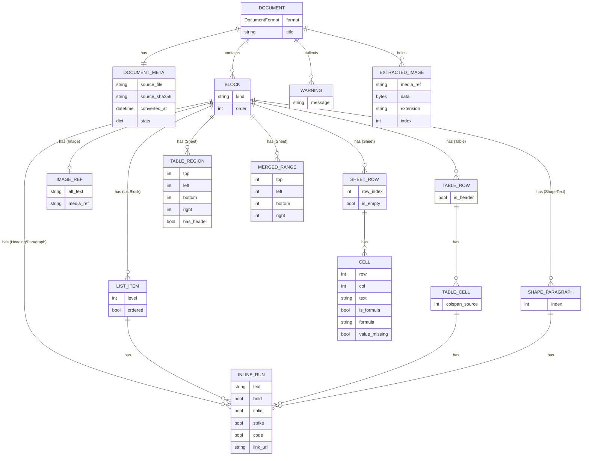
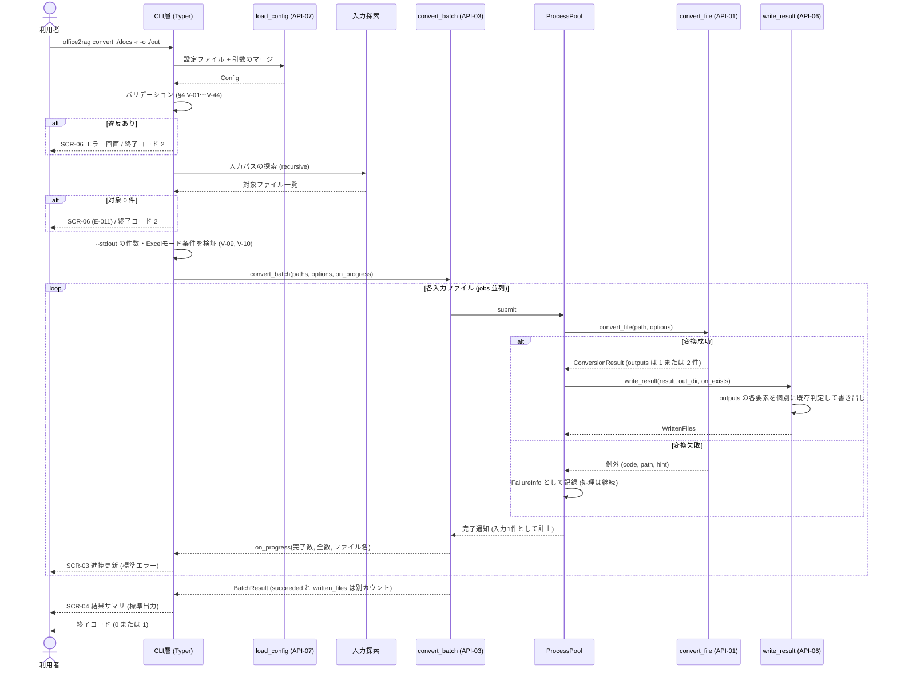
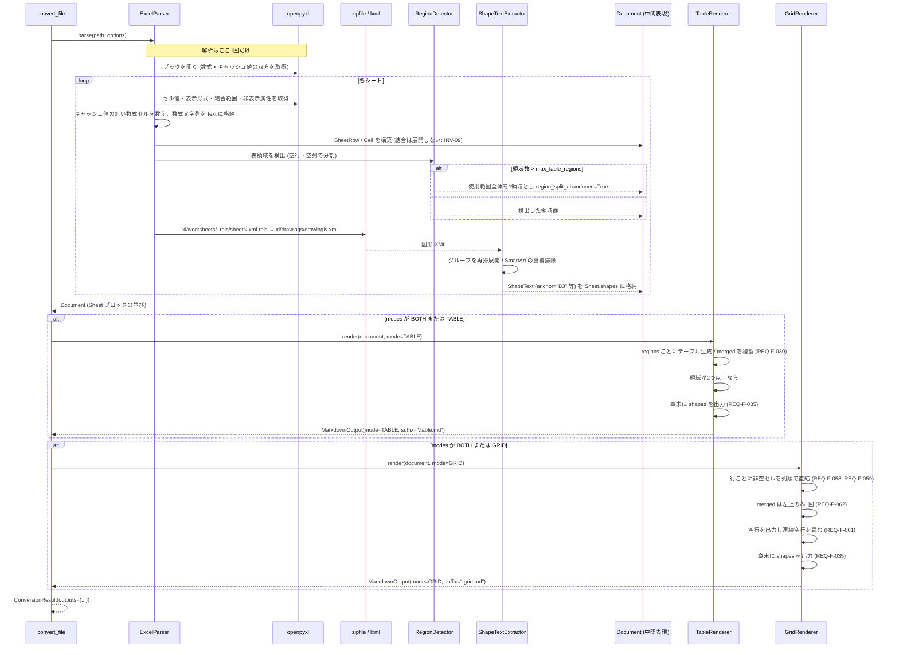
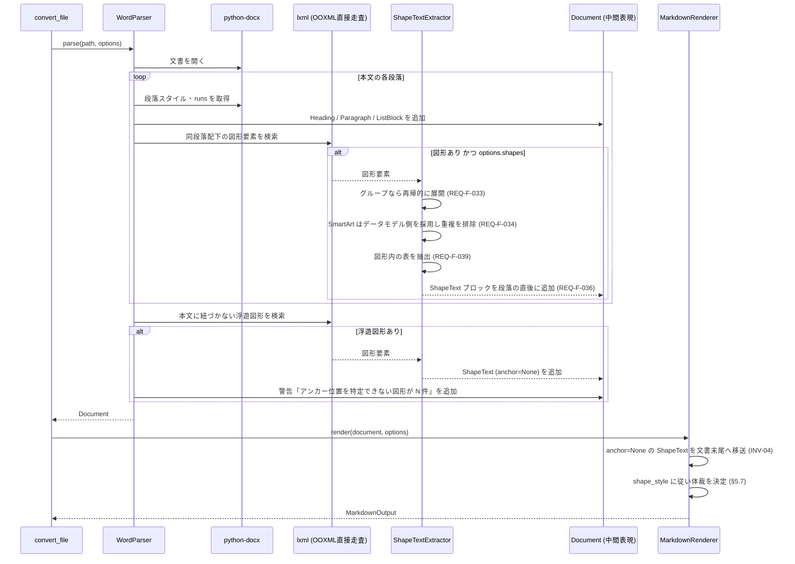
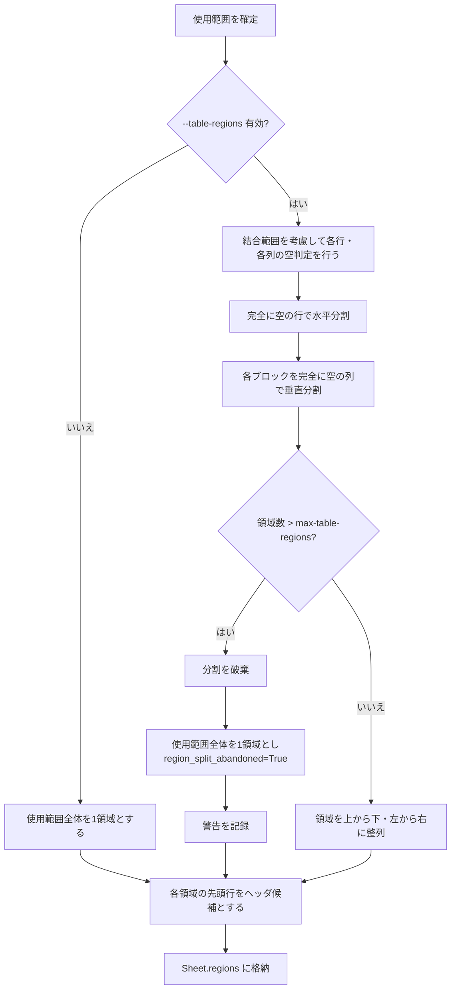

# P002 ユーザインタフェース設計書 — Office2RAGKnowledge

| 項目 | 内容 |
| --- | --- |
| 版 | 2.2 |
| 作成日 | 2026-08-24 |
| インプット | `docs/P001-requirement.md` (版1.3)、`docs/P901-cr-direction/CR-001.md`・`CR-002.md` |
| 対象読者 | P003 (システム詳細設計)・P004 (トレーサビリティ)・P005 (実装計画)・P006 (テスト計画) の担当 |

## 改訂履歴

| 版 | 日付 | 内容 |
| --- | --- | --- |
| 1.0 | 2026-08-24 | 初版 (P001 版1.0 にもとづく) |
| 2.0 | 2026-08-24 | P001 版1.1 (Excel 要求の修正①②③) にもとづき全面改訂。Excel の二重出力・表領域分割・数式キャッシュ値の扱いを反映し、中間表現を「1回の解析から2つのレンダラが動く」構造に再設計した |
| 2.1 | 2026-10-14 | ※CR-001・CR-002により改訂。PDF 入力の追加 (§1 論点11〜15、§3.1・§3.2・§3.5・§4.1.3・§5.2・§5.3・§5.12 新設・§6.2〜6.4・§7.3.7 新設・§9.1・§9.3・§10)。CR と無関係な既存記述は変更していない |
| 2.2 | 2026-10-14 | ※CR-003により変更。§3.2 (SCR-02) の依存ライブラリの表示を PyMuPDF から pdfminer.six に変更。外部仕様 (出力・CLI・公開 API・エラー) は変えていない |

---

## 0. 本書の位置づけと読み替え

本アプリはブラウザ UI を持たない CLI アプリケーションであるため、本書では P002 が本来求める各項目を次のとおり読み替えて設計する。

| P002 が求める項目 | 本アプリでの読み替え | 該当章 |
| --- | --- | --- |
| 画面の入力項目とバリデーションルール | CLI の引数・オプションと、その検証ルール | §3, §4 |
| 画面の表示項目 | 各サブコマンドの端末出力レイアウト | §3 |
| API の完全な外部仕様 | 公開ライブラリ API (API-01〜07) の外部仕様 | §6 |
| データモデル (ER図 + テーブル定義書) | 中間表現 (共通ドキュメントモデル) の構造図 + 型定義 | §7 |
| 複数画面をまたぐ処理フロー | バッチ変換・図形テキスト抽出・Excel 二重出力のシーケンス | §8 |

**永続化データストアを持たないことについて**: 本アプリはローカル実行の変換ツールであり、RDB・KVS 等のデータストアを一切持たない。したがって §7 の「ER図・テーブル定義書」は、**プロセス内メモリ上のドキュメントモデル (中間表現) の型定義**として記述する。中間表現は形式別パーサの出力先であると同時に Markdown レンダラの入力であり、本アプリで唯一「複数モジュールが共有する構造化データ」であるため、ER 図の対象としてこれを扱うことが設計上もっとも意味を持つ。**とりわけ Excel は、1回の解析結果 (中間表現) から表計算モードと方眼紙モードの2つのレンダラが動くため (REQ-F-068)、中間表現がどこまでの情報を保持するかが設計の要になる。**
★ACCEPTED★ 検討: データストアが無いことを理由に §7 を省略する案もあったが、中間表現の型定義は P003 (パーサ実装) と P006 (テスト設計) の双方が前提とする最重要の共有仕様であり、省略すると両フェーズが各自の解釈で実装・テストを進めることになる。残存リスク: 「ER図」という呼称と実体 (メモリ上の型) が厳密には一致しない。

**本書で確定する範囲と P003 に委ねる範囲**: 外部から観測できる契約 (CLI の受理する入力、端末に出る表示、生成される Markdown の体裁、公開 API のシグネチャと例外、終了コード) は本書で確定する。その内部実現 (OOXML の走査アルゴリズム、名前空間の扱い、並列実行の実装方式、openpyxl の呼び出し回数) は `docs/P003-backend-spec.md` で確定する。判断に迷いやすい項目については該当箇所に明記する。

---

## 1. スコープ確認 (P001 からの追加・逸脱がないことの確認)

本書は P001 §6.1 の画面 SCR-01〜07 および §9 の API-01〜07 のみを詳細化しており、新たな画面・API を追加していない。

**P001 の詳細化過程で気づいたスコープ上の論点** (勝手に拡張せず、指摘のみ行う):

| # | 論点 | 影響 | 本書での扱い |
| --- | --- | --- | --- |
| 論点1 | P001 REQ-F-096 の `--stdout` は「単一ファイル変換時」と限定されているが、ディレクトリ入力で結果的に1件だけ該当した場合の可否が未定義 | CLI の受理判定 | §4 V-09 で「変換対象が1件に確定した場合に限り許可、2件以上ならエラー」と定義した。**P001 の要求範囲内の詳細化であり、新規要求ではない** |
| 論点2 | P001 REQ-F-005 の `--on-exists` は Markdown 本体についての規定だが、`--images extract` 時の画像ファイルの既存時挙動が未定義 | 出力仕様 | §5.7 で「画像も同じ `--on-exists` 方針に従う」と定義した。同上 |
| 論点3 | P001 には「変換対象が0件だった場合」の終了コードが明示されていない (REQ-F-097 は 0/1/2 のみ規定) | 終了コード | §9.2 で「対象0件は実行前異常として終了コード 2」と定義した。同上 |
| 論点4 | P001 REQ-F-091 の `inspect` は「パスワード保護の有無」を出力項目に含むが、パスワード保護ファイルは変換不能である。`convert` 時の扱い (スキップか失敗か) の区別が未定義 | エラー分類 | §9.1 で E-005 として「失敗」に分類した。同上 |
| 論点5 | P001 には CLI メッセージの日本語固定が定められているが (REQ-NF-016)、Typer/Click が自動生成する定型文言 (`Usage:` 等) は英語のままとなる | 表示の一貫性 | §3.1 で「自作メッセージは日本語、フレームワーク由来の定型句は英語のまま許容」と定義した。★ACCEPTED★ 検討: Click の全メッセージを日本語化する案もあったが、フレームワーク内部文言の上書きは版差で壊れやすく保守コストに見合わない。残存リスク: ヘルプ画面に日英が混在する |
| **論点6** | **P001 §3.2 の Excel 出力ファイル名 (`.table.md` / `.grid.md`) は二重出力を前提とした記述であり、`--excel-modes` で単一モードに絞った場合のファイル名が未定義** | 出力ファイル名 | §5.2 で「モードの指定によらずサフィックスは固定」と定義した。単一モード指定時に無印 `.md` へ変わると、同じブックを異なる設定で変換した際に出力名が揺れ、RAG 側の再取り込み判定が壊れるため |
| **論点7** | **P001 REQ-F-054 の「完全に空の行・列」の定義が、結合セルの扱いについて未定義。** 結合範囲の左上以外を空とみなすと、見出しを結合した行で表領域が不当に分割される | 表領域検出 | §5.4.2 で「結合範囲に含まれるセルは、左上に値があれば範囲全体を非空とみなす」と定義した |
| **論点8** | **P001 REQ-F-024 の `--formulas` (数式併記) について、方眼紙モードでの併記形式が未定義。** 表計算モードはセル内に併記できるが、方眼紙モードはセルを直結するため併記すると本文が壊れる | 出力体裁 | §5.5.4 で「方眼紙モードでは `--formulas` を無視し、警告を出す」と定義した |
| **論点9** | **P001 §7.1 の `stats.tables` は表計算モードでのみ意味を持つ。方眼紙モードでの値が未定義** | front matter | §5.3 で「方眼紙モードでは `tables` を省略し、代わりに `lines` を出力する」と定義した |
| **論点10** | **P001 REQ-F-096 は `--stdout` と Excel 複数モードの併用時に「単一モードの指定を必須とする」と定めるが、エラーコードが未定義** | エラー仕様 | §9.1 で E-017 として定義した |

**CR-001・CR-002 (PDF 入力) にもとづく論点** ※CR-001・CR-002により追加:

| # | 論点 | 影響 | 本書での扱い |
| --- | --- | --- | --- |
| 論点11 | CR-001 は見出しタグ `H1`/`H2`/`H3` を `#`/`##`/`###` に写すことを求めている。一方 Word は文書タイトルが `#` を占めるため見出し1を `##` から始める (§5.9)。PDF にも同じ繰り下げを適用するか | 出力体裁 | §5.12 で「**PDF は繰り下げず、`H1` を `#` とする**」と定義した。依頼者の指定 (CR-001 期待する振る舞い) に従う。★ACCEPTED★ 検討: Word と揃えて `##` から始める案を検討したが、CR-001 が見出しレベルの対応を明示しており、それを覆す根拠が無い。残存リスク: 文書タイトルの `#` と PDF の `H1` 由来の `#` が同じレベルで並ぶ (チャンク分割上の実害は無い) |
| 論点12 | P001 REQ-F-124 は PDF のヘッダー・フッター除去の無効化を Word の `--headers-footers` と同一オプションとしたが、既定値の意味 (Word: 出力しない / PDF: 除去する) が利用者に同じに見えるか | オプション説明 | §4.1.3 V-35 で「`--headers-footers` = ヘッダー・フッターを出力する。Word と PDF に適用」と定義した。既定 (無効) はどちらの形式でも「出力しない」で意味が一致する |
| 論点13 | タグ付き PDF の `Artifact` (REQ-F-123) は、`--headers-footers` 指定時に出力するか | 出力仕様 | §5.12.4 で「**`Artifact` はオプションによらず出力しない**」と定義した。`Artifact` は作成者が「本文ではない」と宣言した内容であり、ヘッダー・フッター以外 (罫線・背景の装飾文字など) も含むため、本文として出力すると構造ツリーの読み順に位置付けられない。★ACCEPTED★ 検討: `Pagination` 種別の `Artifact` だけを `--headers-footers` 時に文書末尾へまとめる案を検討したが、CR-002 の期待する振る舞いはタグなし PDF での無効化のみを求めており、タグ付き PDF でまで出力する需要が示されていない。残存リスク: タグ付き PDF のヘッダー・フッターの文言は、オプションを指定しても Markdown に現れない |
| 論点14 | REQ-F-118 は PDF の画像バイナリを書き出さないとしたが、`--images extract` 指定時の本文の画像参照の書き方が未定義 | 出力仕様 | §5.11・§5.12.3 で「PDF では `--images` の値によらず `none` と同じプレースホルダを出力し、`extract` 指定時は警告を出す」と定義した |
| 論点15 | 開くためのパスワードは無いが、テキストのコピーを禁じる権限が設定された PDF (REQ-F-121) を変換するか | エラー仕様 | §9.3 で「変換し、警告を記録する」と定義した。★ACCEPTED★ 検討: 権限設定に従ってエラーとする案を検討したが、本アプリは利用者が自ら管理する文書を RAG に取り込む前処理であり、権限フラグは暗号による強制ではなく閲覧ソフトへの指示である。変換したことは警告で可視化する。残存リスク: 権限設定の趣旨に反する利用を本アプリ側では止めない (利用者の責任とする) |

上記はいずれも P001 の要求を実装可能な粒度に落とす過程で必要となった補完であり、**新しい機能の追加ではない**。

---

## 2. コマンド体系

```
office2rag [グローバルオプション] <サブコマンド> [引数] [オプション]
```

| サブコマンド | 用途 | 関連画面 | 関連要求 |
| --- | --- | --- | --- |
| `convert` | Office 文書・PDF (※CR-001により追加) を Markdown に変換する | SCR-03, SCR-04, SCR-07 | REQ-F-090 |
| `inspect` | 変換せずに文書構造を確認する | SCR-05 | REQ-F-091 |
| (なし) + `--help` | ヘルプを表示する | SCR-01 | REQ-F-092 |
| (なし) + `--version` | バージョンを表示する | SCR-02 | REQ-F-092 |

サブコマンドを省略して実行した場合はヘルプ (SCR-01) を表示し、終了コード 2 を返す。

---

## 3. 画面別詳細設計

### 3.1 SCR-01 ヘルプ画面

**入力**: `office2rag --help` / `office2rag convert --help` / `office2rag inspect --help`

**出力レイアウト** (`office2rag --help`):

```
 Usage: office2rag [OPTIONS] COMMAND [ARGS]...

 Office 文書 (Word/Excel/PowerPoint) と PDF を RAG 向け Markdown に変換します。

╭─ Options ────────────────────────────────────────────────────────────╮
│ --version             バージョンを表示して終了します                 │
│ --help                このヘルプを表示して終了します                 │
╰──────────────────────────────────────────────────────────────────────╯
╭─ Commands ───────────────────────────────────────────────────────────╮
│ convert   Office 文書・PDF を Markdown に変換します                  │
│ inspect   変換せずに文書の構造を表示します                           │
╰──────────────────────────────────────────────────────────────────────╯
```

**`office2rag convert --help` の Excel 関連部分** (抜粋):

```
╭─ Excel オプション ───────────────────────────────────────────────────╮
│ --excel-modes [both|table|grid]  生成する Markdown の種類            │
│                                  both: 両方 / table: 表計算モードのみ│
│                                  grid: 方眼紙モードのみ (既定: both) │
│ --grid-separator TEXT            方眼紙モードで同一行のセルを連結する│
│                                  際の区切り文字 (既定: なし)         │
│ --table-regions/--no-table-regions                                   │
│                                  1シート内の複数の表を分割して検出   │
│                                  します (既定: 有効)                 │
│ --max-table-regions INTEGER      これを超える表領域が検出された場合、│
│                                  分割せず1つの表にします (既定: 100) │
│ --formulas                       数式を値と併記します (表計算モード  │
│                                  のみ有効)                           │
│ --max-rows INTEGER               1シートあたりの出力上限行数         │
│                                  (既定: 10000、0 で無制限)           │
╰──────────────────────────────────────────────────────────────────────╯
```

**設計方針**:

* `Usage:` `Options` `Commands` 等の枠組み文言は Typer/Click が生成するため英語のままとする (§1 論点5)。各コマンド・各オプションの説明文は日本語で記述する (REQ-NF-016)。
* オプションの説明文は既定値を明記する。
* Excel 関連オプションは独立したパネルにまとめる。オプション総数が多く、形式別に整理しないと利用者が目的のオプションに辿り着けないため。
* 端末幅が 80 桁未満の場合、Rich が自動で折り返す。装飾が使えない環境 (非TTY・`NO_COLOR` 環境変数) では罫線と色を落としたプレーン出力とする。

**表示項目**: コマンド名 / 概要 / オプション名 (短縮形・長形式) / オプションの値の型 / 既定値 / 説明文

**`--headers-footers` の説明文** ※CR-002により変更: `ヘッダー・フッターを出力します。Word: ヘッダー・フッターを出力 / PDF: ページ上端・下端の繰り返しテキストを除去しない (既定: 出力しない)`

### 3.2 SCR-02 バージョン画面

**入力**: `office2rag --version`

**出力**:

```
office2rag 1.1.0 (office2ragknowledge)
Python 3.14.2 / lxml 5.x / python-docx 1.x / openpyxl 3.x / python-pptx 1.x / pdfminer.six 20260107
```

※CR-001により PDF 読み取りライブラリの版を追加した。※CR-003により表示するライブラリを `PyMuPDF` から `pdfminer.six` に変更した。表示例の版数は、依頼者の指示 (2026-10-15) で 1.1.0 に上げたことに合わせた。

**表示項目**: アプリ版 / パッケージ名 / 実行中の Python 版 / 主要依存ライブラリの版 (障害報告時の切り分けに用いる)。終了コード 0。

### 3.3 SCR-03 変換実行画面

**入力**: `office2rag convert <入力パス...> [オプション]` (§4 参照)

**出力レイアウト** (標準エラー出力。TTY の場合):

```
変換中... ━━━━━━━━━━━━━━━━━━━━━━━━━━━━━╸━━━━━━━━━  73% 22/30  売上管理_2026Q2.xlsx
```

**表示項目**

| 項目 | 説明 |
| --- | --- |
| 進捗バー | 完了件数 / 全件数 の比率 |
| パーセンテージ | 同上 |
| 件数 | `{完了件数}/{全件数}`。**入力ファイル数で数える** (Excel の二重出力を2件と数えない。REQ-F-094) |
| 現在処理中のファイル名 | ベース名のみ (パスが長い場合は末尾を優先して省略) |

**設計方針**:

* 進捗表示は**標準エラー出力**に出す。標準出力は結果サマリと `--stdout` の Markdown 本文のために空けておく (REQ-NF-013)。
* 非TTY (パイプ・リダイレクト) の場合、進捗バーを出さず、1ファイル完了ごとに1行のログを出す。
* `--quiet` 指定時は進捗表示を行わない (REQ-F-095)。
* 並列実行時 (`--jobs > 1`) も進捗バーは単一とし、完了件数のみを更新する。

### 3.4 SCR-04 変換結果サマリ画面

**出力レイアウト** (標準出力。全件成功時):

```
変換結果: 成功 28 件 / スキップ 2 件 / 失敗 0 件  (所要 12.4 秒)
出力ファイル: 41 件  (Excel 13 件から 26 ファイルを生成)
出力先: C:\out\markdown
```

**失敗・警告がある場合** (標準出力):

```
変換結果: 成功 25 件 / スキップ 2 件 / 失敗 3 件  (所要 14.1 秒)
出力ファイル: 36 件  (Excel 11 件から 22 ファイルを生成)
出力先: C:\out\markdown

失敗したファイル:
┏━━━━━━━━━━━━━━━━━━━━━━━━┳━━━━━━━━━━━━━━━━┳━━━━━━━━━━━━━━━━━━━━━━━━━━━━━━━━━━━━━━┓
┃ ファイル               ┃ 種別           ┃ 理由                                   ┃
┡━━━━━━━━━━━━━━━━━━━━━━━━╇━━━━━━━━━━━━━━━━╇━━━━━━━━━━━━━━━━━━━━━━━━━━━━━━━━━━━━━━┩
│ old_report.doc         │ 非対応形式     │ .doc は非対応です。.docx で保存し直し… │
│ locked.xlsx            │ パスワード保護 │ 保護されたファイルは変換できません      │
│ broken.pptx            │ 破損           │ ZIP として読み取れませんでした          │
└────────────────────────┴────────────────┴────────────────────────────────────────┘

警告 (4 件):
  - sales.xlsx: シート「明細」は 10000 行で打ち切りました (全 24500 行)
  - sales.xlsx: シート「集計」に計算結果を持たない数式セルが 42 件あり、数式を出力しました
  - taisei.xlsx: シート「体制図」は表領域が 100 件を超えたため、分割せず1つの表として出力しました
  - plan.docx: アンカー位置を特定できない図形が 3 件あり、文書末尾にまとめました
```

**表示項目**

| 項目 | 説明 | 関連要求 |
| --- | --- | --- |
| 成功件数 / スキップ件数 / 失敗件数 | **入力ファイル単位**で数える。Excel の二重出力は「1件の成功」とする | REQ-F-094 |
| **出力ファイル数** | 実際に書き出したファイル数。入力件数と一致しないため別行に出す。Excel が含まれる場合は内訳を括弧で添える | REQ-F-094 |
| 所要時間 | 秒。小数第1位まで | — |
| 出力先 | 出力ディレクトリの絶対パス | — |
| 失敗ファイル一覧 | パス / エラー種別 / 理由。§9.1 のエラー種別を用いる | REQ-F-006, REQ-F-093 |
| 警告一覧 | ファイル名と警告本文。0件なら節ごと表示しない | §9.3 |

**設計方針**:

* 「出力ファイル数」を独立した行として出す理由は、Excel の二重出力により**入力件数と出力ファイル数が一致しなくなる**ためである。1行に混ぜると利用者が件数の意味を取り違える。
* 理由の文字列が列幅を超える場合は末尾を省略記号で切り詰める。全文は `--verbose` 時に折り返して表示する。
* 警告は変換の成功を妨げない (成功件数に計上する)。
* `--quiet` 時もサマリの1行目のみは出力する。

### 3.5 SCR-05 構造確認画面

**入力**: `office2rag inspect <入力パス...> [-r] [--json]`

**出力レイアウト** (人間可読形式):

```
┏━━━━━━━━━━━━━━┳━━━━━━┳━━━━━━━━┳━━━━━━┳━━━━━━┳━━━━━━┳━━━━━━━━━┳━━━━━━┳━━━━━━┳━━━━━━━━┓
┃ ファイル     ┃ 形式 ┃ サイズ ┃ 保護 ┃ 単位 ┃ 表   ┃ 図形    ┃ 領域 ┃ 数式 ┃ 推定字 ┃
┡━━━━━━━━━━━━━━╇━━━━━━╇━━━━━━━━╇━━━━━━╇━━━━━━╇━━━━━━╇━━━━━━━━━╇━━━━━━╇━━━━━━╇━━━━━━━━┩
│ 会議資料.pptx│ pptx │ 1.0 MB │ なし │ 24   │ 6    │ 58 (41) │ -    │ -    │ 18,430 │
│ 売上.xlsx    │ xlsx │ 340 KB │ なし │ 5    │ 12   │ 12 (9)  │ 12   │ 42   │ 62,110 │
│ 規程.docx    │ docx │ 210 KB │ なし │ 312  │ 8    │ 7 (7)   │ -    │ -    │ 24,905 │
│ 報告書.pdf   │ pdf  │ 2.1 MB │ なし │ 18   │ 4    │ 3 (3)   │ -    │ -    │ 31,200 │
└──────────────┴──────┴────────┴──────┴──────┴──────┴─────────┴──────┴──────┴────────┘

単位: Excel=シート数 / PowerPoint=スライド数 / Word=段落数 / PDF=ページ数
構造: PDF の論理構造の有無 (タグ付き / タグなし)
図形: 図形の総数 (うち括弧内はテキストを持つ図形の数)
領域: Excel で検出された表領域の数 (表計算モードで出力されるテーブル数)
数式: Excel で計算結果を持たない数式セルの数
```

**表示項目**

| 項目 | 説明 | 関連要求 |
| --- | --- | --- |
| ファイル | ベース名 | REQ-F-091 |
| 形式 | docx / xlsx / pptx / pdf (pdf は ※CR-001により追加) | REQ-F-001 |
| サイズ | 人間可読 (KB / MB) | — |
| 保護 | パスワード保護の有無 (あり / なし) | REQ-F-091 |
| 単位 | 形式に応じた主構成単位の数 (シート/スライド/段落/**ページ** (PDF。※CR-001により追加)) | REQ-F-091 |
| 表 | 表の総数 | — |
| 図形 | **図形の総数と、そのうちテキストを持つ図形の数**。本アプリの中核機能の効き具合を事前に把握するための最重要指標 | REQ-F-031, REQ-F-091 |
| **領域** | **Excel で検出される表領域の数** (= 表計算モードで出力されるテーブル数)。この値が異常に大きければ、そのシートは方眼紙用法である可能性が高く、方眼紙モードの出力を採るべきと判断できる | REQ-F-054, REQ-F-091 |
| **数式** | **Excel でキャッシュ値を持たない数式セルの数**。0 でなければ、そのファイルは数式が数式のまま出力される | REQ-F-051, REQ-F-091 |
| 推定字 | 変換後 Markdown のおおよその文字数。Excel は**表計算モードの推定値**を示す | REQ-F-091 |
| **構造** ※CR-001により追加 | **PDF の論理構造の有無**。`タグ付き` / `タグなし`。PDF 以外は `-`。端末幅を抑えるため人間可読形式では表の下に `構造: 報告書.pdf=タグ付き` の形で PDF の行についてのみ列挙する。`--json` では `pdf_tagged` 項目 (§6.4) として出力する | REQ-F-091 |

Excel 以外の形式では「領域」「数式」列に `-` を表示する。PDF の「図形」列は図表テキストブロックの数 (総数とテキストあり数は同じ値) を示す (※CR-001により追加)。

**`--json` 指定時**: 上記と同じ情報を JSON 配列で標準出力に出す。RAG パイプラインが事前に処理量を見積もる用途を想定する。スキーマは §6.4 の `DocumentInfo` に一致させる。

**設計方針**: `inspect` は文書を変換せず、構造の走査のみを行う。パスワード保護・破損ファイルもエラーとせず、その旨を行に表示して一覧を完成させる (一覧性を優先する)。終了コードは常に 0 とする。

### 3.6 SCR-06 エラー画面

**出力レイアウト** (標準エラー出力):

```
エラー: 入力パスが見つかりません
  パス: C:\data\notfound.docx
  対処: パスの綴りと、ファイルが存在することを確認してください。
```

**表示項目**: エラー種別の見出し / 該当パス (あれば) / 対処方法の案内文。終了コード 2 (REQ-F-097)。

**設計方針**: スタックトレースは表示しない (REQ-NF-005)。`--verbose` 指定時のみ、案内文の後にスタックトレースを付す。エラー種別と文言は §9.1 の一覧で固定する。

### 3.7 SCR-07 標準出力モード

**入力**: `office2rag convert <単一ファイル> --stdout [オプション]`

**出力**: 変換後の Markdown 本文のみを標準出力に書き出す。front matter を含む (`--no-front-matter` で抑止可能)。

**設計方針**:

* 進捗表示 (SCR-03) は標準エラー出力に退避する。標準出力には Markdown 以外を一切混ぜない (REQ-F-096)。
* 結果サマリ (SCR-04) は、`--stdout` 時は標準エラー出力に出す。
* **入力が Excel で、かつ `--excel-modes both` (既定) の場合はエラー (E-017) とする。** 標準出力に2つの独立した Markdown 文書を書き出すと、受け取った側が文書の境界を判定できないため。`--excel-modes table` または `--excel-modes grid` の指定を求める。
* `--output` との同時指定はエラー (E-012)。
* 変換に失敗した場合、標準出力には何も書かず、標準エラーにエラーを出して終了コード 1 とする。

---

## 4. 入力項目バリデーション一覧

P001 §6.3 の全入力項目について、検証ルールと違反時の挙動を定める。検証はすべて**変換処理の開始前**に行い、違反があれば1件も変換せずに終了コード 2 で終了する (部分的に処理してから落ちることを避ける)。

### 4.1 `convert` サブコマンド

#### 4.1.1 入出力に関する項目

| # | 項目 | 指定方法 | 必須 | 型 | 検証ルール | 違反時 |
| --- | --- | --- | --- | --- | --- | --- |
| V-01 | 入力パス | 位置引数 (1個以上) | ○ | パス (複数可) | 1件以上指定されていること | E-010 |
| V-02 | 入力パス | 同上 | ○ | — | 各パスが存在すること | E-001 |
| V-03 | 入力パス | 同上 | ○ | — | 各パスが読み取り可能であること | E-003 |
| V-04 | 入力パス | 同上 | ○ | — | 探索の結果、変換対象が1件以上あること | E-011 |
| V-05 | 出力先 | `-o, --output` | — | ディレクトリパス | 存在しない場合は自動作成する。作成できない/書き込めない場合はエラー | E-004 |
| V-06 | 出力先 | 同上 | — | — | `--stdout` と同時指定しないこと | E-012 |
| V-07 | 再帰探索 | `-r, --recursive` | — | フラグ | ディレクトリ入力が1件も無い場合、指定しても無視する (警告を出す) | 警告のみ |
| V-08 | 既存時挙動 | `--on-exists` | — | 列挙 | `skip` / `overwrite` / `fail` のいずれか (既定 `skip`) | E-013 |
| V-09 | 標準出力 | `--stdout` | — | フラグ | 変換対象が**ちょうど1件**に確定していること。2件以上ならエラー (§1 論点1) | E-014 |
| V-10 | 標準出力 | 同上 | — | — | **対象が Excel の場合、`--excel-modes` が `table` または `grid` であること** (§1 論点10) | E-017 |
| V-11 | front matter | `--no-front-matter` | — | フラグ | 既定は無効 (= front matter を出力する) | — |

#### 4.1.2 Excel に関する項目

P001 REQ-F-099 が定める Excel 関連オプション群の詳細仕様である。

| # | 項目 | 指定方法 | 必須 | 型 | 検証ルール | 違反時 | 関連要求 |
| --- | --- | --- | --- | --- | --- | --- | --- |
| V-20 | **Excel 出力モード** | `--excel-modes` | — | 列挙 | `both` / `table` / `grid` のいずれか (既定 `both`) | E-013 | REQ-F-064, REQ-F-067 |
| V-21 | **方眼紙の区切り文字** | `--grid-separator` | — | 文字列 | 任意の文字列 (既定は空文字)。ただし**改行文字を含まないこと** (行の構造が壊れるため)。長さは 8 文字以内 | E-018 | REQ-F-059 |
| V-22 | **表領域の分割** | `--table-regions` / `--no-table-regions` | — | フラグ対 | 相互排他。既定は有効 | E-012 | REQ-F-054, REQ-F-056 |
| V-23 | **表領域数の上限** | `--max-table-regions` | — | 整数 | 1 以上 10,000 以下 (既定 100) | E-019 | REQ-F-057 |
| V-24 | 数式併記 | `--formulas` | — | フラグ | 既定は無効。**方眼紙モードのみが有効な場合 (`--excel-modes grid`) は無視して警告を出す** (§1 論点8) | 警告のみ | REQ-F-024 |
| V-25 | 最大行数 | `--max-rows` | — | 整数 | 0 以上 1,048,576 以下 (Excel の最大行数)。既定 10000。`0` は「無制限」として受理する | E-015 | REQ-F-029 |

#### 4.1.3 その他の変換オプション

| # | 項目 | 指定方法 | 必須 | 型 | 検証ルール | 違反時 |
| --- | --- | --- | --- | --- | --- | --- |
| V-30 | 画像出力 | `--images` | — | 列挙 | `none` / `extract` のいずれか (既定 `none`) | E-013 |
| V-31 | 図形テキスト | `--shapes` / `--no-shapes` | — | フラグ対 | 相互排他。既定は有効 | E-012 |
| V-32 | 図形体裁 | `--shape-style` | — | 列挙 | `quote` / `heading` / `plain` のいずれか (既定 `quote`)。§5.6 参照 | E-013 |
| V-33 | 非表示要素 | `--include-hidden` | — | フラグ | 既定は無効 | — |
| V-34 | ノート出力 | `--notes` / `--no-notes` | — | フラグ対 | 相互排他。既定は有効。PowerPoint 以外では無視する | E-012 |
| V-35 | ヘッダーフッター | `--headers-footers` | — | フラグ | 既定は無効。**Word と PDF に適用し**、それ以外では無視する。PDF では、ページ上端・下端の繰り返しテキストの除去 (REQ-F-122) を行わない (§1 論点12。※CR-002により変更) | — |
| V-36 | コメント出力 | `--comments` | — | フラグ | 既定は無効。Word 以外では無視する | — |

#### 4.1.4 実行制御・ログに関する項目

| # | 項目 | 指定方法 | 必須 | 型 | 検証ルール | 違反時 |
| --- | --- | --- | --- | --- | --- | --- |
| V-40 | 並列度 | `-j, --jobs` | — | 整数 | 1 以上 64 以下。既定は CPU コア数。CPU コア数の 4 倍を超える値は受理するが警告する | E-016 |
| V-41 | 設定ファイル | `-c, --config` | — | ファイルパス | 指定時はファイルが存在し、TOML として解析でき、未知のキーを含まないこと | E-005, E-006 |
| V-42 | ログ量 | `-q` / `-v` | — | フラグ対 | 同時指定は不可 | E-012 |
| V-43 | ログファイル | `--log-file` | — | ファイルパス | 親ディレクトリが存在し書き込み可能であること (ファイル自体は自動作成) | E-004 |
| V-44 | ログ形式 | `--log-format` | — | 列挙 | `text` / `json` のいずれか (既定 `text`) | E-013 |

**検証順序**: (1) 引数の型・列挙値・範囲の検証 → (2) 排他指定の検証 → (3) パスの存在・権限の検証 → (4) 入力探索と対象件数の確定 → (5) `--stdout` の件数条件と Excel モード条件の検証。先に検出した違反で終了する (複数違反をまとめて報告しない)。
★ACCEPTED★ 検討: 全違反をまとめて報告する案もあったが、検証段階が進むほど前段の成功を前提とするため (例: `--stdout` の Excel モード条件は、対象が Excel だと確定していることが前提)、まとめて報告すると誤解を招く出力になる。残存リスク: 複数の指定ミスがある場合、利用者は修正と再実行を繰り返すことになる。

**オプションの適用対象外な組み合わせについて**: `--formulas` を PowerPoint のみの入力に指定した場合など、形式に対して意味を持たないオプションは**エラーとせず無視する**。バッチ入力では複数形式が混在しうるため、形式ごとの適用可否をエラー条件にできないためである。ただし `--excel-modes grid` と `--formulas` の組合せのように、**指定した設定どうしが矛盾していて利用者の意図が満たされない場合は警告を出す** (V-24)。

### 4.2 `inspect` サブコマンド

| # | 項目 | 指定方法 | 必須 | 検証ルール | 違反時 |
| --- | --- | --- | --- | --- | --- |
| V-50 | 入力パス | 位置引数 (1個以上) | ○ | V-01〜V-04 と同じ | E-001, E-010, E-011 |
| V-51 | 再帰探索 | `-r, --recursive` | — | V-07 と同じ | 警告のみ |
| V-52 | JSON出力 | `--json` | — | フラグ。既定は無効 | — |

`inspect` は変換オプションを受け付けない。表領域数の算出には `--max-table-regions` の既定値 (100) を用いる。

### 4.3 設定ファイル (TOML) の項目

`--config` で指定するか、カレントディレクトリから上位に向かって `office2rag.toml` を探索して自動読込する。優先順位はコマンドライン引数 > 設定ファイル > 既定値 (REQ-F-098)。

```toml
[convert]
output = "./out"
recursive = true
on_exists = "skip"
images = "none"
shapes = true
shape_style = "quote"
include_hidden = false
notes = true
headers_footers = false
comments = false
jobs = 4
front_matter = true

[excel]
modes = "both"           # both | table | grid
grid_separator = ""      # 方眼紙モードの行内区切り文字
table_regions = true     # 表領域の分割検出
max_table_regions = 100
formulas = false
max_rows = 10000

[log]
level = "info"      # quiet | info | verbose
format = "text"     # text | json
file = ""           # 空文字は「ファイル出力なし」
```

**検証ルール**: 各キーの値は §4.1 の対応するオプションと同じ検証を受ける。**未知のキーが含まれる場合はエラー (E-006)** とする (綴り間違いが黙って無視されると、利用者は設定が効いていると誤解するため)。未知のテーブル (`[convert]` `[excel]` `[log]` 以外) も同様にエラーとする。

Excel 関連の設定を `[excel]` テーブルに分離した理由は、オプション数が多く `[convert]` に混在させると設定ファイルの見通しが悪くなるためである。

---

## 5. 出力 Markdown 仕様 (利用者が受け取る成果物の体裁)

出力される Markdown は本アプリの主たる成果物であり、利用者と後段の RAG パイプラインが直接目にするものであるため、その体裁を本書で確定する。**どの OOXML 要素をどう走査して各ブロックを得るか**という内部実現は `docs/P003-backend-spec.md` で確定する。

### 5.1 共通事項

| 項目 | 仕様 | 関連要求 |
| --- | --- | --- |
| 文字コード | UTF-8 (BOM なし) | REQ-F-008 |
| 改行コード | LF | REQ-F-008 |
| 方言 | CommonMark + GFM table | REQ-F-010 |
| 末尾 | ファイル末尾は改行1つで終える (連続する空行を残さない) | — |
| 空行 | ブロック間は空行1つで区切る。空行2つ以上を連続させない | REQ-F-061 |

**エスケープ規則** (REQ-F-009): 本文テキストに対して、次の場合に限りバックスラッシュエスケープを行う。

| 対象 | エスケープする条件 | 理由 |
| --- | --- | --- |
| `|` | GFM テーブルのセル内に現れる場合 | 列区切りと解釈され表が壊れる |
| `#` | 段落の**行頭**に現れる場合 | 見出しと解釈される |
| `-` `*` `+` | 段落の**行頭**に現れ、直後が空白の場合 | リストと解釈される |
| `>` | 段落の**行頭**に現れる場合 | 引用と解釈される |
| 数字 + `.` | 段落の**行頭**に現れ、直後が空白の場合 | 番号付きリストと解釈される |
| ` ``` ` | 行頭に現れる場合 | コードフェンスと解釈される |

行中に現れる `*` `_` `` ` `` `[` `]` は**エスケープしない**。
★ACCEPTED★ 検討: CommonMark 仕様上これらも強調やリンクと解釈されうるため全エスケープする案を検討したが、日本語文書では `_` を含む識別子や `*` を含む注記が頻出し、全エスケープすると本文がバックスラッシュだらけになって埋め込み品質を落とす。実害は稀な誤強調に留まるため、行頭の構造記号のみを対象とした。残存リスク: 本文中に `*強調風の記述*` があると強調として解釈される。

**方眼紙モードにおけるエスケープの適用位置** (REQ-F-063): 方眼紙モードは行内のセルを連結してから1行を構成するため、**エスケープは連結後の行に対して適用する**。連結前の各セルに適用すると、行頭でないセルの先頭文字が不要にエスケープされる。

### 5.2 出力ファイル名

| 入力形式 | `--excel-modes` | 出力ファイル |
| --- | --- | --- |
| Word / PowerPoint / PDF (PDF は ※CR-001により追加) | (無関係) | `{ステム}.md` |
| Excel | `both` (既定) | `{ステム}.table.md` と `{ステム}.grid.md` の2ファイル |
| Excel | `table` | `{ステム}.table.md` のみ |
| Excel | `grid` | `{ステム}.grid.md` のみ |

**モードの指定によらず、Excel の出力ファイル名のサフィックスは固定とする** (§1 論点6)。単一モード指定時に無印 `{ステム}.md` へ変えると、同じブックを異なる設定で変換したときに出力ファイル名が揺れ、RAG 側が「同じ文書の再取り込みか、別文書か」を判定できなくなるためである。

`--on-exists` の判定は**出力ファイルごとに個別に行う** (REQ-F-005)。`{ステム}.table.md` が既存で `{ステム}.grid.md` が無い場合、前者はスキップし後者は書き出す。

### 5.3 front matter

Markdown 冒頭に YAML front matter を出力する (REQ-F-007)。P001 §7.1 で定めた項目を出力する。確定事項:

* キーの出現順は P001 §7.1 の記載順に固定する (REQ-NF-018 の冪等性のため)。
* 値が取得できない項目 (作成者未設定など) は**キーごと省略する**。`null` を出力しない。
* 文字列値は YAML のダブルクォートで囲み、内部の `"` と `\` をエスケープする。
* `warnings` が空の場合はキーごと省略する。
* `--no-front-matter` 指定時は front matter 全体を出力しない。
* `converted_at` は ISO 8601 (ローカルタイムゾーンのオフセット付き)。**冪等性比較の際に除外すべき唯一のフィールド**である (REQ-NF-018)。

**`output_mode` フィールド** (REQ-F-066):

| 形式 | `output_mode` の値 |
| --- | --- |
| Word / PowerPoint / PDF | キーごと省略する |
| Excel / 表計算モード | `"table"` |
| Excel / 方眼紙モード | `"grid"` |

**`stats` の形式別の内容** (§1 論点9):

| 形式 / モード | `stats` に含めるキー |
| --- | --- |
| Word | `paragraphs`, `headings`, `tables`, `shapes_with_text`, `images` |
| Excel / 表計算モード | `sheets`, `tables` (= 出力した表領域の総数), `shapes_with_text`, `images` |
| **Excel / 方眼紙モード** | `sheets`, **`lines`** (= 出力した本文行の総数。`tables` は方眼紙モードでは意味を持たないため省略), `shapes_with_text`, `images` |
| PowerPoint | `slides`, `tables`, `shapes_with_text`, `images` |
| **PDF** ※CR-001・CR-002により追加 | `pages`, `paragraphs`, `headings`, `tables`, `shapes_with_text`, `images`, **`headers_footers_removed`** (※CR-002), **`multi_column_pages`** (※CR-002)。タグ付き/タグなしによらず、すべてのキーを常に出力する (値が 0 でも省略しない。PDF の出力どうしでキーの集合を揃えるため) |

**`pdf_structure` フィールド** (REQ-F-120) ※CR-001により追加: PDF の出力にのみ、`source_format` の直後に `pdf_structure: "tagged"` (論理構造にもとづいて変換した) または `pdf_structure: "untagged"` (論理構造が無い、またはタグ付けが不完全でタグなしとして変換した) を出力する。他の形式ではキーごと省略する。

**PDF の `stats` の意味** ※CR-002により追加:

| キー | 意味 |
| --- | --- |
| `pages` | PDF の総ページ数 |
| `headers_footers_removed` | ヘッダー・フッターとして出力しなかったテキスト行の数。タグなし PDF では繰り返し判定 (REQ-F-122) で除去した行、タグ付き PDF では構造ツリーの外 (`Artifact`、および構造ツリーから参照されていない内容) として出力しなかった行を数える (※P011 CR-No.2 により定義を P003 §7A.4 に一致させた)。`--headers-footers` 指定時のタグなし PDF では 0 |
| `multi_column_pages` | 段組み (2段以上) を検出して読み順を補正したページの数 (REQ-F-125)。タグ付き PDF では常に 0 (座標による並べ替えをしないため。REQ-F-127) |

**Excel の二重出力における front matter の一致**: `output_mode` と `stats` を除くすべてのフィールド (`source_*`, `title`, `author`, 各種日時, `converter`) は2つのファイルで**同一の値**とする。`warnings` は、そのモードで実際に発生した警告のみを含める (例: 表領域上限超過の警告は表計算モードにのみ現れる)。

### 5.4 Excel / 表計算モードの出力 (`.table.md`)

#### 5.4.1 全体構造

```markdown
---
output_mode: "table"
...
---

# {ファイル名}

## {シート名}

| ヘッダ1 | ヘッダ2 |
| --- | --- |
| 値 | 値 |

> **[図形: テキストボックス @ B3]**
> 図形内のテキスト
```

**表領域が複数検出された場合** (REQ-F-055):

```markdown
## 売上集計

### 表 1 (A1:D12)

| 商品 | 4月 | 5月 | 6月 |
| --- | --- | --- | --- |
| A | 100 | 120 | 130 |

### 表 2 (F1:H8)

| 区分 | 予算 | 実績 |
| --- | --- | --- |
| 国内 | 1000 | 980 |

> **[図形: 吹き出し @ A15]**
> 6月は新製品の寄与が大きい
```

* シートはブック内の並び順で出力する (REQ-F-021)。
* **表領域が1つだけの場合、`### 表 N` の小見出しは出力しない** (REQ-F-055)。不要な階層を増やさないため。
* 空のシートは `## {シート名}` の直後に `(空のシートです)` と記す (REQ-F-022)。
* 打ち切りが発生した場合、最後のテーブルの直後に `> ※ このシートは {N} 行で打ち切りました (全 {M} 行)` を出力する (REQ-F-029)。
* 図形テキストは**シートの章の末尾** (全テーブルの後) に出力する (REQ-F-035)。

#### 5.4.2 表領域の検出規則 (REQ-F-054、§1 論点7)

利用者から見た挙動として、次の規則で領域が定まる。**検出アルゴリズムの実装 (走査方法・計算量) は P003 で確定する。**

| # | 規則 |
| --- | --- |
| 1 | 対象はシートの使用範囲 (末尾の空行・空列を除いた矩形) とする (REQ-F-023) |
| 2 | 使用範囲を、**完全に空の行**で水平方向に分割する |
| 3 | 分割された各ブロックを、さらに**完全に空の列**で垂直方向に分割する |
| 4 | 分割の結果できた各矩形を1つの表領域とする。領域の順序は「上から下、同じ高さなら左から右」とする |
| 5 | **結合セルの扱い**: 結合範囲に含まれるセルは、その範囲の左上に値があれば**範囲全体を非空とみなす**。これにより、複数列にまたがる結合見出しがある行が空行と判定されて表が不当に分割されることを防ぐ |
| 6 | 1セルのみの領域も表領域として扱う (1行1列の表として出力する) |
| 7 | 検出された領域数が `--max-table-regions` (既定 100) を超えた場合、**分割を行わず使用範囲全体を1つの表領域とし、警告を記録する** (REQ-F-057) |
| 8 | `--no-table-regions` 指定時は分割を行わず、使用範囲全体を1つの表領域とする (REQ-F-056) |

規則7 の意図は、方眼紙として使われているシートを表計算モードで処理したときの暴発を防ぐことである。方眼紙シートでは非空白セルが散在するため、分割すると数百〜数千の微小領域が生じ、Markdown が実用にならない。この場合は「1つの大きな表」として出力し、意味のある表現は方眼紙モードの出力 (`.grid.md`) が担う。

#### 5.4.3 テーブルの生成規則

| 項目 | 仕様 | 関連要求 |
| --- | --- | --- |
| ヘッダ行 | 領域の先頭行をヘッダとして扱う (REQ-F-025)。領域が複数ある場合は**領域ごとにその先頭行**を対象とする | REQ-F-025 |
| 列数 | 領域内の全行で列数を揃える。不足するセルは空セルで埋める | INV-01 |
| 結合セル | 結合範囲の左上の値を範囲内の全セルに**複製**する | REQ-F-030 |
| セル内改行 | `<br>` に置換する | REQ-F-028 |
| 空セル | 空文字とする (プレースホルダを入れない) | — |
| 数式 | §5.5 に従う | REQ-F-024, REQ-F-051 |

#### 5.4.4 表領域の座標表記

小見出しの座標 (`### 表 1 (A1:D12)`) は、**A1 形式のセル参照**で領域の左上と右下を示す。シート名は含めない (直前の章見出しが示しているため)。

### 5.5 数式セルの出力 (REQ-F-024, REQ-F-051〜053)

`.xlsx` は数式セルについて「数式そのもの」と「Excel が最後に計算した結果 (キャッシュ値)」を保持するが、機械生成されたファイルはキャッシュ値を持たない。利用者から見た出力は次のとおり。

| キャッシュ値 | `--formulas` | 表計算モードの出力 | 方眼紙モードの出力 |
| --- | --- | --- | --- |
| あり | 指定なし (既定) | `1200` (値のみ) | `1200` |
| あり | 指定あり | `1200 (=SUM(B2:B10))` (値と数式を併記) | `1200` (併記しない。§5.5.4) |
| **なし** | 指定なし (既定) | **`=SUM(B2:B10)` (数式そのもの)** | **`=SUM(B2:B10)`** |
| **なし** | 指定あり | `=SUM(B2:B10)` (併記する値が無いため数式のみ) | `=SUM(B2:B10)` |

#### 5.5.1 キャッシュ値が無い場合の出力 (REQ-F-051)

セルを空にせず、**数式そのものを出力する**。値が得られないことと、そこに何も無いことは意味が異なるため、区別できる出力とする。数式は先頭の `=` を含めてそのまま出力する。

#### 5.5.2 警告の粒度 (REQ-F-052)

キャッシュ値の無い数式セルが1つ以上あった場合、**シート単位で警告を1件**記録する。

```
シート「集計」に計算結果を持たない数式セルが 42 件あり、数式を出力しました
```

セル単位で警告を出すと、大規模シートで警告が数千件に達し、警告一覧 (SCR-04) が機能しなくなるためである。

#### 5.5.3 再計算を行わないこと (REQ-F-053)

本アプリは数式を評価しない。`=SUM(B2:B10)` に対して和を計算して出力することはない。

#### 5.5.4 方眼紙モードにおける `--formulas` (§1 論点8)

**方眼紙モードでは `--formulas` を無視する。** 方眼紙モードはセルの内容を区切り文字なしで直結するため、`1200 (=SUM(B2:B10))` のような併記形式を挿入すると本文が破壊される。`--excel-modes grid` と `--formulas` を同時に指定した場合は警告を出す (V-24)。`--excel-modes both` の場合、表計算モードの出力にのみ併記が現れる (警告は出さない)。

### 5.6 Excel / 方眼紙モードの出力 (`.grid.md`)

#### 5.6.1 全体構造

```markdown
---
output_mode: "grid"
...
---

# {ファイル名}

## {シート名}

休暇申請書

氏名山田太郎
所属開発部

上記のとおり申請します。

> **[図形: 吹き出し @ H3]**
> 課長承認が必要です
```

#### 5.6.2 生成規則 (REQ-F-058〜063)

| # | 規則 | 関連要求 |
| --- | --- | --- |
| 1 | シートの **A1 セルを起点に、行順 (上から下)・列順 (左から右)** に走査する | REQ-F-058 |
| 2 | 同一行の非空白セルの内容を、**区切り文字を挟まずに直結**して1行を構成する。`--grid-separator` が指定されていればその文字列を挟む | REQ-F-059 |
| 3 | 非空白セルを1つ以上含む行は、連結した内容を Markdown の1行として出力する | REQ-F-060 |
| 4 | **非空白セルを1つも含まない行は、空行として出力する。連続する空行は1つに畳む** | REQ-F-061 |
| 5 | **結合セルは、左上の値を1回だけ出力する** (範囲内への複製を行わない) | REQ-F-062 |
| 6 | Markdown のテーブル記法を用いない。罫線が引かれていても表として構造化しない | REQ-F-063 |
| 7 | セル内改行はそのまま改行として保持する (`<br>` に置換しない) | REQ-F-028 |
| 8 | 図形テキストは**シートの章の末尾**に出力する | REQ-F-035 |
| 9 | 空のシートは `## {シート名}` の直後に `(空のシートです)` と記す | REQ-F-022 |
| 10 | 打ち切りが発生した場合、本文の末尾に `> ※ このシートは {N} 行で打ち切りました (全 {M} 行)` を出力する | REQ-F-029 |

**区切り文字を既定で空にする理由** (REQ-F-059): 方眼紙用法では1つの文が複数セルに分割して格納される。例えば「休暇」「申請」「書」が A1・B1・C1 に入っている場合、区切り文字なしで直結すれば `休暇申請書` となり文として読める。空白を挟むと `休暇 申請 書` となり、日本語としては不自然で、埋め込みモデルにとってもノイズとなる。

**空行がチャンク区切りとして機能すること** (REQ-F-061): 出力された空行は Markdown の段落境界であり、一般的なチャンク分割器が分割点として扱う。方眼紙用法では意味のまとまりごとに空行が置かれていることが多いため、この対応付けが RAG の検索単位として妥当に働く。

#### 5.6.3 連続する空行を畳むこと (REQ-F-061)

方眼紙用法では、レイアウト調整のために空行が5行・10行と連続することがある。これをそのまま出力すると、空白が Markdown の大半を占める。**2行以上連続する空行は1つの空行に畳む。**

★ACCEPTED★ 検討: 空行の数をそのまま保持する案 (レイアウトの忠実な再現) を検討したが、本アプリは視覚的忠実性を目的としない (P001 §1.1) うえ、空行数の違いは埋め込みに何ら寄与しない。残存リスク: 元シート上で「空行が何行あったか」の情報は失われる。段落の区切りが存在したことは保持されるため、チャンク分割には影響しない。

### 5.7 図形テキストブロックの体裁 (REQ-F-038 の確定)

P001 REQ-F-038 で保留していた体裁を、本節で確定する。**この体裁は Word / Excel / PowerPoint に共通で、Excel については表計算モード・方眼紙モードの両方で同一とする** (REQ-F-035)。

**既定の体裁 (`--shape-style quote`)**:

```markdown
> **[図形: {図形種別}{位置情報}]**{グループ注記}
> {図形内の1段落目}
> {図形内の2段落目}
```

| 構成要素 | 内容 | 例 |
| --- | --- | --- |
| `{図形種別}` | 図形の種類の日本語名。§5.8 の対応表による | `テキストボックス` / `四角形` / `吹き出し` / `SmartArt` |
| `{位置情報}` | Excel のみ。アンカーセルが判る場合に ` @ {セル参照}` を付す (REQ-F-035) | ` @ B3` |
| `{グループ注記}` | グループ図形の内部だった場合に付す (REQ-F-033) | ` (グループ「業務フロー図」内)` |
| 本文 | 図形内の各段落を1行ずつ引用行として出力。段落の区切りは保持する (REQ-F-040) | — |

**選択理由**: 引用ブロック (`>`) を採用した理由は、(a) 本文と機械的に区別でき、RAG のチャンク分割器が必要に応じて図形テキストのみを分離・除外できること、(b) 見出し (`#`) と違い文書の見出し階層を乱さないこと、(c) プレーンテキストとして読んだ場合も自然に読めること、の3点である。

**代替の体裁**:

| `--shape-style` | 出力形 | 想定用途 |
| --- | --- | --- |
| `quote` (既定) | 上記の引用ブロック | 汎用。本文と図形を区別したい |
| `heading` | `#### [図形] {図形種別}` + 通常段落 | 図形テキストを独立したチャンクとして切り出したい場合。見出しがチャンク境界になる分割器と相性がよい |
| `plain` | マーカーなしの通常段落 | 図形を本文と同格に扱い、埋め込みへのマーカー混入を避けたい場合 |

**図形内に表がある場合** (REQ-F-039): 引用ブロック内に GFM テーブルを入れると多くのパーサで表として解釈されないため、**表は引用ブロックの外に出し、直前に図形の見出し行を置く**。

```markdown
> **[図形: 四角形] 内の表**

| A | B |
| --- | --- |
| 1 | 2 |
```

★ACCEPTED★ 検討: 引用内にテーブルを埋め込む案 (`> | A | B |`) を検討したが、CommonMark/GFM では引用内テーブルの解釈が処理系によって割れ、RAG 側のパーサ次第で表が壊れる。表構造の保持を優先し、引用の外に出すこととした。残存リスク: 図形と表の対応が視覚的にやや弱くなる (見出し行のテキストで補う)。

**方眼紙モードにおける図形内の表**: 方眼紙モードは本文にテーブル記法を用いない (REQ-F-063) が、**図形内の表はこの制約の対象外**とし、上記と同じ形式で出力する。REQ-F-063 が禁じているのは「シートのセル配置を表として構造化すること」であり、図形が内部に保持する表はもともと表として作られたものだからである。

**SmartArt の場合** (REQ-F-034): 図形種別を `SmartArt` とし、内部のノードを箇条書き相当の行として出力する。

```markdown
> **[図形: SmartArt]**
> - 計画
> - 実行
> - 評価
```

**空の図形**: テキストを持たない図形はブロックを出力しない (`inspect` の図形数には計上されるが、Markdown には現れない)。

### 5.8 図形種別の日本語名対応表

OOXML の図形プリセット (`prstGeom` の `prst` 属性) を、日本語の種別名にまとめる。網羅的に列挙せず、頻出の図形を分類し、それ以外は総称にまとめる。この表が、P001 REQ-F-032 が定める「抽出対象とする図形の種類」の具体化にあたる。

| 表示名 | 対応する OOXML 上の要素・プリセット |
| --- | --- |
| テキストボックス | `wps:wsp` でテキストボックス属性を持つもの / `p:sp` のうち `txBox="1"` |
| 四角形 | `rect` / `roundRect` / `snip*Rect` / `round*Rect` |
| 円・楕円 | `ellipse` |
| 三角形 | `triangle` / `rtTriangle` |
| 矢印 | `*Arrow` を含むプリセット全般 |
| 吹き出し | `*Callout` を含むプリセット全般 |
| 線・コネクタ | `p:cxnSp` / `wps:wsp` のうち線種のもの |
| WordArt | テキスト効果 (`a:effectLst`) を伴う装飾テキスト |
| SmartArt | `dgm:relIds` を持つグラフィックフレーム |
| グラフ | `c:chart` を参照するグラフィックフレーム |
| 図形 | 上記のいずれにも該当しないもの (総称) |

★FIXME★ 上記の対応表は代表的なプリセットのみを分類したものであり、Office が持つ全プリセット (180種類以上) を網羅していない。未分類のものは総称「図形」に落ちるため機能上の欠落は生じないが、頻出する図形が総称に落ちていないかは実データで確認する余地がある。

### 5.9 Word の出力

```markdown
# {文書タイトル}

{本文: 見出し・段落・リスト・表・図形テキストブロックが出現順に並ぶ}

## 脚注

[^1]: 脚注の本文

## 図形テキスト (位置不明)

{アンカー位置を特定できなかった図形のブロック}
```

* `# {文書タイトル}` は文書プロパティのタイトル。無い場合はファイル名 (拡張子なし) を用いる。
* 本文中の「見出し1」は `##` から始める (front matter 直後の `#` が文書タイトルで占められるため、文書内の見出し階層を1つ繰り下げる)。以降「見出し2」→`###`、…「見出し5」以上→`######` に丸める (REQ-F-011)。
* `## 脚注` `## 図形テキスト (位置不明)` は該当が0件なら節ごと出力しない。
* **変更履歴 (改訂) が残っている場合、変更を反映した後の状態を出力する** (REQ-F-018)。挿入された文字列は採用し、削除された文字列は出力しない。この扱いは切り替えられない (承認前の草稿を出力する用途は想定しない)。
* **改ページ・セクション区切りは水平線 (`---`) として出力しない** (REQ-F-020)。front matter の区切り記号と紛らわしく、物理ページは RAG の意味単位ではないため。チャンク境界は見出し構造が担う。
* ヘッダー・フッターは既定で出力せず、`--headers-footers` 指定時のみ文書末尾に `## ヘッダー・フッター` 節としてまとめる (REQ-F-017)。コメントは `--comments` 指定時のみ、対象段落の直後に `> **[コメント: {作成者}]**` の引用ブロックとして出力する (REQ-F-019)。

### 5.10 PowerPoint の出力

```markdown
# {文書タイトル}

## スライド 1: {スライドタイトル}

- 箇条書き1
  - 箇条書き1-1

| 表 | 表 |
| --- | --- |

> **[図形: 四角形]**
> 図形内のテキスト

### ノート

発表者ノートの本文
```

* タイトルプレースホルダが無いスライドは `## スライド {N}` とする (REQ-F-041)。
* `### ノート` はノートが空なら出力しない (REQ-F-044)。
* **プレースホルダ (タイトル・本文) 以外の図形テキストは、本文リストと表の後に図形テキストブロックとして出力する。プレースホルダ由来のテキストと二重に出力しない** (REQ-F-037)。
* **スライドマスター・レイアウト由来の定型文言 (会社名・ページ番号・日付プレースホルダ等) は出力しない** (REQ-F-046)。スライドごとに反復するため、RAG の検索結果が定型句で埋まることを避ける。
* 非表示スライドは既定で出力しない。`--include-hidden` 指定時は出力し、見出しに ` (非表示)` を付す (REQ-F-045)。
* **グラフは、タイトルと系列名・カテゴリ名のみをテキストとして抽出する** (REQ-F-047)。図形種別 `グラフ` の図形テキストブロックとして出力し、数値データは含めない。

```markdown
> **[図形: グラフ]**
> 四半期別売上推移
> 系列: 国内, 海外
> カテゴリ: Q1, Q2, Q3, Q4
```

### 5.11 画像の出力

| `--images` | 挙動 | 関連要求 |
| --- | --- | --- |
| `none` (既定) | 画像バイナリを書き出さず、`` の形のプレースホルダを本文の該当位置に出力する | REQ-F-049 |
| `extract` | `{ステム}_assets/` に元の拡張子で保存し、`` として参照する | REQ-F-069 |

* 代替テキストは図の代替テキスト属性から取得する。無い場合は `図{連番}` を用いる (REQ-F-048)。
* 画像ファイル名は `{連番:04d}.{元の拡張子}` とし、出現順に振る (冪等性のため。元の埋め込み名は用いない)。
* **Excel の二重出力では、2つの Markdown が同一の `{ステム}_assets/` を参照し、画像は1回だけ書き出す** (REQ-F-069)。連番は表計算モードの出現順で振る。
* 画像ファイルが既に存在する場合の挙動は、Markdown 本体と同じ `--on-exists` の方針に従う (§1 論点2)。
* **OCR は行わない** (REQ-F-070)。画像内の文字は Markdown に一切現れない。
* **PDF では `--images` の値によらず画像バイナリを書き出さず、`none` と同じプレースホルダを出力する** (REQ-F-118、§1 論点14)。`--images extract` 指定時に画像参照を出力した PDF には警告を記録する (§9.3)。※CR-001により追加

### 5.12 PDF の出力 ※CR-001・CR-002により追加

#### 5.12.1 タグ付き PDF (`pdf_structure: "tagged"`)

```markdown
# {文書タイトル}

# 第1章 概要

本文の段落。複数行にわたる段落は1つの段落に連結する。

- 項目A
  - 子項目A-1
    - 孫項目
1. 番号付きの項目

| 見出し1 | 見出し2 |
| --- | --- |
| 値 | 値 |


> **[図形: 図]**
> 図中の文字
```

| 構造要素 (タグ) | 出力 | 関連要求 |
| --- | --- | --- |
| `H1`〜`H6` | `#`〜`######`。**繰り下げない** (§1 論点11) | REQ-F-112 |
| `H` (レベルなし) | 祖先の `Sect` 要素の数 + 1 を見出しレベルとする (6 で丸める) | REQ-F-112 |
| `Title` | `#` | REQ-F-112 |
| `L` / `LI` / `Lbl` / `LBody` | リスト。入れ子の `L` は1段深いインデント (`  `)。項目の本文は `LBody` (無ければ `LI`) のテキストとし、`Lbl` (行頭記号・番号) は出力しない。番号付き (`1.`) か否かは §5.12.2 による | REQ-F-113 |
| `Table` / `THead` / `TBody` / `TFoot` / `TR` / `TH` / `TD` | GFM テーブル。`ColSpan` / `RowSpan` 属性による結合は値を複製して矩形を保つ。列数が行ごとに異なる場合は最大列数に空セルで揃える | REQ-F-114 |
| `P` / `Caption` / `BlockQuote` 内の段落 / `Note` / `Code` / `Quote` 等の段落相当 | 段落 | REQ-F-115 |
| `Figure` / `Formula` | 代替テキストがあれば画像記法 (``)。内側にテキストがあれば図形テキストブロック (図形種別 `図`。`Formula` は `数式`) | REQ-F-117, REQ-F-118 |
| `Document` / `Part` / `Art` / `Sect` / `Div` / `NonStruct` / `TOC` 等のまとまり | それ自体は出力せず、子要素を順に処理する (`TOC` / `TOCI` は目次をリストとして出力) | REQ-F-115 |
| `Span` / `Link` / `Em` / `Strong` / `Reference` / `Lbl` 等のインライン要素 | 親要素のテキストの一部として出力する | REQ-F-115 |
| `Artifact` (構造ツリー外のマーク付きコンテンツ、および PDF 2.0 の `Artifact` 構造要素) | **出力しない** (§1 論点13) | REQ-F-123 |
| 上記以外のタグ (独自タグ) | 構造ツリーの `RoleMap` で標準タグに対応付けてから上記を適用する。対応付けがなく子要素を持つ場合はまとまりとして、持たない場合は段落として扱う | REQ-F-115 |

* 出力順は構造ツリーの順序とする。ページ上の座標による並べ替えは行わない (REQ-F-115・REQ-F-127)。
* ページ境界は出力しない (REQ-F-020 と同じ考え方)。ページをまたぐ段落・表は1つのブロックとして出力する。
* 1つの要素が複数行にわたる場合、行を連結して1つの段落 (セル・項目) とする。行の連結では、行末または次行頭が日本語 (CJK) の文字であれば空白を挟まず、それ以外は半角空白1つを挟む。
* 太字・斜体等の文字装飾、ハイパーリンクは出力しない (★ACCEPTED★ 検討: フォント名から太字を推定する案、`Link` 要素の注釈から URL を取る案を検討したが、CR-001 の要求に含まれず、フォント名による推定は誤判定が多い。残存リスク: PDF の強調・リンク先は Markdown に現れない)。

#### 5.12.2 番号付きリストの判定

`L` 要素の `ListNumbering` 属性が `Decimal` / `UpperRoman` / `LowerRoman` / `UpperAlpha` / `LowerAlpha` であれば番号付き (`1.`)、`None` / `Disc` / `Circle` / `Square` であれば番号なし (`-`) とする。属性が無い場合は、先頭の項目の `Lbl` のテキストが数字・英字・ローマ数字に `.` または `)` が続く形 (例: `1.` `a)` `(2)`) であれば番号付き、それ以外は番号なしとする。

#### 5.12.3 タグなし PDF (`pdf_structure: "untagged"`)

```markdown
# {文書タイトル}

1ページ目の最初の段落。行を連結して1つの段落にする。

次の段落。

> **[図形: 図]**
> 図中の文字1行目
> 図中の文字2行目
```

* ページ順に、各ページのテキストを読み順 (§5.12.5) に並べ、段落の並びとして出力する。**見出し記号・リスト記号は付けない** (REQ-F-116)。行頭の記号 (`・` `-` `1.` 等) は本文の文字として残り、エスケープ規則 (§5.1) に従う。
* 段落の区切りは、行間が通常の行送りより大きく空いている箇所、段の切り替わり、ページの切り替わりとする (判定の閾値は P003 で定める)。
* **ベクター図形 (線・矩形・曲線) に囲まれた領域内のテキスト**は、本文から外して図形テキストブロック (図形種別 `図`) として出力する (REQ-F-117)。領域内の行は上から下へ1行ずつ出力する。出力位置は、その領域がページ上で占める位置に応じた読み順の位置とする。罫線で囲まれた表もこの扱いになる (★ACCEPTED★ 検討: タグなし PDF の罫線から表を復元して GFM テーブルにする案を検討したが、CR-001 はタグなし PDF を「単純なテキストの羅列」とすることを求めており、表の復元は誤判定時に列のずれた表を作る。残存リスク: タグなし PDF の表は、行ごとの文字列の並びとして図形テキストブロックに現れる)。
* `--no-shapes` 指定時は、図形領域内のテキストも本文の段落として出力する (図形テキストブロックにしない。テキストを失わないため)。

#### 5.12.4 ヘッダー・フッター (REQ-F-122〜124)

| PDF の種類 | `--headers-footers` なし (既定) | `--headers-footers` あり |
| --- | --- | --- |
| タグなし | ページ上端・下端の領域で複数ページに繰り返し現れるテキスト (数字だけ違うものを含む) を出力しない | 除去しない (本文として読み順の位置に出力する) |
| タグ付き | `Artifact` を出力しない。構造ツリー内のテキストには繰り返し判定を適用しない | 同左 (`Artifact` はオプションによらず出力しない。§1 論点13) |

* 繰り返しを判定できない場合 (1ページだけの文書、1ページにしか現れないテキスト) は除去しない。
* 除去した行の数は `stats.headers_footers_removed` に記録する (§5.3)。

#### 5.12.5 タグなし PDF の読み順 (REQ-F-125〜127)

* 段組みの無いページは、上から下、同じ高さでは左から右の順とする。
* 段組み (2段以上) を検出したページは、**段の幅をまたぐ要素 (表題・段抜きの見出し・全幅の図など) を区切りとしてページを上下の区間に分け、各区間の中で左の段を上から下まで読み、次に右の段へ進む**。段の幅をまたぐ要素は、ページ上の縦の位置どおり区間の間に出力する。

```
┌────────────────────────┐
│ ① 全幅の表題           │      出力順: ① → ② → ③ → ④ → ⑤ → ⑥
├───────────┬────────────┤
│ ② 左の段  │ ③ 右の段   │
├───────────┴────────────┤
│ ④ 全幅の図             │
├───────────┬────────────┤
│ ⑤ 左の段  │ ⑥ 右の段   │
└───────────┴────────────┘
```

* 縦書きの段組みは対象外とする (P001 §1.4)。
* 段組みを検出したページの数は `stats.multi_column_pages` に記録する (§5.3)。
* タグ付き PDF には適用しない (構造ツリーの順序が正。REQ-F-127)。

---

## 6. 公開 API 外部仕様

P001 §9 の API-01〜07 の外部仕様を確定する。**内部実装 (パーサの走査手順・openpyxl の呼び出し回数・並列実行方式) は P003 で確定する。**

本アプリは HTTP エンドポイントを持たないため、P002 が求める「メソッド・パス・ステータスコード」は、**関数シグネチャ・引数・戻り値・送出例外**に読み替える。

### 6.1 パッケージ構成 (公開面)

```python
from office2ragknowledge import (
    convert_file, convert_bytes, convert_batch, inspect_file,
    detect_format, write_result, load_config,
    ConvertOptions, ExcelOptions, BatchOptions, Config,
    ConversionResult, MarkdownOutput, BatchResult, DocumentInfo, WrittenFiles,
    DocumentFormat, OutputMode, ExcelModes, ShapeStyle, ImageMode, OnExists,
    Office2RagError, UnsupportedFormatError, PasswordProtectedError,
    CorruptedFileError, FileTooLargeError, OutputError, ConfigError,
)
```

すべての公開シンボルは `__all__` に列挙し、型ヒントを完備する (REQ-F-103)。

### 6.2 オプション型

```python
@dataclass(frozen=True)
class ExcelOptions:
    modes: ExcelModes = ExcelModes.BOTH        # REQ-F-064, REQ-F-067
    grid_separator: str = ""                   # REQ-F-059
    table_regions: bool = True                 # REQ-F-054, REQ-F-056
    max_table_regions: int = 100               # REQ-F-057
    formulas: bool = False                     # REQ-F-024 (方眼紙モードでは無視)
    max_rows: int = 10_000                     # REQ-F-029 (0 は無制限)

@dataclass(frozen=True)
class ConvertOptions:
    excel: ExcelOptions = ExcelOptions()       # Excel 固有の設定
    shapes: bool = True                        # REQ-F-031
    shape_style: ShapeStyle = ShapeStyle.QUOTE # §5.7
    images: ImageMode = ImageMode.NONE         # REQ-F-049
    include_hidden: bool = False               # REQ-F-027, REQ-F-045
    notes: bool = True                         # REQ-F-044
    headers_footers: bool = False              # REQ-F-017 / PDF は REQ-F-124 (※CR-002)
    comments: bool = False                     # REQ-F-019
    front_matter: bool = True                  # §5.3

@dataclass(frozen=True)
class BatchOptions:
    convert: ConvertOptions = ConvertOptions()
    recursive: bool = False                    # REQ-F-003
    on_exists: OnExists = OnExists.SKIP        # REQ-F-005
    jobs: int | None = None                    # None は CPU コア数 (REQ-NF-015)
    output_dir: Path | None = None             # None は入力と同階層 (REQ-F-004)
```

`ConvertOptions` / `ExcelOptions` / `BatchOptions` は不変 (frozen) とする。並列ワーカーへ受け渡す際の安全性と、REQ-NF-018 の冪等性 (途中で設定が変わらないこと) を型で担保するため。

Excel 固有の設定を `ExcelOptions` に分離した理由は、項目数が多く `ConvertOptions` に平坦に並べると形式ごとの関心が混ざるためである。CLI の `[excel]` 設定テーブル (§4.3) と対応する。

**列挙型**

| 型 | 値 | 対応する CLI 文字列 |
| --- | --- | --- |
| `ExcelModes` | `BOTH` / `TABLE` / `GRID` | `both` / `table` / `grid` |
| `OutputMode` | `TABLE` / `GRID` | `table` / `grid` (front matter の `output_mode`) |
| `ShapeStyle` | `QUOTE` / `HEADING` / `PLAIN` | `quote` / `heading` / `plain` |
| `ImageMode` | `NONE` / `EXTRACT` | `none` / `extract` |
| `OnExists` | `SKIP` / `OVERWRITE` / `FAIL` | `skip` / `overwrite` / `fail` |
| `DocumentFormat` | `DOCX` / `XLSX` / `PPTX` / `PDF` (※CR-001により追加) | `docx` / `xlsx` / `pptx` / `pdf` |

`ExcelModes` (入力としての指定) と `OutputMode` (出力の実体) を別の型とする。前者は `BOTH` を取りうるが、後者は個々の出力を指すため `BOTH` を取らない。

### 6.3 API 仕様

#### API-01 `convert_file`

```python
def convert_file(path: Path | str, options: ConvertOptions = ConvertOptions()) -> ConversionResult
```

| 項目 | 内容 |
| --- | --- |
| 用途 | 単一ファイルを変換して結果オブジェクトを返す (REQ-F-100, REQ-F-102) |
| 引数 | `path`: 入力ファイルパス / `options`: 変換オプション |
| 戻り値 | `ConversionResult` (§6.4)。**Excel かつ `modes=BOTH` の場合、`outputs` に2要素が入る**。それ以外は1要素 |
| 副作用 | **なし** (ファイルを書き出さない)。書き出しは API-06 の責務 |
| 例外 | `UnsupportedFormatError` (非対応形式) / `PasswordProtectedError` (保護されている。PDF の暗号化を含む) / `CorruptedFileError` (ZIP/XML/PDF として読めない) / `FileTooLargeError` (ZIP爆弾検査、または PDF の圧縮ストリームの展開後サイズ検査に抵触。REQ-NF-006・REQ-NF-020) / `FileNotFoundError` / `PermissionError` (※CR-001により PDF の条件を追記) |
| 備考 | 変換中の非致命的な問題は例外とせず `ConversionResult.warnings` に積む。**入力の解析は1回のみ行い、2つの出力は同一の解析結果から生成する** (REQ-F-068) |

#### API-02 `convert_bytes`

```python
def convert_bytes(data: bytes, filename: str, options: ConvertOptions = ConvertOptions()) -> ConversionResult
```

| 項目 | 内容 |
| --- | --- |
| 用途 | メモリ上の文書を変換する (REQ-F-101)。Web アプリのアップロード処理からの利用を想定 |
| 引数 | `data`: 文書のバイト列 / `filename`: 形式判定と front matter に用いるファイル名 (パスである必要はない) / `options`: 同上 |
| 戻り値 | `ConversionResult`。`meta.source_path` は `filename` をそのまま格納する |
| 例外 | API-01 と同じ (ただし `FileNotFoundError` / `PermissionError` は送出しない) |

#### API-03 `convert_batch`

```python
def convert_batch(paths: Sequence[Path | str], options: BatchOptions = BatchOptions(),
                  on_progress: Callable[[int, int, str], None] | None = None) -> BatchResult
```

| 項目 | 内容 |
| --- | --- |
| 用途 | 複数ファイル/ディレクトリを並列変換し、ファイルに書き出す (REQ-F-002, REQ-F-006, REQ-NF-015) |
| 引数 | `paths`: ファイルまたはディレクトリのパス列 / `options`: バッチオプション / `on_progress`: 進捗コールバック (完了数, 全数, 現在のファイル名) |
| 戻り値 | `BatchResult` (§6.4) |
| 副作用 | `options.output_dir` に Markdown (と画像) を書き出す |
| 例外 | **個々のファイルの変換失敗では例外を送出しない** (REQ-F-006)。失敗は `BatchResult.failures` に記録して処理を継続する。実行前異常 (出力先に書き込めない等) のみ `OutputError` を送出する |
| 進捗の数え方 | **入力ファイル単位**で数える。Excel の二重出力を2件と数えない (REQ-F-094) |

#### API-04 `inspect_file`

```python
def inspect_file(path: Path | str) -> DocumentInfo
```

| 項目 | 内容 |
| --- | --- |
| 用途 | 変換せずに文書構造を解析する (REQ-F-091) |
| 戻り値 | `DocumentInfo` (§6.4)。Excel では**表領域数**と**キャッシュ値の無い数式セル数**を含む |
| 例外 | `FileNotFoundError` / `PermissionError` のみ。**非対応形式・破損・パスワード保護は例外とせず**、`DocumentInfo.status` にその旨を格納して返す (SCR-05 の一覧性を優先。§3.5) |

#### API-05 `detect_format`

```python
def detect_format(source: Path | str | bytes) -> DocumentFormat | None
```

| 項目 | 内容 |
| --- | --- |
| 用途 | 拡張子と ZIP 内容 (`[Content_Types].xml`) から形式を判定する (REQ-F-001) |
| 戻り値 | 判定できた場合は `DocumentFormat`。対応形式でない場合は `None` (例外ではない) |
| 例外 | `FileNotFoundError` / `PermissionError` |
| 判定規則 | (0) **先頭 1024 バイト以内に `%PDF-` があれば `DocumentFormat.PDF`** (※CR-001により追加) / (1) ZIP として開けるか → 開けなければ `None` / (2) `[Content_Types].xml` の既定パートから実形式を判定 / (3) 拡張子と実形式が食い違う場合は**実形式を優先**し、警告を残す |

#### API-06 `write_result`

```python
def write_result(result: ConversionResult, out_dir: Path | str,
                 on_exists: OnExists = OnExists.SKIP,
                 images: ImageMode = ImageMode.NONE) -> WrittenFiles
```

| 項目 | 内容 |
| --- | --- |
| 用途 | 変換結果を Markdown (と画像) としてファイルに書き出す (REQ-F-004, REQ-F-005, REQ-F-065, REQ-F-069) |
| 戻り値 | `WrittenFiles` (§6.4)。**`result.outputs` の全要素について書き出しを試み、書き出したパスをすべて返す** |
| 例外 | `OutputError` (書き込み不可、`on_exists=FAIL` かつ既存) |
| 既存時の判定 | **出力ファイルごとに個別に判定する** (§5.2)。片方がスキップされ片方が書き出されることがある |
| 画像 | 複数出力があっても画像は1回だけ書き出す (REQ-F-069) |
| 備考 | 書き込みは一時ファイルへ書いてから所定名へ原子的に置換する (途中終了で壊れた Markdown を残さないため) |

#### API-07 `load_config`

```python
def load_config(path: Path | str | None = None) -> Config
```

| 項目 | 内容 |
| --- | --- |
| 用途 | 設定ファイルと既定値をマージした設定を返す (REQ-F-098) |
| 引数 | `path`: 明示指定。`None` の場合はカレントから上位に向かって `office2rag.toml` を探索する |
| 戻り値 | `Config` (`ConvertOptions` / `BatchOptions` / ログ設定を保持) |
| 例外 | `ConfigError` (ファイル不存在・TOML 構文エラー・未知のキー・値の型不正)。エラーメッセージには**該当キー名と期待される値**を含める |

### 6.4 戻り値型

```python
@dataclass(frozen=True)
class MarkdownOutput:
    mode: OutputMode | None        # Excel は TABLE / GRID、それ以外は None
    filename_suffix: str           # ".table.md" / ".grid.md" / ".md"
    markdown: str                  # front matter を含む Markdown 全文
    meta: DocumentMeta             # front matter に出力したメタデータ
    warnings: tuple[str, ...]      # このモードで発生した警告

@dataclass(frozen=True)
class ConversionResult:
    source_path: Path
    format: DocumentFormat
    outputs: tuple[MarkdownOutput, ...]  # 1要素 (Word/PPT) または 1〜2要素 (Excel)
    images: tuple[ExtractedImage, ...]   # images=EXTRACT 時のみ非空。出力間で共有
    warnings: tuple[str, ...]            # モードに依らない警告

    @property
    def markdown(self) -> str:
        """出力が1つだけの場合にその Markdown を返す。
        複数ある場合は ValueError を送出する (どちらを指すか一意でないため)。"""
```

**`markdown` プロパティが複数出力時に例外を送出することについて**: 利便のために「先頭を返す」実装も考えられるが、Excel を渡した利用者が黙って表計算モードだけを受け取り、方眼紙モードの出力を取りこぼす事故につながる。**取りこぼしを黙って起こすより、明示的に失敗させる**方を選ぶ。複数出力を扱う利用者は `outputs` を参照する。
★ACCEPTED★ 検討: 先頭を返す案、`None` を返す案も検討したが、いずれも誤用が silent failure になる。残存リスク: Word のみを想定していた既存利用コードが Excel を渡された際に `ValueError` で落ちる。これは意図した挙動であり、API ドキュメントに明記する。

```python
@dataclass(frozen=True)
class BatchResult:
    succeeded: tuple[Path, ...]              # 入力ファイル単位
    skipped: tuple[tuple[Path, str], ...]    # (パス, 理由)
    failures: tuple[FailureInfo, ...]        # (パス, エラー種別コード, メッセージ)
    warnings: tuple[tuple[Path, str], ...]
    written_files: tuple[Path, ...]          # 実際に書き出した全ファイル (入力数と一致しない)
    elapsed_seconds: float

    @property
    def exit_code(self) -> int: ...          # REQ-F-097 の 0 / 1 を算出

@dataclass(frozen=True)
class DocumentInfo:
    path: Path
    format: DocumentFormat | None
    size_bytes: int
    status: Literal["ok", "unsupported", "protected", "corrupted"]
    password_protected: bool
    unit_count: int                 # Excel=シート数 / PPT=スライド数 / Word=段落数 / PDF=ページ数
    unit_label: str                 # "シート" / "スライド" / "段落" / "ページ"
    table_count: int
    shape_count: int                # 図形の総数
    shape_with_text_count: int      # うちテキストを持つ図形の数 (中核指標)
    image_count: int
    estimated_chars: int
    # 以下は Excel のみ。それ以外の形式では None
    table_region_count: int | None       # 検出された表領域の数 (REQ-F-054)
    formula_without_cache_count: int | None  # キャッシュ値の無い数式セル数 (REQ-F-051)
    # 以下は PDF のみ。それ以外の形式では None (※CR-001により追加)
    pdf_tagged: bool | None = None       # 論理構造にもとづいて変換できるか (REQ-F-091, REQ-F-111)

@dataclass(frozen=True)
class WrittenFiles:
    markdown_paths: tuple[Path, ...]   # 書き出した Markdown (Excel は最大2件)
    image_paths: tuple[Path, ...]
    skipped_paths: tuple[Path, ...]    # on_exists=SKIP で既存のため書かなかったもの
```

### 6.5 例外階層とエラーコードの対応

```
Office2RagError (基底)
├── InputError
│   ├── UnsupportedFormatError   → E-002
│   ├── PasswordProtectedError   → E-005
│   ├── CorruptedFileError       → E-007
│   └── FileTooLargeError        → E-008
├── OutputError                  → E-004
└── ConfigError                  → E-006
```

すべての例外は `code: str` (§9.1 のエラーコード) と `path: Path | None` と `hint: str` (対処方法) を属性として持つ。CLI 層はこれを SCR-06 / SCR-04 の表示にそのまま用いる。**例外メッセージの文言そのものは日本語とし、`code` は言語非依存の識別子とする** (将来の多言語化余地を残すため)。

---

## 7. データモデル (中間表現)

### 7.1 設計の要点: 1回の解析から2つのレンダラが動くこと

Excel は「表計算モード」と「方眼紙モード」の2つの Markdown を生成するが、**入力の解析は1回だけ行う** (REQ-F-068、REQ-NF-011)。したがって中間表現は、**どちらのレンダラも必要とする情報をすべて保持していなければならない**。

| レンダラ | 必要とする情報 |
| --- | --- |
| 表計算モード | 検出済みの表領域、領域ごとのヘッダ行、結合セルの範囲 (複製のため)、セル値 |
| 方眼紙モード | 行ごとのセル値と列位置 (連結順のため)、結合セルの左上位置 (複製しないため)、空行の位置 |

両者の共通部分はセル値だが、**結合セルの扱いが正反対** (表計算モードは複製、方眼紙モードは1回のみ) であるため、中間表現は**結合を展開せず、結合範囲の情報を保ったまま**保持する必要がある。展開済みのテーブルを中間表現とすると、方眼紙モードのレンダラが結合の複製を取り除けなくなる。

★ACCEPTED★ 検討: Excel については中間表現を2つ (テーブル用・本文用) 持つ案を検討したが、パーサが2回走るか、1回のパースで2つの構造を同時に組み立てることになり、REQ-NF-011 の「共通の中間表現を経由する」構造から外れる。**セルの生データ + 検出結果を保持する単一の `Sheet` 構造**とし、複製・連結という表現上の差はレンダラ側の責務とした。残存リスク: `Sheet` 構造が他の形式のブロックより情報量が多く、非対称になる。

### 7.2 ER 図

形式別パーサが生成し、Markdown レンダラが消費する中間表現の構造。**永続化されずプロセス内メモリにのみ存在する** (§0 参照)。



### 7.3 型定義 (「テーブル定義書」に相当)

#### 7.3.1 `Document`

| フィールド | 型 | 必須 | 制約・説明 |
| --- | --- | --- | --- |
| `format` | `DocumentFormat` | ○ | 由来形式 |
| `title` | `str` | ○ | 文書タイトル。空の場合はファイル名 (拡張子なし) |
| `meta` | `DocumentMeta` | ○ | front matter の元データ (モード非依存の部分) |
| `blocks` | `tuple[Block, ...]` | ○ | 本文ブロックの**出現順**の並び。順序が Markdown の出力順を決める |
| `warnings` | `tuple[str, ...]` | ○ | 変換時の警告。空可 |
| `images` | `tuple[ExtractedImage, ...]` | ○ | 抽出した画像バイナリ。`images=EXTRACT` のときのみ非空。パーサが収集し `ConversionResult.images` へそのまま渡る。**Excel の二重出力でも中間表現は1つであるため画像が重複しない** (REQ-F-069)。※P201 の申し送り3にもとづき追加 |

#### 7.3.2 `Block` (バリアント)

`Block` は次のいずれかを取る直和型 (Python では基底クラス + `kind` 判別)。

| バリアント | フィールド | 説明 | 関連要求 |
| --- | --- | --- | --- |
| `Heading` | `level: int (1..6)`, `runs: tuple[InlineRun, ...]` | 見出し。`level` は文書内の論理レベル。Word は §5.9 の規則で1繰り下げる | REQ-F-011, REQ-F-041 |
| `Paragraph` | `runs: tuple[InlineRun, ...]` | 通常段落 | REQ-F-014 |
| `ListBlock` | `items: tuple[ListItem, ...]` | 連続するリスト項目のまとまり | REQ-F-012, REQ-F-042 |
| `Table` | `rows: tuple[TableRow, ...]`, `has_header: bool` | 表 (Word / PowerPoint / 図形内)。全行の列数は揃っていること (INV-01) | REQ-F-013, REQ-F-043 |
| **`Sheet`** | **§7.3.3 参照** | **Excel の1シート。セルの生データ・結合範囲・検出済み表領域・図形を保持する。両モードのレンダラがこれを消費する** | REQ-F-021〜063 |
| `ShapeText` | `shape_kind: str`, `shape_name: str \| None`, `anchor: str \| None`, `group_path: tuple[str, ...]`, `paragraphs: tuple[ShapeParagraph, ...]`, `tables: tuple[Table, ...]` | **図形テキスト。本アプリの中核**。`anchor` は Excel のセル参照等。`group_path` はグループの入れ子名を外側から並べたもの | REQ-F-031〜040 |
| `Image` | `alt_text: str`, `media_ref: str`, `extension: str` | 画像への参照。バイナリ自体は `ConversionResult.images` が保持する | REQ-F-048, REQ-F-069 |
| `Footnote` | `marker: str`, `runs: tuple[InlineRun, ...]` | 脚注本文。文書末尾にまとめて出力される | REQ-F-016 |
| `SlideBreak` | `slide_number: int`, `slide_title: str \| None`, `notes: tuple[ShapeParagraph, ...]` | PowerPoint のスライド境界 | REQ-F-041, REQ-F-044 |

Excel については、旧版にあった `SheetBreak` + `Table` の組を廃し、**`Sheet` 1つに統合した**。両モードのレンダラが同じ構造から異なる出力を生成できるようにするためである (§7.1)。

#### 7.3.3 `Sheet` (Excel 専用。本改訂の中心)

| フィールド | 型 | 必須 | 制約・説明 | 関連要求 |
| --- | --- | --- | --- | --- |
| `name` | `str` | ○ | シート名。章見出し `## {name}` に用いる | REQ-F-021 |
| `hidden` | `bool` | ○ | 非表示シートか。`include_hidden` が偽なら、パーサ側で除外済み | REQ-F-027 |
| `rows` | `tuple[SheetRow, ...]` | ○ | 使用範囲内の行の並び (行番号順)。**空行も要素として含む** (方眼紙モードが空行を段落境界として使うため) | REQ-F-061 |
| `merged` | `tuple[MergedRange, ...]` | ○ | 結合範囲の一覧。**結合は展開せずここに保持する** (§7.1) | REQ-F-030, REQ-F-062 |
| `regions` | `tuple[TableRegion, ...]` | ○ | 検出済みの表領域。`table_regions=False` または上限超過時は使用範囲全体の1要素となる | REQ-F-054〜057 |
| `region_split_abandoned` | `bool` | ○ | 上限超過により分割を諦めたか。真なら警告が出る | REQ-F-057 |
| `shapes` | `tuple[ShapeText, ...]` | ○ | このシートに属する図形。**両モードとも章の末尾に出力する** | REQ-F-035 |
| `truncated_at` | `int \| None` | — | 打ち切った行数。`None` なら打ち切りなし | REQ-F-029 |
| `total_rows` | `int` | ○ | 打ち切り前の総行数 (警告文に用いる) | REQ-F-029 |
| `formula_without_cache_count` | `int` | ○ | キャッシュ値の無い数式セルの数。1以上なら警告が出る | REQ-F-051, REQ-F-052 |
| `shape_count` | `int` | ○ | このシートの図形の総数。**テキストを持たない図形も含む**。`shapes` は INV-05 によりテキストを持つ図形しか保持しないため、`inspect` の「図形」列 (総数と、うちテキストあり数) を出すにはこのフィールドが要る (P003 §8.3)。※P011 の矛盾点 No.2 にもとづき追加 | REQ-F-091 |
| `is_empty` | `bool` | ○ | 非空白セルが1つもないか | REQ-F-022 |

#### 7.3.4 `SheetRow` / `Cell` / `TableRegion` / `MergedRange`

| 型 | フィールド | 制約・説明 |
| --- | --- | --- |
| `SheetRow` | `row_index: int`, `cells: tuple[Cell, ...]`, `is_empty: bool` | `row_index` は 1 起点の Excel 行番号。`cells` は**非空セルのみ**を列番号順に持つ (疎な保持)。`is_empty` は `cells` が空であることと等価 |
| `Cell` | `row: int`, `col: int`, `text: str`, `is_formula: bool`, `formula: str \| None`, `value_missing: bool` | `row`/`col` は 1 起点。`text` は表示形式を適用した後の文字列 (REQ-F-026)。`value_missing` が真なら `text` には数式文字列が入る (REQ-F-051) |
| `TableRegion` | `top: int`, `left: int`, `bottom: int`, `right: int`, `has_header: bool` | 1 起点の閉区間。`### 表 N (A1:D12)` の座標表記の元になる |
| `MergedRange` | `top: int`, `left: int`, `bottom: int`, `right: int` | 1 起点の閉区間。左上セルの値が範囲の代表値 |

**`Cell.text` に表示形式適用後の文字列を持たせる理由**: 表計算モードと方眼紙モードで同じ値が同じ文字列として出力されるべきであり、整形をレンダラ側に置くと2箇所で同じ処理を書くことになる。整形はパーサの責務とする。

#### 7.3.5 `InlineRun`

| フィールド | 型 | 必須 | 制約・説明 |
| --- | --- | --- | --- |
| `text` | `str` | ○ | 生のテキスト。**Markdown エスケープ前**の値を保持する (エスケープはレンダラの責務) |
| `bold` | `bool` | ○ | 既定 `False` |
| `italic` | `bool` | ○ | 既定 `False` |
| `strike` | `bool` | ○ | 既定 `False` |
| `code` | `bool` | ○ | 既定 `False`。等幅フォントの run に付与 |
| `link_url` | `str \| None` | — | ハイパーリンク先。`None` ならリンクでない (REQ-F-015) |

#### 7.3.6 `ListItem` / `TableRow` / `TableCell` / `ShapeParagraph`

| 型 | フィールド | 制約・説明 |
| --- | --- | --- |
| `ListItem` | `level: int (0..8)`, `ordered: bool`, `runs: tuple[InlineRun, ...]` | `level` 0 が最上位 |
| `TableRow` | `cells: tuple[TableCell, ...]`, `is_header: bool` | ヘッダ行は表の先頭のみに出現しうる |
| `TableCell` | `runs: tuple[InlineRun, ...]`, `from_merge: bool` | `from_merge` は結合セルの複製由来であることを示す。Word/PowerPoint の表で用いる (Excel はレンダラが `merged` から複製するため、パーサ段階では使わない) |
| `ShapeParagraph` | `runs: tuple[InlineRun, ...]`, `level: int` | 図形内の1段落。`level` は図形内の箇条書き階層 (SmartArt のノード階層を含む) |

#### 7.3.7 `DocumentMeta` の PDF 用項目 ※CR-001により追加

`DocumentMeta` (front matter の元データ。§5.3) に次の項目を追加する。

| フィールド | 型 | 必須 | 制約・説明 | 関連要求 |
| --- | --- | --- | --- | --- |
| `pdf_structure` | `str \| None` | — | PDF のみ `"tagged"` / `"untagged"`。他の形式では `None` (front matter のキーを省略)。§5.3 | REQ-F-120 |

PDF の本文は既存のブロック (`Heading` / `Paragraph` / `ListBlock` / `Table` / `ShapeText` / `Image`) だけで表す。**PDF 専用のブロックは追加しない** (Word と同じレンダラで出力するため)。ページ数とレイアウト補正の件数 (`pages` / `headers_footers_removed` / `multi_column_pages`) は、パーサが `DocumentMeta.stats` に入れて渡し、レンダラが自身の集計と合わせて `stats` を組み立てる (P003 で詳細化)。

### 7.4 不変条件 (パーサが保証し、レンダラが前提としてよい条件)

| # | 不変条件 | 理由 |
| --- | --- | --- |
| INV-01 | `Table.rows` の全行は同じセル数を持つ | GFM テーブルは列数が揃っている必要がある (Word/PowerPoint の表) |
| INV-02 | `InlineRun.text` は Markdown エスケープされていない生の文字列である | 二重エスケープを防ぐ。エスケープはレンダラの単一責務 |
| INV-03 | `InlineRun.text` は空文字列でない | 空 run は出力に寄与せず、冪等性比較のノイズになる |
| INV-04 | `Document.blocks` の順序が、そのまま Markdown の出力順序である | レンダラは並べ替えを行わない。ただし `Footnote` と `anchor is None` の `ShapeText` のみ、レンダラが文書末尾へ移送する (REQ-F-016, REQ-F-036) |
| INV-05 | `ShapeText.paragraphs` と `ShapeText.tables` の少なくとも一方が非空である | テキストを持たない図形はブロック化しない (§5.7) |
| INV-06 | 同一の入力・同一のオプションから生成された `Document` は、`meta.converted_at` を除いて完全に等価である | REQ-NF-018 の冪等性の土台。並列実行やハッシュ順序への依存を禁じる |
| **INV-07** | **`Sheet.rows` は使用範囲の全行を、行番号の昇順で欠番なく含む (空行を含む)** | 方眼紙モードが空行を段落境界として使うため、空行が抜けていると段落構造が壊れる (REQ-F-061) |
| **INV-08** | **`Sheet.rows[*].cells` は列番号の昇順で並び、非空セルのみを含む** | 方眼紙モードは列順に連結するため、順序が保証されないと文が乱れる (REQ-F-058, REQ-F-059) |
| **INV-09** | **`Sheet` は結合セルを展開しない。`Cell` は結合範囲の左上位置にのみ存在する** | 表計算モードは複製し、方眼紙モードは複製しないため、展開済みだと後者が復元できない (§7.1、REQ-F-030, REQ-F-062) |
| **INV-10** | **`Sheet.regions` は空タプルでない (最低1要素)。空シートの場合は使用範囲が存在しないため、`is_empty=True` かつ `regions` は空タプルとなる (この場合のみ例外)** | レンダラが領域数で分岐する際の前提を単純にする |
| **INV-11** | **`Sheet.regions` の各領域は互いに重ならない** | 同じセルが複数のテーブルに現れると内容が重複し、RAG に重複チャンクが入る |

---

## 8. 処理フロー (シーケンス図)

### 8.1 バッチ変換の全体フロー (SCR-03 → SCR-04)



### 8.2 Excel の二重出力フロー (解析1回・レンダリング2回)

本改訂の中心となるフロー。**入力の解析は1回のみ**であり (REQ-F-068)、2つの Markdown は同一の中間表現から生成される。



### 8.3 図形テキスト抽出のフロー (Word の例)

Word を例に、図形テキストがどのように本文へ差し込まれるかを示す。**具体的な XPath や名前空間の扱いは P003 で確定する。**



### 8.4 表領域の検出 (REQ-F-054、§5.4.2)



---

## 9. エラー仕様

### 9.1 エラー種別一覧

| コード | 種別 (表示名) | 発生条件 | メッセージ | 対処案内 (hint) | 分類 |
| --- | --- | --- | --- | --- | --- |
| E-001 | パス不存在 | 指定された入力パスが存在しない | `入力パスが見つかりません` | パスの綴りと、ファイルが存在することを確認してください。 | 実行前異常 |
| E-002 | 非対応形式 | `.doc` / `.xls` / `.ppt` など対応外の形式 | `{拡張子} は非対応の形式です` | Office で開き、.docx / .xlsx / .pptx 形式で保存し直してください (PDF はそのまま変換できます)。※CR-001により括弧内を追加 | ファイル失敗 |
| E-003 | 読み取り権限不足 | 入力ファイルを読めない | `入力ファイルを読み取れません` | ファイルのアクセス権を確認してください。他のアプリで開いている場合は閉じてください。 | 実行前異常 |
| E-004 | 出力エラー | 出力先を作成/書き込みできない | `出力先に書き込めません` | 出力先ディレクトリのアクセス権と空き容量を確認してください。 | 実行前異常 |
| E-005 | パスワード保護 | 文書が暗号化されている (PDF は開くためのパスワードが設定されている。※CR-001により追加) | `パスワードで保護されたファイルは変換できません` | Office または PDF の編集ソフトで開いてパスワードを解除し、保存し直してください。※CR-001により「または PDF の編集ソフト」を追加 | ファイル失敗 |
| E-006 | 設定エラー | 設定ファイルの構文/キー/値が不正 | `設定ファイルの {キー名} が不正です` | 期待される値: {期待値}。設定ファイル {パス} を修正してください。 | 実行前異常 |
| E-007 | 破損ファイル | ZIP または XML として読み取れない。PDF として読み取れない、またはページが1つも無い (※CR-001により追加) | `ファイルが破損しているため読み取れません` | ファイルが完全にダウンロード/コピーされているか確認してください。 | ファイル失敗 |
| E-008 | サイズ超過 | ZIP 爆弾検査に抵触 (REQ-NF-006)。PDF の圧縮ストリームの展開後サイズが上限を超える (REQ-NF-020。※CR-001により追加) | `展開後のサイズが上限を超えています` | 意図しない巨大ファイルの可能性があります。ファイルの出所を確認してください。 | ファイル失敗 |
| E-010 | 引数不足 | 入力パスが指定されていない | `入力パスを指定してください` | 例: office2rag convert ./docs -o ./out | 実行前異常 |
| E-011 | 対象0件 | 探索の結果、変換対象が1件もない (§1 論点3) | `変換対象のファイルが見つかりませんでした` | ディレクトリ配下を探索する場合は -r を指定してください。 | 実行前異常 |
| E-012 | 排他指定違反 | 同時指定できないオプションの併用 | `{オプションA} と {オプションB} は同時に指定できません` | いずれか一方のみを指定してください。 | 実行前異常 |
| E-013 | 値不正 | 列挙値が候補外 | `{オプション} の値 '{値}' は不正です` | 指定できる値: {候補一覧} | 実行前異常 |
| E-014 | stdout 対象複数 | `--stdout` で対象が2件以上 (§1 論点1) | `--stdout は変換対象が1件のときのみ使用できます (対象: {N} 件)` | 単一ファイルを指定するか、--stdout を外して -o で出力先を指定してください。 | 実行前異常 |
| E-015 | 範囲外 | `--max-rows` が範囲外 | `--max-rows は 0〜1048576 の範囲で指定してください` | 0 を指定すると行数制限なしになります。 | 実行前異常 |
| E-016 | 範囲外 | `--jobs` が範囲外 | `--jobs は 1〜64 の範囲で指定してください` | 既定では CPU コア数が使われます。 | 実行前異常 |
| **E-017** | **stdout とExcel複数モード** | **`--stdout` かつ入力が Excel かつ `--excel-modes both` (§1 論点10)** | **`Excel を --stdout で出力する場合は --excel-modes で単一のモードを指定してください`** | **--excel-modes table (表計算として出力) または --excel-modes grid (方眼紙として出力) を指定してください。** | 実行前異常 |
| **E-018** | **区切り文字不正** | **`--grid-separator` に改行文字が含まれる、または 8 文字を超える** | **`--grid-separator に改行文字は指定できません` / `--grid-separator は 8 文字以内で指定してください`** | **セルを連結する際に挟む短い文字列を指定してください (既定: なし)。** | 実行前異常 |
| **E-019** | **範囲外** | **`--max-table-regions` が範囲外** | **`--max-table-regions は 1〜10000 の範囲で指定してください`** | **既定は 100 です。この値を超える表領域が検出された場合、分割せず1つの表として出力します。** | 実行前異常 |

**分類の意味**:

* **実行前異常**: 1件も変換せずに終了コード 2 で終了する (SCR-06)。
* **ファイル失敗**: そのファイルのみ失敗として記録し、後続ファイルの処理を継続する (REQ-F-006)。バッチ終了時に SCR-04 の失敗一覧に現れ、終了コードは 1 となる。単一ファイル指定時も同様に終了コード 1 とする。

**Excel の二重出力における部分的失敗について**: 一方の Markdown の書き出しに成功し、他方が失敗した場合 (例: ディスク枯渇)、**その入力ファイルは「失敗」として計上する**。片方だけが出力された状態は不完全であるため成功とみなさない。既に書き出したファイルは削除せず残し、失敗理由に「片方のみ出力されました」と記す。
★ACCEPTED★ 検討: 書き出し済みのファイルをロールバック削除する案も検討したが、削除自体が失敗しうるうえ、既に正しく書けたファイルを消すのは情報の破棄にあたる。残存リスク: 出力先に不完全な組が残る。再実行時は `--on-exists overwrite` で解消できる。

### 9.2 終了コード

| コード | 条件 | 関連要求 |
| --- | --- | --- |
| 0 | 全対象が成功またはスキップで終了した。`--help` / `--version` / `inspect` の正常終了 | REQ-F-097 |
| 1 | 1件以上の「ファイル失敗」が発生した (他が成功していても 1) | REQ-F-097, REQ-F-006 |
| 2 | 実行前異常により1件も処理しなかった (引数不正・パス不存在・対象0件・設定エラー・出力先不可) | REQ-F-097, §1 論点3 |

### 9.3 警告 (エラーではないもの)

次は変換を成功として扱い、`warnings` に記録して SCR-04 で表示する。

| 条件 | 警告文 | 出力先モード | 関連要求 |
| --- | --- | --- | --- |
| Excel のシートが行数上限で打ち切られた | `シート「{名前}」は {N} 行で打ち切りました (全 {M} 行)` | 両モード | REQ-F-029 |
| **キャッシュ値の無い数式セルがあった** | **`シート「{名前}」に計算結果を持たない数式セルが {N} 件あり、数式を出力しました`** | **両モード** | REQ-F-052 |
| **表領域が上限を超えた** | **`シート「{名前}」は表領域が {上限} 件を超えたため、分割せず1つの表として出力しました`** | **表計算モードのみ** | REQ-F-057 |
| **`--excel-modes grid` と `--formulas` を併用した** | **`--formulas は方眼紙モードでは無視されます`** | (実行前の1回) | §1 論点8, V-24 |
| アンカー位置を特定できない図形があった | `アンカー位置を特定できない図形が {N} 件あり、文書末尾にまとめました` | — | REQ-F-036 |
| 拡張子と実形式が食い違っていた | `拡張子は {拡張子} ですが、実際の形式は {形式} です。実形式として変換しました` | — | REQ-F-001 |
| **PDF からテキストが1文字も得られなかった** ※CR-001 | **`テキストを抽出できませんでした (スキャン画像の可能性があります。OCR は行いません)`** | — | REQ-F-119 |
| **PDF の一部のページからテキストが得られなかった** ※CR-001 | **`ページ {ページ番号の一覧} からテキストを抽出できませんでした (画像のみのページの可能性があります。OCR は行いません)`** (一覧は `3, 5-7` のように連続を範囲で表す) | — | REQ-F-119 |
| **タグ付き PDF だがタグ付けが不完全だった** ※CR-001 | **`論理構造 (タグ) が本文の一部しか覆っていないため、タグなし PDF として変換しました`** | — | REQ-F-111 |
| **テキストのコピーを制限する権限設定のある PDF を変換した** ※CR-001 | **`この PDF にはテキストのコピーを制限する権限設定がありますが、変換しました`** | — | REQ-F-121, §1 論点15 |
| **PDF に `--images extract` を指定し、画像参照を出力した** ※CR-001 | **`PDF の画像は書き出しません (代替テキストのみを出力しました)`** | — | REQ-F-118, §1 論点14 |
| 対応形式でないファイルをディレクトリ探索でスキップした | (スキップ件数に計上。個別の警告は `--verbose` 時のみ) | — | REQ-F-001 |
| `-r` を指定したがディレクトリ入力が無かった | `-r が指定されましたが、ディレクトリ入力がないため無視しました` | — | V-07 |
| `--jobs` が CPU コア数の4倍を超える | `--jobs の値が大きすぎます (CPU コア数: {N})。性能が低下する可能性があります` | — | V-40 |

「出力先モード」列は、その警告がどの `MarkdownOutput.warnings` に含まれるかを示す。両モードに関わる警告は両方に含める (front matter の `warnings` に現れる)。SCR-04 の表示では入力ファイル単位で重複を除いて1回だけ表示する。

---

## 10. P003 へ委ねる事項 (本書で確定しない事項)

役割分担が判断しづらい項目について、確定先を明示する。

| 項目 | 本書 (P002) で確定したこと | P003 で確定すること |
| --- | --- | --- |
| **Excel の二重出力** | **出力ファイル名 (§5.2)、front matter の `output_mode` と `stats` (§5.3)、両モードの体裁 (§5.4, §5.6)、`ConversionResult.outputs` の契約 (§6.4)、中間表現 `Sheet` の形と不変条件 (§7.3.3, INV-07〜11)** | **`Sheet` の構築手順、レンダラ2本の実装分離の仕方、メモリ上に中間表現を保持したまま2回レンダリングする際のメモリ使用量の抑え方** |
| **表領域の検出** | **利用者から見た検出規則 (§5.4.2)、上限超過時の挙動、座標表記** | **検出アルゴリズムの実装と計算量、大きな使用範囲での性能、結合範囲を考慮した空判定の具体的手順** |
| **数式のキャッシュ値** | **出力される文字列 (§5.5)、警告の粒度と文言 (§5.5.2)** | **openpyxl でキャッシュ値の有無を判定する方法。`data_only` の切替のためにブックを2回開く必要があるか、1回の ZIP 読み取りから両方を得られるか。REQ-F-068 (解析1回) との整合** ★FIXME★ (P001 §8.3 で挙げた未確認事項。P003 またはP005 のスパイクで確認する) |
| 図形テキストの抽出 | 出力の体裁 (§5.7)、中間表現 `ShapeText` の形 (§7.3.2)、抽出対象の図形種別 (§5.8) | OOXML の走査アルゴリズム、対象要素の XPath と名前空間、`mc:AlternateContent` のフォールバック選択、SmartArt の重複排除の具体的手順、Excel の drawing とシートの関連付け |
| 形式判定 | 判定規則の外部仕様と戻り値 (§6.3 API-05) | `[Content_Types].xml` の解析方法、ZIP のマジックナンバー検査 |
| 並列実行 | `--jobs` の受理範囲 (§4 V-40)、進捗コールバックの契約 (§6.3 API-03) | プロセスプールの構成、ワーカーへの受け渡し方式、例外の伝播方法、Windows における spawn 方式への対応 |
| 冪等性の担保 | 冪等であるという契約と比較除外フィールド (§5.3, INV-06) | 実装上の担保方法 (順序付けの規則、ハッシュ順序への非依存化) |
| セキュリティ | 例外として観測される結果 (E-007, E-008) | XXE 無効化のパーサ設定、ZIP 爆弾の判定閾値、パストラバーサル検査の実装 (REQ-NF-006〜008) |
| 性能 | 進捗表示の粒度 | メモリ使用量を抑える読み取り方式、REQ-NF-001〜003 の達成手段、**二重出力が単一モードの2倍の時間を要さないことの実現方法** |
| **PDF の読み取り** ※CR-001 | **出力の体裁 (§5.12)、`pdf_structure` と `stats` (§5.3)、エラー・警告 (§9)、`DocumentInfo.pdf_tagged` (§6.4)** | **構造ツリーの走査と MCID の対応付け、タグ付けの完全さの判定閾値、行・段落の組み立て、ベクター図形の領域判定、暗号化・権限の判定、展開後サイズの上限と検査方法、ライブラリの呼び出し方** |
| **PDF のレイアウト補正** ※CR-002 | **利用者から見た除去・並べ替えの規則 (§5.12.4・§5.12.5)、記録の項目 (§5.3)** | **ヘッダー・フッター領域の大きさと出現ページ数の閾値、数字の正規化規則、段組み検出のアルゴリズムと閾値、決定性の担保** |
| インフラ寄りの非機能要件 | (本書では扱わない) | P003 が扱い、必要に応じて P005 (実装計画)・P302 (納品物作成) に委譲する旨を明記する |
