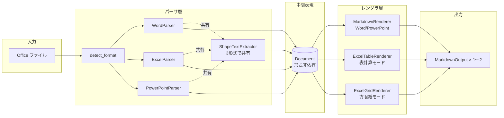
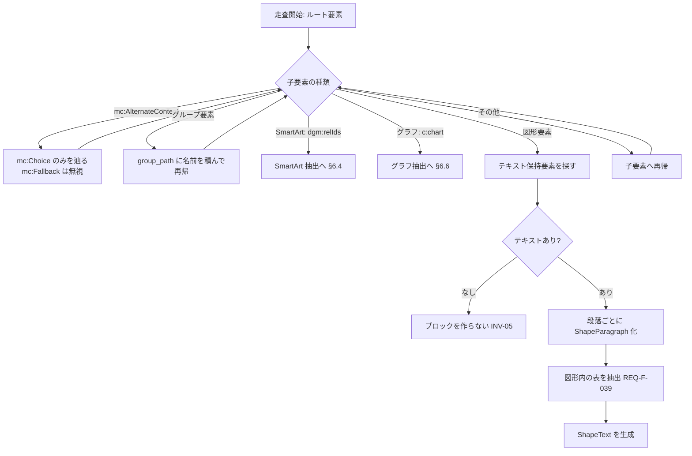
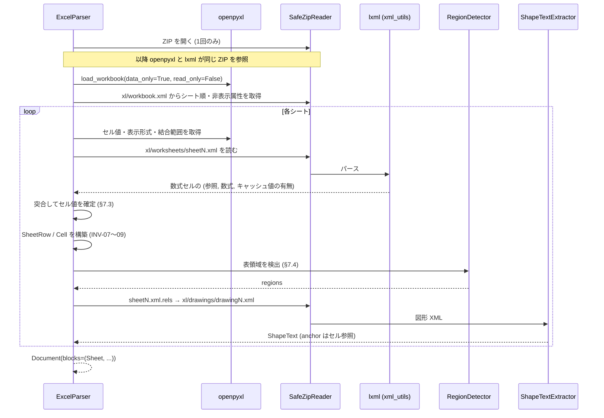
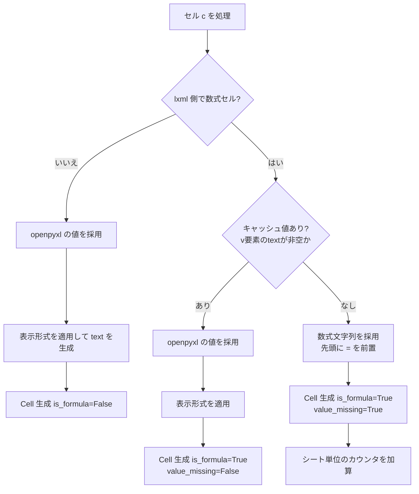
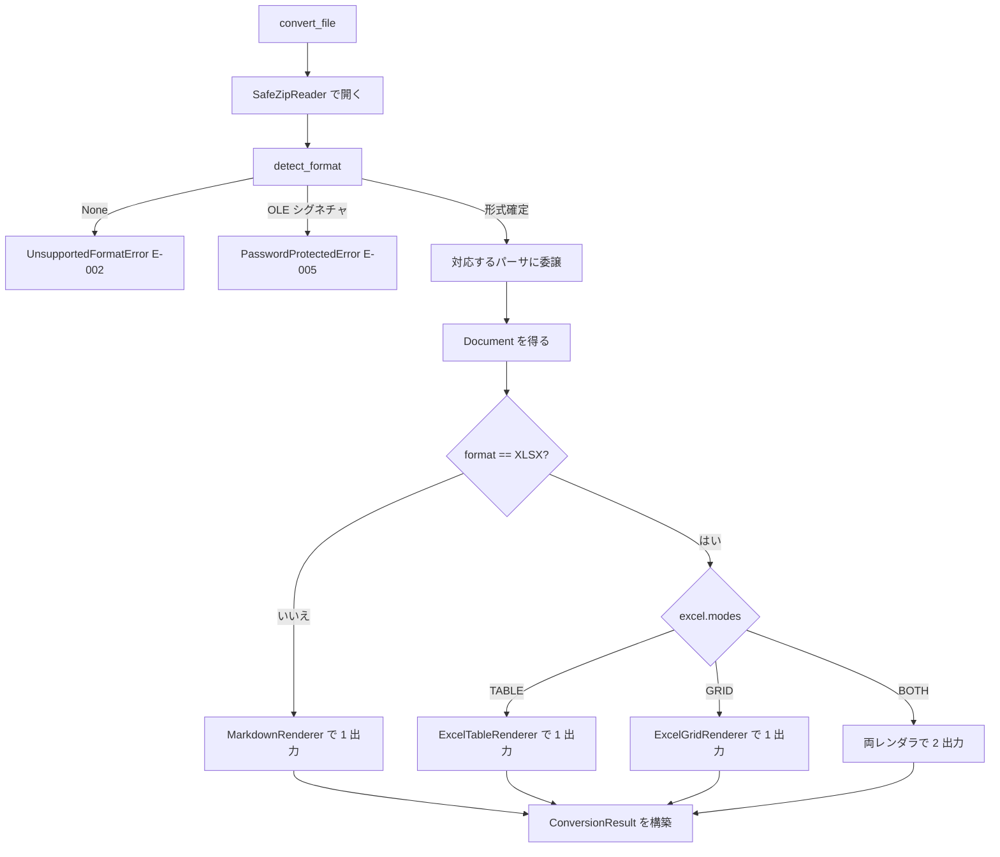

# P003 システム詳細設計書 — Office2RAGKnowledge

| 項目 | 内容 |
| --- | --- |
| 版 | 1.0 |
| 作成日 | 2026-08-24 |
| インプット | `docs/P001-requirement.md` (版1.1) / `docs/P002-frontend-spec.md` (版2.0) |
| 対象読者 | P004 (トレーサビリティ)・P005 (実装計画)・P006 (テスト計画) の担当 |

---

## 0. 本書の位置づけ

`docs/P002-frontend-spec.md` が確定した**外部から観測できる契約**を、どう成り立たせるかを定める。

| 区分 | 確定先 |
| --- | --- |
| CLI が受理する入力、端末表示、生成される Markdown の体裁、公開 API のシグネチャと例外、終了コード | P002 |
| **モジュール構成、OOXML の走査アルゴリズム、状態の持ち方、セキュリティ実装、並列実行方式、性能の達成手段** | **本書 (P003)** |
| インフラ構成 (コンテナ・配布トポロジー) | P005 / P302 (§13 で委譲を明記) |

**P001 になかった API をここで追加していない。** 詳細化の過程で気づいたスコープ上の論点は §14 に指摘としてまとめる。

---

## 1. 事前検証 (スパイク) の結果

本書の設計判断のうち、実測なしには確定できないものについて、設計に先立ち検証を実施した。**以下はすべて実行して得た結果であり、推定ではない。**

検証環境: Windows 11 Pro (10.0.26200) / Python 3.14.2 / 隔離した venv

### 1.1 依存ライブラリの Python 3.14 での動作 (P001 §8.3 の★FIXME★を解消)

| ライブラリ | 版 | import | 最小の読み書き |
| --- | --- | --- | --- |
| openpyxl | 3.1.5 | OK | OK |
| python-docx | 1.2.0 | OK | OK (見出し・段落の書込/読込) |
| python-pptx | 1.0.2 | OK | OK (スライド・タイトルの書込/読込) |
| lxml | 6.1.2 | OK | OK |
| typer | 0.27.1 | OK | — |
| rich | 15.0.0 | OK | — |

**結論: 開発・実行環境は Python 3.14 系でよい。** P001 §8.3・§8.4 が挙げていた「動作しない場合は 3.12/3.13 を使う」という代替案は不要となった。ただし対応範囲の下限は REQ-NF-017 のとおり 3.11 とし、CI では 3.11 と 3.14 の両方で検証する (P006 で計画)。

### 1.2 数式のキャッシュ値の判定 (P002 §10 の★FIXME★を解消)

REQ-F-051 (キャッシュ値が無い場合は数式を出力する) を、REQ-F-068 (解析は1回のみ) と両立させる方法を検証した。

**検証結果**

| 方式 | キャッシュなしの判定 | キャッシュありの判定 | 200行20回の平均所要 |
| --- | --- | --- | --- |
| openpyxl 1回ロード (`data_only=False`) | 数式は取れるが値が取れない | 同左 | 5.07 ms |
| openpyxl 2回ロード (`data_only` 切替) | 判定可 (値が `None`) | 判定可 (値 `999`) | 10.10 ms (**1.99倍**) |
| **lxml で sheet XML を1回パース** | **判定可** | **判定可** | **2.36 ms** |

**発見された重要な実装上の落とし穴**: openpyxl が書き出したファイルの数式セルの生 XML は次のようになっていた。

```xml
<c r="B2"><f>A2*2</f><v></v></c>
```

`<v>` 要素は**存在するが中身が空**である。したがって **「`<v>` 要素の有無」でキャッシュ値の有無を判定してはならない。**`<v>` の**テキストが空か否か**で判定する必要がある。素朴に `v is None` で判定すると、キャッシュ値が無いファイルを「値あり」と誤判定し、空文字がセル値として出力される。

もう1点、XML 上の `<f>` は**先頭の `=` を含まない** (`A2*2`) が、openpyxl の `cell.value` は `=` を含む (`=A2*2`)。lxml 経路で取得した数式は `=` を前置して正規化する必要がある。

**採用する方式 (§7.3 で詳述)**: **openpyxl を `data_only=True` で1回ロードし、加えて sheet XML に対する lxml の1パスを併用する**ハイブリッド方式とする。

* openpyxl が担当: セル値・表示形式・結合範囲・非表示属性・シート順 (これらを自前で再実装するのは割に合わない)
* lxml が担当: 数式文字列と、キャッシュ値の有無
* 合計コスト: 5.07 + 2.36 = 約 7.4 ms。2回ロード方式 (10.10 ms) より**約27%速い**
* 図形テキストの抽出 (REQ-F-035) でどのみち同じ ZIP を開くため、ZIP のオープンは1回に統合できる

★ACCEPTED★ 検討: (a) openpyxl を2回ロードする案は、実測で正確に2倍のコストとなり REQ-F-068 の趣旨 (解析を二重に行わない) に反する。(b) openpyxl を捨てて全て lxml で読む案は最速だが、共有文字列・表示形式・スタイル継承・結合範囲の解決を自前で実装することになり、実装量と不具合リスクが釣り合わない。(c) 採用したハイブリッドは、責務が「値と書式 = openpyxl」「数式の生データ = lxml」と明確に分かれる。残存リスク: 同じシートを2つの経路で読むため、両者のセル座標の対応付けにずれがあると値と数式が食い違う。§7.3 で座標を 1 起点に統一し、突合はセル参照文字列で行うことで防ぐ。

### 1.3 図形テキストの走査方式 (REQ-F-031〜033 の実現性)

本アプリの中核要件であるため、機構が成立することを実測で確認した。

**検証結果1: python-docx の公開 API では図形テキストを取得できない**

テキストボックスを含む段落に対し `document.paragraphs` が返したテキストは `['通常の段落です。', '']` であり、**図形内の文字列は空文字として落ちた**。P001 §8.3 が選定理由に挙げた「python-docx はオートシェープの走査を公開 API で提供していない」ことを、実測で確認した。lxml による直接走査の併用は必須である。

**検証結果2: 素朴な走査は同じテキストを二重に取得する**

Word のテキストボックスは `mc:AlternateContent` の下に、`mc:Choice` (新形式 `wps:txbx`) と `mc:Fallback` (旧 VML 形式 `v:textbox`) の**両方に同じ内容を持つ**。`.//w:txbxContent` を素朴に全件拾うと次のようになった。

```
素朴な走査:      txbxContent 2 件 → ['図形の1段落目図形の2段落目', '図形の1段落目図形の2段落目']
Choice優先走査:  txbxContent 1 件 → [['図形の1段落目', '図形の2段落目']]
```

**`mc:AlternateContent` に遭遇したら `mc:Choice` のみを辿り、`mc:Fallback` は無視する**必要がある (§6.3)。これを怠ると、すべての図形テキストが2回ずつ Markdown に出力される。

**検証結果3**: 上記の方式で、図形内の段落の区切りが保持されること (REQ-F-040) を確認した。

**検証結果4: PowerPoint のグループ再帰**

`shape.shapes` を再帰的に辿る走査ロジックが成立することを確認した。ただし **python-pptx はグループ図形を生成する API を持たない**ため、実際のグループを含むファイルでの確認は固定フィクスチャで行う必要がある (P006 のテストデータ方針に反映する)。

---

## 2. アーキテクチャ

### 2.1 三層構成

REQ-NF-011 (形式別コンバータをプラグイン的に追加でき、共通の中間表現を経由する) を満たす構成とする。



**この構成の要点は、Excel が「1つの中間表現から2つのレンダラが動く」ことである** (REQ-F-068)。パーサは1回しか走らず、表計算モードと方眼紙モードの差はレンダラ側にのみ存在する。

### 2.2 モジュール構成

```
src/office2ragknowledge/
├── __init__.py              公開API (__all__ で P002 §6.1 のシンボルを再輸出)
├── py.typed                 REQ-F-103
├── errors.py                例外階層 (P002 §6.5)
├── config.py                load_config / Config (API-07)
├── detect.py                detect_format (API-05)
├── convert.py               convert_file / convert_bytes (API-01/02)
├── batch.py                 convert_batch (API-03)
├── inspection.py            inspect_file (API-04)
├── writer.py                write_result (API-06)
├── models/
│   ├── options.py           ConvertOptions / ExcelOptions / BatchOptions / 列挙型
│   ├── inline.py            InlineRun / ListItem / TableRow / TableCell / ShapeParagraph
│   ├── media.py             ExtractedImage (document.py と result.py の双方が参照。循環import回避)
│   ├── document.py          Document / Block 系 / DocumentMeta
│   ├── sheet.py             Sheet / SheetRow / Cell / TableRegion / MergedRange
│   └── result.py            ConversionResult / MarkdownOutput / BatchResult / DocumentInfo / WrittenFiles
├── logging_setup.py         ロガーの構成 (§12A)
├── ooxml/
│   ├── zip_reader.py        安全な ZIP 読み取り (REQ-NF-006/008)
│   ├── xml_utils.py         安全な XML パーサ・名前空間定義 (REQ-NF-007)
│   ├── shapes.py            ShapeTextExtractor (3形式で共有)
│   ├── smartart.py          SmartArt のテキスト抽出と重複排除
│   ├── charts.py            グラフのタイトル・系列名・カテゴリ名の抽出 (§6.6)
│   └── images.py            画像の代替テキストとバイナリの収集 (REQ-F-048/049/069)
├── parsers/
│   ├── base.py              Parser プロトコル
│   ├── word.py              WordParser
│   ├── excel.py             ExcelParser
│   ├── excel_regions.py     表領域検出
│   └── powerpoint.py        PowerPointParser
├── render/
│   ├── escape.py            Markdown エスケープ (P002 §5.1)
│   ├── frontmatter.py       front matter の生成 (P002 §5.3)
│   ├── shapes.py            図形テキストブロックの体裁 (P002 §5.7)
│   ├── markdown.py          MarkdownRenderer (Word / PowerPoint)
│   ├── excel_base.py        ExcelRendererBase (両モード共通処理。§9.4)
│   ├── excel_table.py       ExcelTableRenderer (表計算モード)
│   └── excel_grid.py        ExcelGridRenderer (方眼紙モード)
└── cli/
    ├── main.py              Typer アプリ (convert / inspect)
    ├── options.py           CLI オプション定義とバリデーション (P002 §4)
    └── console.py           Rich による SCR-03〜06 の描画
```

**`ooxml/shapes.py` を3形式で共有する理由**: 図形テキストの抽出ロジック (グループ再帰・`mc:AlternateContent` の選択・SmartArt の重複排除) は3形式でほぼ共通であり、形式ごとに書くと同じ不具合を3回修正することになる。形式差 (Word は `w:txbxContent`、PowerPoint は `p:sp`、Excel は `xdr:sp`) は、抽出器に渡す「テキスト保持要素の探索規則」として注入する。

### 2.3 依存の方向

```
cli/  →  convert.py / batch.py / inspection.py / config.py
              ↓
        parsers/  →  ooxml/
              ↓
          models/   ←  render/
```

* `models/` は他のどの層にも依存しない (純粋なデータ定義)。
* `render/` は `models/` にのみ依存し、`parsers/` や `ooxml/` を知らない。
* `parsers/` は `render/` を知らない。
* この一方向依存により、レンダラの単体テストがパーサなしに (中間表現を直接組み立てて) 書ける。P006 のテスト設計はこれを前提とする。

---

## 3. 状態の保持

| 項目 | 内容 |
| --- | --- |
| **状態のスコープ** | **プロセス内、かつ1ファイルの変換処理中のみ**。プロセスをまたぐ状態・利用者セッション・システム全体の状態を一切持たない |
| **実現方法** | **メモリのみ**。RDB・KVS・ファイルキャッシュを使用しない |
| 具体的に保持するもの | (1) 変換中の中間表現 `Document`、(2) 抽出した画像バイナリ、(3) 進捗カウンタ、(4) マージ済み設定 `Config` |
| 生存期間 | `convert_file` の呼び出し中。戻り値を返した時点でパーサ側の一時データは解放される |
| 並列実行時 | ワーカープロセス間で状態を共有しない。各ワーカーは独立に1ファイルを処理する (§10) |

**設計判断**: 本アプリは「入力ファイル → 出力ファイル」の純粋な変換であり、実行間で引き継ぐべき状態が存在しない。変換結果のキャッシュ (同じファイルの再変換を省く) も持たない。
★ACCEPTED★ 検討: 入力の SHA-256 をキーにした変換結果キャッシュを検討したが、(a) キャッシュの保存先・無効化・容量管理という新たな複雑さが生じ、(b) RAG パイプライン側が既に「取り込み済みかどうか」を管理していることが多く、(c) front matter の `source_sha256` (REQ-F-007) を出力しているため**再変換の要否判定は利用者側で行える**。残存リスク: 同じファイルを繰り返し変換する使い方では毎回フルに処理する。

### 3.1 データストアのスキーマ適用方式 (マイグレーション) について

**本アプリは永続化データストアを持たないため、スキーマ適用方式 (マイグレーション) は存在しない。**

この記載は省略ではなく、**明示的な「該当なし」の宣言**である。根拠は次のとおり。

* 本アプリが書き出すのは Markdown ファイルと画像ファイルのみであり、スキーマを持つデータストア (RDB・SQLite・KVS) を使用しない (§3)。
* 設定ファイル (`office2rag.toml`) は利用者が管理する入力であって、アプリが管理するスキーマではない。未知のキーはエラーとする (P002 §4.3) が、これは検証であってマイグレーションではない。
* したがって「適用のタイミングと方式」「冪等性」「冪等でない場合の担保方法」のいずれも定義対象が存在しない。

**将来データストアを導入する場合の申し送り**: もし将来 CR によって変換結果のキャッシュや索引を永続化することになった場合、その時点で本節を改訂し、**バージョン管理テーブルで適用済みマイグレーションを記録して差分のみ適用する方式**を採ること。「起動時に `migrations/*.sql` を全件再実行する」方式は、初回は `CREATE TABLE IF NOT EXISTS` のみで冪等に見えても、後から `ALTER TABLE ... ADD COLUMN` が加わった時点で SQLite 等では `duplicate column name` で起動不能になるため採らない。

**テスト計画への申し送り**: データストアを持たないため「アプリケーションを停止・再起動しても正常に起動すること」を確認する受け入れテストは、**マイグレーションの観点としては不要**である。ただし本アプリには別の理由で再実行に関する確認が必要であり、それは次の2点として P006・P009 に含める。

1. **同一の出力先に対する2回目の実行が正しく振る舞うこと** (`--on-exists skip` で既存分がスキップされ、`overwrite` で上書きされること)。**Excel の二重出力では、片方だけが既存の場合にもう片方が正しく書き出されること**を含む (P002 §5.2)。
2. **テストスイートを2回続けて実行しても同じ結果になること** (前回実行の出力ファイルが残ることで2回目が失敗しないこと)。

上記1は永続化された出力ディレクトリに対して実行する必要があり、単体テスト・スプリント内結合テストでは代替できないため、**受け入れ結合テスト (P009) が担当する**。

### 3.2 クロスオリジン (CORS) の扱いについて

**本アプリはクライアントとサーバを別プロセス/別ポートで動作させる構成を持たないため、クロスオリジンの問題は発生しない。**

この記載も明示的な「該当なし」の宣言である。根拠は次のとおり。

* 本アプリは単一プロセスの CLI アプリケーションであり、HTTP サーバを持たない (P001 §2)。ブラウザから読み込まれることがない。
* 認証機構を持たない (P001 §2) ため、Cookie・トークンのいずれも扱わない。
* 公開ライブラリ API (§8) は同一プロセス内の関数呼び出しであり、オリジンの概念が存在しない。
* 開発時・テスト時も、フロントエンド開発サーバに相当するものを起動しない。テストは pytest からの直接呼び出しと、`subprocess` による CLI 起動で行う (P006 で詳述)。

**申し送り**: P001 §1.4 で「Web UI は提供しない」と決定済みであるが、将来 CR により Web UI を追加する場合は、その時点で本節を改訂し、クロスオリジン方針を技術的決定として記録する必要がある。

---

## 4. 共通基盤の設計

### 4.1 安全な XML パース (REQ-NF-007)

`ooxml/xml_utils.py` に、本アプリで用いる唯一の XML パーサ生成関数を置く。**各モジュールが `etree.fromstring` を直接呼ぶことを禁止し、必ずこの関数を経由する。**

| パーサ設定 | 値 | 理由 |
| --- | --- | --- |
| `resolve_entities` | `False` | 実体参照を展開しない。XXE と十億の笑い (Billion Laughs) を防ぐ |
| `no_network` | `True` | 外部 DTD・スキーマの取得を禁じる (REQ-NF-010: 外部通信を行わない) |
| `load_dtd` | `False` | DTD を読み込まない |
| `huge_tree` | `False` | 深い入れ子・巨大ノードの制限を有効に保つ |
| `recover` | `False` | 壊れた XML を黙って修復しない。`CorruptedFileError` (E-007) として扱う |

**名前空間の定義**も同モジュールに集約する。OOXML は名前空間が多く、モジュールごとに定義すると綴り違いによる「要素が見つからない」不具合が起きるため。

| 接頭辞 | URI (末尾のみ記載) | 用途 |
| --- | --- | --- |
| `w` | `.../wordprocessingml/2006/main` | Word 本文 |
| `mc` | `.../markup-compatibility/2006` | `AlternateContent` (§6.3) |
| `wps` | `.../office/word/2010/wordprocessingShape` | Word の図形 |
| `wpg` | `.../office/word/2010/wordprocessingGroup` | Word の図形グループ |
| `a` | `.../drawingml/2006/main` | DrawingML 共通 |
| `p` | `.../presentationml/2006/main` | PowerPoint |
| `xdr` | `.../drawingml/2006/spreadsheetDrawing` | Excel の図形 |
| `m` | `.../spreadsheetml/2006/main` | Excel シート |
| `dgm` | `.../drawingml/2006/diagram` | SmartArt |
| `r` | `.../officeDocument/2006/relationships` | 関係 ID |
| `v` | `urn:schemas-microsoft-com:vml` | 旧 VML (Fallback 側。読み飛ばす) |

### 4.2 安全な ZIP 読み取り (REQ-NF-006, REQ-NF-008)

`ooxml/zip_reader.py` に `SafeZipReader` を置く。OOXML ファイルはすべてこれを経由して開く。

| 検査 | 規則 | 違反時 |
| --- | --- | --- |
| **展開後サイズの上限** | 全エントリの `file_size` 合計が **入力ファイルサイズの 200 倍**、または **1 GiB** のいずれか小さい方を超える場合に拒否 | `FileTooLargeError` (E-008) |
| **単一エントリの上限** | 1エントリの `file_size` が **512 MiB** を超える場合に拒否 | 同上 |
| **圧縮率の上限** | 単一エントリの `file_size / compress_size` が **1000** を超える場合に拒否 (ZIP 爆弾の典型) | 同上 |
| **エントリ数の上限** | エントリ数が **10,000** を超える場合に拒否 | 同上 |
| **パストラバーサル** | エントリ名が絶対パス、`..` を含む、またはドライブレターを含む場合に拒否 | `CorruptedFileError` (E-007) |
| **読み取り時の再検査** | 実際に読み出したバイト数が宣言された `file_size` を超えた場合に中断 | `FileTooLargeError` (E-008) |

★ACCEPTED★ 検討: 閾値は固定値とし、オプションでの変更を設けない。可変にすると「上限を上げれば通る」という運用が定着し、防御の意味が失われる。正当な業務文書がこの閾値に触れることは想定しにくい (50MB の入力に対し 1GiB の展開後上限)。残存リスク: 極端に大きな正当ファイルが拒否される可能性。その場合は E-008 のメッセージから原因が判るため、利用者は分割して処理できる。

**パストラバーサルの検査位置について** (REQ-NF-008): 本アプリは ZIP エントリを**ファイルとして展開しない** (メモリ上で読むのみ) ため、エントリ名がそのまま書き込み先になることはない。ただし画像抽出時に元の拡張子を利用するため、**拡張子部分のみを検証済みの許可リスト** (`png` `jpg` `jpeg` `gif` `bmp` `tiff` `emf` `wmf` `svg`) と照合し、それ以外は `bin` として扱う。出力ファイル名は `{連番:04d}.{拡張子}` で本アプリが生成するため (P002 §5.11)、エントリ名が出力パスに混入する経路は存在しない。

### 4.3 形式判定 (API-05 / REQ-F-001)

```
detect_format(source) -> DocumentFormat | None
```

| 手順 | 内容 |
| --- | --- |
| 1 | 先頭4バイトが `PK\x03\x04` かを確認。異なれば `None` (旧バイナリ形式や非 Office ファイル) |
| 2 | `SafeZipReader` で開く。開けなければ `None` |
| 3 | `[Content_Types].xml` を読み、`Override` の `ContentType` を走査する |
| 4 | `.../wordprocessingml.document.main+xml` → `DOCX` / `.../spreadsheetml.sheet.main+xml` → `XLSX` / `.../presentationml.presentation.main+xml` → `PPTX` |
| 5 | いずれにも該当しなければ `None` |

**拡張子との突合** (REQ-F-001): 拡張子から推定した形式と手順4の結果が食い違う場合、**実形式を優先**し、警告「拡張子は {拡張子} ですが、実際の形式は {形式} です」を記録する (P002 §9.3)。

**パスワード保護の検出**: 暗号化された OOXML は ZIP ではなく OLE 複合ファイル (先頭が `\xd0\xcf\x11\xe0`) である。手順1でこのシグネチャを検出した場合、`None` ではなく `PasswordProtectedError` (E-005) を送出する。`detect_format` 自体は `None` を返し、呼び出し元 (`convert_file`) が判定する。
★FIXME★ 一部の保護形式 (ZIP のまま一部パートのみ暗号化) はこの判定で捕まらない可能性がある。その場合はパート読み取り時の失敗として `CorruptedFileError` に落ちる。実データでの確認が望ましい。

---

## 5. 中間表現の実装

P002 §7 が定めたデータモデルの実装方針を定める。**P002 のデータモデルに対する変更は行わない** (§14 参照)。

### 5.1 実装形式

| 項目 | 決定 | 理由 |
| --- | --- | --- |
| 基本形 | `@dataclass(frozen=True, slots=True)` | 不変性で INV-06 (冪等性) を型で支え、`slots` でメモリを抑える (REQ-NF-003) |
| コレクション | `tuple` (`list` を使わない) | 不変性の徹底。生成後に変更されないことを保証する |
| `Block` の直和 | 抽象基底クラス `Block` + 各バリアントのサブクラス。判別は `match` 文の型パターン | Python に代数的データ型がないため。`kind` 文字列による判別より型検査 (mypy strict) が効く |
| 構築 | パーサ内部では可変のビルダー (`list`) で組み立て、最後に `tuple` に固定して `Document` を生成 | 不変オブジェクトの逐次構築を効率的に行うため |

### 5.2 不変条件の担保方法

P002 §7.4 の INV-01〜11 について、どこで保証するかを定める。

| 不変条件 | 担保する場所 | 方法 |
| --- | --- | --- |
| INV-01 (表の列数が揃う) | 各パーサの表構築部 | 最大列数を求め、不足行を空セルで埋める |
| INV-02 (エスケープ前の生文字列) | パーサ全体 | パーサはエスケープ処理を一切呼ばない。`render/escape.py` はレンダラからのみ import される (§2.3 の依存方向で機械的に担保) |
| INV-03 (空 run を作らない) | `InlineRun` の生成関数 | 空文字の場合は `None` を返し、呼び出し側が追加しない |
| INV-04 (blocks の順序が出力順) | レンダラ | 並べ替えを行わない。`Footnote` と `anchor is None` の `ShapeText` のみ末尾へ移送する |
| INV-05 (空の図形をブロック化しない) | `ShapeTextExtractor` | 段落と表の双方が空なら `ShapeText` を生成しない |
| INV-06 (冪等性) | 全体 | §11 で詳述 |
| **INV-07 (Sheet.rows が空行を含み欠番なし)** | `ExcelParser` | 使用範囲の最小行〜最大行を `range` で走査し、非空セルが無い行も `SheetRow(is_empty=True)` として必ず追加する |
| **INV-08 (cells が列番号昇順・非空のみ)** | `ExcelParser` | 列番号でソートして格納。空セルは追加しない |
| **INV-09 (結合を展開しない)** | `ExcelParser` | `merged` に範囲を記録するのみ。`Cell` は結合範囲の左上にのみ生成する |
| **INV-10 (regions が最低1要素、空シートのみ空)** | `excel_regions.py` | 検出結果が空かつ使用範囲が存在する場合は使用範囲全体を1領域として返す |
| **INV-11 (regions が重ならない)** | `excel_regions.py` | 分割アルゴリズムの性質上、重なりは構造的に生じない (§7.4)。単体テストで不変条件として検証する |

---

## 6. 図形テキスト抽出の内部仕様 (中核機能)

REQ-F-031〜040 の実装。§1.3 のスパイク結果を反映する。

### 6.1 共通の抽出器

`ooxml/shapes.py` の `ShapeTextExtractor` が3形式で共有される。形式差は次の「方言」オブジェクトとして注入する。

| 方言の項目 | Word | Excel | PowerPoint |
| --- | --- | --- | --- |
| 図形要素のタグ | `wps:wsp` | `xdr:sp` | `p:sp` |
| グループ要素のタグ | `wpg:wgp` | `xdr:grpSp` | `p:grpSp` |
| テキスト保持要素 | `w:txbxContent` | `xdr:txBody` | `p:txBody` |
| 段落要素 | `w:p` | `a:p` | `a:p` |
| テキスト実行要素 | `w:t` | `a:t` | `a:t` |
| 図形名の取得元 | `wps:cNvPr/@name` | `xdr:cNvPr/@name` | `p:cNvPr/@name` |
| アンカーの解決 | 段落位置 (§6.5) | セル参照 (§7.6) | なし |

### 6.2 走査の全体手順



### 6.3 `mc:AlternateContent` の扱い (§1.3 の検証結果2 への対処)

**素朴に `.//w:txbxContent` を全件拾うと、すべての図形テキストが2回出力される。** `mc:AlternateContent` は `mc:Choice` (新形式) と `mc:Fallback` (旧 VML) に同じ内容を重複して持つためである。

| 規則 | 内容 |
| --- | --- |
| 1 | `mc:AlternateContent` に遭遇したら、その配下を**直接走査しない** |
| 2 | `mc:Choice` が1つ以上あれば、**最初の `mc:Choice` のみ**を辿る |
| 3 | `mc:Choice` が無い場合に限り `mc:Fallback` を辿る |
| 4 | 上記の選択は再帰の各階層で行う (入れ子の `AlternateContent` にも適用する) |

**`mc:Choice` が複数ある場合**: `Requires` 属性が示す拡張のうち、本アプリが解釈できるもの (`wps` / `wpg`) を優先し、いずれも解釈できなければ最初のものを採る。
★ACCEPTED★ 検討: `Requires` を無視して常に最初の `Choice` を採る単純な案も検討したが、将来 Office が新しい拡張を先頭に置いた場合に未知の形式を掴んでしまう。`Requires` を見る実装コストは小さい。残存リスク: 未知の拡張しか無い場合、テキストが取れないことがある (この場合 `mc:Fallback` も辿れないため)。この状況は現行の Office では生じない。

### 6.4 SmartArt の重複排除 (REQ-F-034)

SmartArt は同じテキストを2箇所に保持する。

| 保持場所 | 内容 |
| --- | --- |
| `diagrams/data*.xml` | データモデル。ノードの階層構造 (`dgm:pt` の親子関係) を持つ |
| `diagrams/drawing*.xml` | 描画結果。レイアウト後の図形として、同じテキストを持つ |

**データモデル側 (`data*.xml`) を採用し、描画結果側は読まない。** 理由は、データモデルがノードの階層を保持しており、P002 §5.7 が定める箇条書き形式 (`- 計画` / `- 実行`) の階層を再現できるためである。描画結果側は階層が失われている。

| 手順 | 内容 |
| --- | --- |
| 1 | グラフィックフレームの `dgm:relIds/@r:dm` から データモデルパートの関係 ID を得る |
| 2 | `_rels` を解決して `diagrams/dataN.xml` を読む |
| 3 | `dgm:ptLst/dgm:pt` のうち `type` が `node` のものを走査する (`type="pres"` は表示専用のため除外) |
| 4 | `dgm:cxnLst` の接続 (`type="parOf"`) から親子関係を組み立て、深さを算出する |
| 5 | 各ノードの `dgm:t` 配下のテキストを `ShapeParagraph(level=深さ)` として格納する |
| 6 | 同じグラフィックフレーム配下の `drawing*.xml` は走査しない (重複防止) |

★FIXME★ `dgm:cxnLst` から階層を組み立てる手順は、SmartArt のレイアウト種別 (組織図・循環・リスト等) によって接続の張られ方が異なる可能性がある。階層が正しく取れない場合はすべて `level=0` (フラットな箇条書き) に落とす。実データのフィクスチャで確認する (P006)。

### 6.5 Word におけるアンカー解決 (REQ-F-036)

| 図形の種類 | アンカー | 出力位置 |
| --- | --- | --- |
| インライン図形 (`wp:inline`) | それを含む `w:p` | その段落の直後 |
| 浮動図形 (`wp:anchor`) で本文中の `w:p` 配下にあるもの | それを含む `w:p` | その段落の直後 |
| ヘッダー・フッター内の図形 | なし | `--headers-footers` が偽なら出力しない。真ならヘッダー・フッター節に出力 |
| 上記のいずれでもない図形 | なし | 文書末尾の `## 図形テキスト (位置不明)` 節。警告を記録 |

Word の浮動図形は XML 上は必ずいずれかの段落の子として現れるため、**「アンカー位置を特定できない図形」は実際にはヘッダー・フッター由来か、想定外の構造の場合に限られる**。P002 §9.3 の警告は、そうした例外的な場合のための安全網である。

### 6.6 グラフの扱い (REQ-F-047)

PowerPoint のグラフ (`c:chart`) から、タイトル・系列名・カテゴリ名のみを抽出する。

| 抽出対象 | XML 上の位置 |
| --- | --- |
| タイトル | `c:chart/c:title` 配下の `a:t` を連結 |
| 系列名 | 各 `c:ser/c:tx/c:strRef/c:strCache/c:pt/c:v` |
| カテゴリ名 | 最初の `c:ser/c:cat` 配下の `c:strCache/c:pt/c:v` (系列間で共通のため1つ目のみ) |

数値データ (`c:val`) は読まない。図形種別 `グラフ` の `ShapeText` として、P002 §5.10 の体裁で出力する。

---

## 7. Excel パーサの内部仕様

本改訂の中心。REQ-F-021〜068 の実装。

### 7.1 全体の処理順序



**ZIP は1回だけ開く。** openpyxl は内部で独自にファイルを開くため、厳密にはファイルハンドルは2つになるが、**解析 (パース) は各パートについて1回ずつ**であり、REQ-F-068 を満たす。

### 7.2 openpyxl のロードオプション

| オプション | 値 | 理由 |
| --- | --- | --- |
| `data_only` | `True` | キャッシュ値を得る。数式は lxml 経路から得るため `False` は不要 (§1.2) |
| `read_only` | `False` | `read_only=True` は結合範囲 (`merged_cells`) と一部の書式にアクセスできないため。REQ-F-030 (結合セルの複製) に必須 |
| `keep_vba` | `False` | マクロを読み込まない (REQ-NF-009) |
| `keep_links` | `False` | 外部ブックへのリンクを解決しない (REQ-NF-010: 外部通信を行わない) |
| `rich_text` | `False` | セル内の部分書式を保持しない。Markdown のテーブルセル内で部分的な太字を表現しても RAG の価値に寄与せず、処理コストのみ増えるため |

★ACCEPTED★ 検討: `read_only=True` はメモリ効率が良く REQ-NF-003 に有利だが、結合範囲が取得できず REQ-F-030 を実装できない。機能要件を優先し `False` とした。残存リスク: 巨大ファイルでのメモリ使用量が増える。`--max-rows` (既定 10,000) による打ち切りが緩和策として働く。

### 7.3 セル値の確定手順 (§1.2 のスパイク結果を反映)

各シートについて、openpyxl の値と lxml の数式情報を突合してセル値を確定する。



**キャッシュ値の有無の判定規則 (最重要)**:

```
キャッシュ値あり  ⇔  <v> 要素が存在し、かつ その text が None でも空文字でもない
```

**`<v>` 要素の存在有無で判定してはならない。** openpyxl が書き出したファイルは `<f>A2*2</f><v></v>` のように**空の `<v>` を持つ**ことをスパイクで確認している (§1.2)。

**数式文字列の正規化**: XML の `<f>` は先頭の `=` を含まない (`A2*2`) ため、`=` を前置して `=A2*2` とする。openpyxl 経由の値 (`cell.value`) は `=` を含むため、両経路の表現を一致させる。

**共有数式 (`<f t="shared">`)**: 配列の先頭セルのみが数式文字列を持ち、以降のセルは `si` 属性で参照する。先頭セルの数式を記憶し、参照するセルにはその数式をそのまま出力する (セル参照の相対調整は行わない)。
★ACCEPTED★ 検討: 共有数式の相対参照を各セル向けに再計算して正しい数式文字列を復元する案を検討したが、A1 形式の相対/絶対参照の解析と再構成が必要で実装量が大きい。キャッシュ値が無いファイルでのみ表示される情報であり、かつ「そこに数式がある」ことが判れば RAG の用途としては足りる。残存リスク: 共有数式のセルには、先頭セルの数式がそのまま表示される (セル参照がずれて見える)。この旨を出力に注記せず、`docs/ArchitectureHandbook.md` の既知の制約に記録する。

**表示形式の適用 (REQ-F-026)**:

| セルの型 | 変換 |
| --- | --- |
| 日付・時刻 | `number_format` を見て `YYYY-MM-DD` / `YYYY-MM-DD HH:MM:SS` / `HH:MM:SS` に整形 |
| パーセント | 値を100倍して `%` を付す (`0.153` かつ書式に `%` → `15.3%`) |
| 通貨・会計 | 書式の通貨記号を前置し、桁区切りを適用 |
| 一般の数値 | `int` で表せる値は整数として、それ以外は不要な末尾ゼロを除いた10進表記 |
| 論理値 | `TRUE` / `FALSE` |
| エラー値 | `#REF!` 等をそのまま文字列として出力 |
| 文字列 | そのまま |
| `None` (空セル) | セルを生成しない (INV-08) |

★FIXME★ 通貨・会計書式の記号抽出は、`number_format` の書式文字列を解析する必要がある。ロケール依存の書式 (`[$¥-411]` 等) の網羅は難しいため、記号が抽出できない場合は数値のみを出力する方針とする。実データでの確認が望ましい。

### 7.4 表領域の検出アルゴリズム (REQ-F-054〜057)

P002 §5.4.2 が定めた外部から見える規則を、次のアルゴリズムで実現する。

**入力**: 使用範囲 (`min_row`, `min_col`, `max_row`, `max_col`)、非空セルの集合、結合範囲の集合
**出力**: `tuple[TableRegion, ...]`

| 手順 | 内容 |
| --- | --- |
| 1 | 各行について「非空か」を判定する。判定には**結合範囲を考慮する** (下記) |
| 2 | 使用範囲を、非空でない行 (空行) を境界として水平に分割する。空行自体はどの領域にも属さない |
| 3 | 手順2で得た各行ブロックについて、そのブロック内で各列が非空かを判定し、空列を境界として垂直に分割する |
| 4 | 得られた各矩形について、実際に非空セルが存在する範囲まで境界を収縮させる (トリミング) |
| 5 | 領域を (top, left) の昇順に並べる |
| 6 | 領域数が `max_table_regions` を超えたら、手順2〜5の結果を破棄し、使用範囲全体を1領域として返す。`region_split_abandoned = True` |
| 7 | 領域が0件かつ使用範囲が存在する場合は、使用範囲全体を1領域として返す (INV-10) |

**結合範囲を考慮した非空判定** (P002 §1 論点7):

```
セル (r, c) が非空 ⇔  (r, c) に値がある
                    ∨ (r, c) を含む結合範囲が存在し、その範囲の左上に値がある
```

これにより、複数列にまたがる結合見出し (例: A1:F1 に「2026年度 売上集計」) がある行が空行と判定されず、その下の表と切り離されない。

**垂直分割を行ブロックごとに行う理由**: 使用範囲全体で空列を判定すると、上部の表と下部の表で列位置が異なる場合に、どちらにも属さない列が空列と判定されず、分割が効かない。行ブロック単位で判定することで、表ごとに適切な列境界が得られる。

**計算量**: 使用範囲の行数を R、列数を C とすると、手順1が O(R×C)、手順3が O(R×C)、全体で **O(R×C)**。`--max-rows` により R は既定 10,000 に制限され、C は Excel の上限 16,384 だが実用上は数十。使用範囲が 10,000×50 の場合で 50万セルの走査となり、Python でも 0.1 秒程度に収まる見込みである。
★FIXME★ 上記の所要時間は見積もりであり、実測していない。P102 の実装後に P103 で計測し、REQ-NF-001 (1ファイル10秒以内) に対する寄与を確認する。

**重なりが生じないこと (INV-11)**: 手順2の水平分割は行の集合を互いに素な区間に分ける。手順3は各行ブロック内で列を互いに素な区間に分ける。手順4のトリミングは範囲を縮小するのみ。したがって領域どうしが重なることは構造的に生じない。

### 7.5 打ち切りの扱い (REQ-F-029)

`--max-rows` (既定 10,000、`0` で無制限) を超えるシートは、**使用範囲の先頭から上限行までを対象とする**。

* 打ち切りは表領域の検出**より前**に行う。検出後に切ると、領域が途中で切れて不整合な `TableRegion` が残るため。
* `Sheet.truncated_at` に上限行数、`Sheet.total_rows` に打ち切り前の総行数を記録する。
* 図形は打ち切りの影響を受けない (シート全体の図形を抽出する)。図形のアンカーが打ち切り範囲外でも、章の末尾に出力されるため位置の矛盾は生じない。

### 7.6 Excel の図形とシートの対応付け (REQ-F-035)

| 手順 | 内容 |
| --- | --- |
| 1 | `xl/workbook.xml` の `sheets/sheet` から、シート名・シートID・`r:id` を得る |
| 2 | `xl/_rels/workbook.xml.rels` で `r:id` → `xl/worksheets/sheetN.xml` を解決する |
| 3 | `xl/worksheets/_rels/sheetN.xml.rels` から `drawing` 関係 (`.../drawing`) を探し、`xl/drawings/drawingM.xml` を解決する |
| 4 | `drawingM.xml` の `xdr:twoCellAnchor` / `xdr:oneCellAnchor` / `xdr:absoluteAnchor` を走査する |
| 5 | `xdr:from/xdr:col` と `xdr:from/xdr:row` (**いずれも0起点**) から、1起点のセル参照 (`B3` 形式) に変換する |
| 6 | `xdr:absoluteAnchor` の図形はセル位置を持たないため `anchor=None` とする |

**シート名からドローイングへの対応付けを `_rels` で解決する理由**: `sheetN.xml` の `N` とシートの並び順は一致しないことがある (シートの削除・並べ替えの履歴により)。ファイル名の数値で対応付けると誤ったシートに図形が付く。

**列番号のセル参照への変換**: 0起点の列番号を A, B, ..., Z, AA, AB, ... に変換する。26進数だが 0 に相当する桁がないため、通常の基数変換ではなく「余りが0のとき Z として桁借りする」処理が必要である (列 26 は `AA` ではなく `AA`、列 25 は `Z`)。境界値 (25, 26, 51, 52, 701, 702) を単体テストの対象とする。

---

## 8. 公開 API の内部仕様

P002 §6.3 が定めた外部仕様を、どう実現するかを定める。

### 8.1 API-01 `convert_file` / API-02 `convert_bytes`



`convert_file` はパスから読み、`convert_bytes` はバイト列から読む。両者は**入力の取得方法のみが異なる**ため、内部では共通の `_convert_source(reader, filename, options)` に集約する。

**`convert_bytes` の `filename`**: 形式判定の補助 (拡張子) と front matter の `source_file` に用いる。パスとして解決しない (存在しないファイル名でもよい)。`source_sha256` は渡されたバイト列から計算する。

### 8.2 API-03 `convert_batch`

| 段階 | 内容 |
| --- | --- |
| 1. 探索 | 各入力パスについて、ファイルなら対象に加え、ディレクトリなら配下を走査する。`recursive` が偽なら直下のみ。**対応拡張子のファイルのみを対象とし、それ以外はスキップに計上する** |
| 2. 重複排除 | 同じファイルが複数の入力パスから到達しうるため、解決済み絶対パスで重複を除く。**順序は最初に出現した順を保つ** (冪等性のため) |
| 3. 出力先の決定 | `output_dir` が指定されていればそこへ、なければ各入力ファイルと同じ階層へ |
| 4. 事前検証 | 出力先の作成と書き込み可否を確認する。失敗すれば `OutputError` を送出し、1件も処理しない |
| 5. 並列変換 | §10 の方式で各ファイルを処理する |
| 6. 集計 | `BatchResult` を構築する |

**探索順序の決定性** (REQ-NF-018): ディレクトリ走査の結果は OS のファイルシステム順に依存するため、**パス文字列でソートしてから処理する**。これにより、同じディレクトリに対する2回の実行で `BatchResult.succeeded` の順序が一致する。

### 8.3 API-04 `inspect_file`

変換を行わず、`DocumentInfo` を組み立てる。**`convert_file` と同じパーサを使う** (別実装を持たない)。

| 項目 | 取得方法 |
| --- | --- |
| `unit_count` / `unit_label` | Excel=シート数、PowerPoint=スライド数、Word=段落数 |
| `table_count` | Excel は表領域の総数、他は `Table` ブロックの数 |
| `shape_count` / `shape_with_text_count` | 図形の走査時に、テキスト有無に関わらず数える。**テキストなしの図形は `ShapeText` を作らない (INV-05) ため、抽出器が別途カウンタを返す** |
| `table_region_count` | Excel のみ。`Sheet.regions` の合計 |
| `formula_without_cache_count` | Excel のみ。`Sheet.formula_without_cache_count` の合計 |
| `estimated_chars` | 表計算モードでレンダリングした場合の文字数。**実際にレンダリングして `len()` を取る** (推定式を持たない) |
| `status` | `ok` / `unsupported` / `protected` / `corrupted`。例外を捕捉して分類する |

★ACCEPTED★ 検討: `estimated_chars` を「セル数 × 平均文字数」のような推定式で求める案もあったが、推定式の精度を保証できず、利用者が処理量を見積もる用途に耐えない。実際にレンダリングすれば正確な値が得られ、`inspect` は変換より軽い処理を求められているわけでもない。残存リスク: `inspect` の所要時間が `convert` とほぼ同じになる (書き出しの分だけ速い)。

### 8.4 API-06 `write_result`

| 手順 | 内容 |
| --- | --- |
| 1 | `result.outputs` の各要素について、出力パス `{out_dir}/{ステム}{suffix}` を決める |
| 2 | **出力ファイルごとに個別に** `on_exists` を判定する (P002 §5.2)。`SKIP` かつ既存ならその要素を飛ばし `skipped_paths` に記録。`FAIL` かつ既存なら `OutputError` |
| 3 | 一時ファイル (`{目的名}.tmp{PID}`) に書き、`os.replace` で目的名へ原子的に置換する |
| 4 | `images` が `EXTRACT` かつ画像がある場合、`{ステム}_assets/` を作成し、**全出力で共有して1回だけ**書き出す (REQ-F-069) |
| 5 | `WrittenFiles` を返す |

**原子的置換の理由**: 変換途中でプロセスが中断された場合に、壊れた Markdown が正しいファイル名で残ると、RAG パイプラインが不完全な文書を取り込む。一時ファイルへ書いてから置換すれば、目的名のファイルは「完全に書けたもの」か「存在しない」かのいずれかになる。

**画像を1回だけ書き出すこと**: `outputs` が2件でも画像は共有である。手順4は `outputs` のループの外で1回だけ実行する。

**Excel の片方のみ書き出せた場合** (P002 §9.1): 例外は `write_result` の呼び出し元 (`convert_batch`) に伝播し、そのファイルは失敗として計上される。既に書き出したファイルは削除しない。

### 8.5 API-07 `load_config`

| 手順 | 内容 |
| --- | --- |
| 1 | `path` が指定されていればそれを読む。無ければカレントから上位へ `office2rag.toml` を探索し、最初に見つかったものを使う。ルートに達しても無ければ既定値のみで `Config` を返す |
| 2 | `tomllib.load` で解析する。構文エラーは `ConfigError` (E-006) |
| 3 | **既知のテーブル (`[convert]` `[excel]` `[log]`) と既知のキーの集合と照合し、未知のものがあれば `ConfigError`** |
| 4 | 各値を対応する型・範囲で検証する (P002 §4.1 と同一の検証を共有する) |
| 5 | 既定値にマージした `Config` を返す |

**CLI 引数とのマージ**: 優先順位は CLI 引数 > 設定ファイル > 既定値 (REQ-F-098)。Typer は「指定されなかったオプション」と「既定値と同じ値が明示された」の区別がつきにくいため、**CLI 層のオプション既定値を `None` とし、`None` でないものだけを設定ファイルの値に上書き適用する**。

---

## 9. レンダラの内部仕様

### 9.1 共通処理

| 処理 | 実装場所 | 内容 |
| --- | --- | --- |
| エスケープ | `render/escape.py` | P002 §5.1 の規則。**行頭判定が必要なため、行を組み立てた後に適用する** |
| front matter | `render/frontmatter.py` | P002 §5.3。キー順を固定し、値が無いキーを省略する |
| 図形ブロック | `render/shapes.py` | P002 §5.7。`shape_style` に応じて3通りの体裁 |
| 空行の正規化 | 各レンダラの最終段 | 連続する空行を1つに畳み、末尾を改行1つで終える |

### 9.2 ExcelTableRenderer (表計算モード)

```
for sheet in document.blocks:
    出力: "## {sheet.name}"
    if sheet.is_empty:
        出力: "(空のシートです)"
    else:
        for i, region in enumerate(sheet.regions):
            if len(sheet.regions) >= 2:
                出力: "### 表 {i+1} ({左上}:{右下})"
            出力: GFM テーブル (結合セルを複製)
        if sheet.truncated_at:
            出力: "> ※ このシートは {N} 行で打ち切りました (全 {M} 行)"
    出力: sheet.shapes の図形ブロック
```

**結合セルの複製** (REQ-F-030): 領域内の各セルについて、そのセルを含む結合範囲があれば、範囲の左上の `Cell` の `text` を用いる。中間表現は結合を展開していない (INV-09) ため、この複製はレンダラが行う。

**列数の統一** (INV-01): 領域の `left`〜`right` の全列を必ず出力する。非空セルが無い列も空セルとして出力し、GFM テーブルの矩形を保つ。

### 9.3 ExcelGridRenderer (方眼紙モード)

```
for sheet in document.blocks:
    出力: "## {sheet.name}"
    if sheet.is_empty:
        出力: "(空のシートです)"
    else:
        直前が空行だったか = False
        for row in sheet.rows:
            if row.is_empty:
                if not 直前が空行だったか:
                    出力: ""            # 空行を1つだけ
                    直前が空行だったか = True
            else:
                出力: 行内の非空セルを列順に separator で連結
                直前が空行だったか = False
        if sheet.truncated_at:
            出力: "> ※ このシートは {N} 行で打ち切りました (全 {M} 行)"
    出力: sheet.shapes の図形ブロック
```

**結合セルを複製しないこと** (REQ-F-062): `Sheet.rows` の `Cell` は結合範囲の左上にのみ存在する (INV-09) ため、**レンダラは何もしなくてよい**。中間表現がそのまま望ましい形になっている。表計算モードとの差はここに集約される。

**連続空行の畳み込み** (REQ-F-061): 上記の擬似コードの `直前が空行だったか` フラグで実現する。シートの先頭と末尾の空行も同じ規則で処理され、最終段の正規化 (§9.1) で末尾の空行は除かれる。

**`--formulas` の無視** (P002 §5.5.4): 方眼紙モードは `Cell.text` をそのまま連結する。`Cell.text` にはキャッシュ値または数式文字列のいずれかが既に入っており (§7.3)、併記形式は生成しない。

### 9.4 レンダラ間の共通化

表計算モードと方眼紙モードは、**シート見出し・空シートの扱い・打ち切り注記・図形ブロックが共通**である。これらを基底クラス `ExcelRendererBase` に置き、本文の生成 (`_render_sheet_body`) のみをサブクラスで実装する。共通部分を二重に書くと、片方だけ修正されて出力が食い違う不具合が生じやすいため。

---

## 10. 並列実行 (REQ-NF-015)

| 項目 | 決定 | 理由 |
| --- | --- | --- |
| 方式 | `concurrent.futures.ProcessPoolExecutor` | ファイル単位の変換は CPU バウンドかつ相互依存がなく、GIL の影響を受けないプロセス並列が適する |
| 粒度 | **1タスク = 1入力ファイル** (変換 + 書き出し) | Excel の二重出力を分割しない。同じ中間表現を2プロセスに渡すことになり、解析が二重になる (REQ-F-068 違反) |
| ワーカー数 | `jobs` (既定 CPU コア数、1〜64) | REQ-NF-015 |
| `jobs == 1` | **プールを作らず逐次実行する** | プロセス起動のコストを避け、デバッグ時のスタックトレースを追いやすくする |
| ワーカーへ渡すもの | 入力パス (文字列)、`ConvertOptions`、出力先、`on_exists` | すべて pickle 可能。`ConvertOptions` は frozen dataclass で安全 |
| ワーカーから返すもの | 成功時: 書き出したパスの一覧と警告。失敗時: エラーコード・メッセージ・パス | **`Document` や `ConversionResult` を返さない**。中間表現は大きく、pickle のコストが変換自体を上回るため |
| 例外の伝播 | ワーカー内で捕捉し、`FailureInfo` として返す | 例外オブジェクトの pickle は型によって失敗しうる。文字列化して返す方が確実 |
| 進捗通知 | `as_completed` で完了順に受け取り、親プロセスがカウンタを進める | ワーカーからのコールバックは実装が複雑になるため |

**Windows における spawn 方式への対応**: Windows は `fork` を持たず `spawn` でワーカーを起動するため、**ワーカーが実行する関数はモジュールのトップレベルに定義された名前でなければならない** (ローカル関数・ラムダは pickle できない)。`batch.py` に `_worker_convert(args) -> _WorkerResult` をトップレベル関数として定義する。加えて、CLI のエントリポイントは `if __name__ == "__main__":` の保護下に置く (これを怠るとワーカーが再帰的に CLI を起動する)。

**結果の順序** (REQ-NF-018): `as_completed` は完了順であり実行ごとに変わる。`BatchResult` に格納する前に、**入力パスの順序 (§8.2 でソート済み) に並べ替える**。これにより2回の実行で `BatchResult` の内容が一致する。

---

## 11. 冪等性の担保 (REQ-NF-018)

同一入力・同一オプションから、`converted_at` を除いて完全に同一の Markdown を出力する。次の各点が担保のために必要である。

| # | 危険な要素 | 担保方法 |
| --- | --- | --- |
| 1 | 辞書やセットの反復順 | 出力に影響する反復は、**必ず明示的にソートするか、入力の出現順を保つリストで行う**。`set` を出力順の決定に使わない |
| 2 | ファイルシステムの走査順 | パス文字列でソートする (§8.2) |
| 3 | 並列実行の完了順 | 入力順に並べ替える (§10) |
| 4 | 一時ファイル名 | 出力内容に含めない (`os.replace` 後は痕跡が残らない) |
| 5 | 画像の連番 | **表計算モードでの出現順**で固定する。方眼紙モードのレンダリング順に依存させない |
| 6 | 浮動小数の文字列化 | 表示形式の適用結果を用い、`repr()` の処理系依存の表現に頼らない |
| 7 | 警告の順序 | シートの並び順・発生順で追加し、集計時にソートしない |
| 8 | `converted_at` | **唯一の非決定的フィールド**。比較時に除外する手段をテストに用意する (P006) |

**比較手段の提供**: `--no-front-matter` を指定すれば front matter 全体が出力されないため、これを用いた比較で `converted_at` を回避できる。P006 のゴールデンファイルテストはこの方法を用いる (front matter 自体の検証は別のテストで行う)。

---

## 12. 性能とメモリ (REQ-NF-001〜003)

| 要求 | 達成手段 |
| --- | --- |
| REQ-NF-001 (1ファイル10秒以内、Excel の二重出力を含む) | 解析1回・レンダリング2回の構成 (§2.1)。§1.2 の実測より、キャッシュ値判定のハイブリッド方式は2回ロード方式より27%速い |
| REQ-NF-002 (バッチでの劣化が1.5倍以内) | ワーカープロセスは1ファイルごとに中間表現を解放する。`ProcessPoolExecutor` の `max_tasks_per_child` を設定せず、プロセス再利用によるプロセス起動コストの償却を優先する ★FIXME★ (メモリ断片化が観測された場合は `max_tasks_per_child` の導入を検討する。P103 の計測で判断する) |
| REQ-NF-003 (50MB 入力でメモリ 2GB 以内) | (a) `--max-rows` による打ち切り、(b) 画像バイナリは `images=EXTRACT` のときのみ保持し、書き出し後に解放、(c) 中間表現は `slots=True` の dataclass でインスタンスあたりのメモリを削減 |

**二重出力によるメモリの増加**: 表計算モードと方眼紙モードの Markdown 文字列を同時にメモリ上に持つため、出力サイズの約2倍を要する。ただし Markdown 文字列は中間表現より小さく、支配的にならない見込みである。
★FIXME★ 上記は見積もりであり実測していない。P103 で 50MB 級の Excel を用いて計測する。

**中間表現を2回レンダリングする際のメモリ**: `Document` は1つだけ保持し、レンダラは読み取り専用で走査する。中間表現の複製は行わない。

---

## 12A. ログ設計 (REQ-NF-013, REQ-NF-014, REQ-F-095)

> 本節は P004 (要求トレーサビリティマトリクス) の第1パスで、REQ-NF-013・REQ-NF-014・REQ-F-095 に対応する内部設計が本書に欠落していると判定されたため、差し戻しを受けて追記した。

### 12A.1 出力先と形式

| 項目 | 決定 | 根拠 |
| --- | --- | --- |
| 出力先 | **標準エラー出力**。`--log-file` 指定時はファイルにも同時に出力する | REQ-NF-013。標準出力は変換結果 (`--stdout`) と結果サマリのために空けておく |
| 形式 | 既定 `text`、`--log-format json` で1行1レコードの JSON | REQ-NF-013 |
| 実装 | Python 標準の `logging`。ルートロガーではなく `office2ragknowledge` 名前空間のロガーを使う | ライブラリとして `import` された場合に、利用者側のログ設定を壊さないため |
| ハンドラの設定場所 | **CLI 層 (`cli/main.py`) でのみ行う**。ライブラリ側のモジュールはハンドラを追加せず、`logging.getLogger(__name__)` でログを出すだけとする | ライブラリ利用時 (API-01〜07 の直接呼び出し) に勝手に標準エラーへ出力しないため。ライブラリ側には `NullHandler` のみを付ける |

### 12A.2 ログレベルと `--quiet` / `--verbose` の対応 (REQ-F-095)

| CLI 指定 | ログレベル | 進捗表示 (SCR-03) | 結果サマリ (SCR-04) |
| --- | --- | --- | --- |
| `--quiet` | `WARNING` | 出さない | **1行目のみ出す** (P002 §3.4) |
| (既定) | `INFO` | 出す | 全体を出す |
| `--verbose` | `DEBUG` | 出す | 全体を出す + 失敗理由の全文 + スタックトレース |

**スタックトレースの扱い** (REQ-NF-005): `--verbose` 指定時のみ `logger.exception` を用いる。それ以外では `logger.error` でメッセージのみを出し、スタックトレースを利用者に露出させない。

### 12A.3 ログに出してよい情報 / 出してはならない情報 (REQ-NF-014)

**文書の本文テキストをログに出力してはならない。** 変換対象には機微情報を含む業務文書が想定され、ログファイルは本文より弱い権限管理下に置かれることがあるためである。

| 区分 | 例 | 可否 |
| --- | --- | --- |
| 出してよい | ファイルパス、ファイル名、ファイルサイズ、シート名/スライド番号、件数 (図形数・表領域数・警告数)、エラー種別コード、所要時間 | ○ |
| **出してはならない** | セルの値、段落のテキスト、図形テキスト、front matter の `title` / `author`、数式の内容 | **×** |

**シート名を出してよい理由**: 警告文 (「シート「明細」は 10000 行で打ち切りました」) が既にシート名を含んでおり (P002 §9.3)、これは利用者が対処するために不可欠な情報である。シート名は本文テキストではなく構造の識別子として扱う。
★ACCEPTED★ 検討: シート名も伏せる案を検討したが、どのシートで打ち切りが起きたか判らない警告は用をなさない。残存リスク: シート名自体が機微な語を含む場合、それがログに残る。この制約を `docs/ArchitectureHandbook.md` の既知の制約に記録する。

**担保方法**: ログ出力を行う箇所で、`InlineRun.text` / `Cell.text` / `ShapeParagraph` の値をフォーマット引数に渡さない。P006 のテストで、代表的な変換を実行したログに本文の既知文字列が現れないことを検証する。

### 12A.4 構造化ログ (JSON) のフィールド

`--log-format json` 指定時、1行1レコードで次のフィールドを出力する。

| フィールド | 内容 |
| --- | --- |
| `ts` | ISO 8601 のタイムスタンプ |
| `level` | `DEBUG` / `INFO` / `WARNING` / `ERROR` |
| `event` | イベント識別子 (`convert.start` / `convert.done` / `convert.failed` / `sheet.truncated` / `formula.no_cache` / `region.abandoned` など) |
| `path` | 対象ファイルのパス (あれば) |
| `code` | エラーコード (§9.1 の E-NNN。あれば) |
| `detail` | 件数などの補足 (本文テキストを含めない) |

`event` を機械可読な識別子とすることで、外部の収集エージェントが集計できる。ログ集約基盤への転送は本アプリの責務としない (§13)。

---

## 12B. 文字コードと日本語の扱い (REQ-NF-016)

> 本節も P004 第1パスの差し戻しを受けて追記した。

| 項目 | 決定 |
| --- | --- |
| 出力ファイル | UTF-8 (BOM なし)、改行 LF。`open(..., encoding="utf-8", newline="\n")` を明示指定し、プラットフォーム既定に依存しない (REQ-F-008) |
| 入力パス | `pathlib.Path` で扱う。文字列連結によるパス組み立てを行わない |
| Windows のパス長 | 260 文字を超えるパスが渡されうる。`Path` をそのまま用い、失敗時は `OSError` を `OutputError` (E-004) に変換して原因を示す ★FIXME★ (長パス有効化の要否は実環境で確認する) |
| 標準出力 (`--stdout`) | `sys.stdout.reconfigure(encoding="utf-8", newline="\n")` を明示する。Windows の既定コードページ (cp932) では日本語が化けるため |
| 標準エラー (ログ・進捗) | 同上。ただし Rich が非 TTY を検出した場合は装飾を落とす |
| サロゲートペア | 絵文字・第4水準漢字など BMP 外の文字は Python の `str` で正しく扱われる。**文字数を数える箇所 (`estimated_chars`) は `len()` を用いる**。書記素単位の数え上げは行わない (RAG の見積り用途では不要) |
| 機種依存文字 | 変換せずそのまま出力する。正規化 (NFKC 等) を**行わない**。①や㈱を別の文字に置き換えると原文と一致しなくなり、RAG の検索で原文の表記と食い違うため |
| CLI メッセージ | 日本語固定 (REQ-NF-016)。フレームワーク由来の定型句は英語のまま (P002 §1 論点5) |

★ACCEPTED★ 検討: 出力時に Unicode 正規化 (NFKC) を適用して表記ゆれを吸収する案を検討したが、(a) 埋め込みモデルは正規化前の表記も扱えること、(b) 原文と異なる文字列を出力すると利用者が原文を検索して照合できなくなること、から不採用。残存リスク: 全角英数と半角英数が別の語として索引される。これは RAG パイプライン側で必要なら正規化すべき事項である。

---

## 12C. 開発支援ツールの適用方針 (REQ-NF-012)

> 本節も P004 第1パスの差し戻しを受けて追記した。

| ツール | 適用範囲 | 設定 | 担当フェーズ |
| --- | --- | --- | --- |
| **ruff** (lint) | `src/` と `tests/` 全体 | `pyproject.toml` の `[tool.ruff]`。既定ルールに加え `E` `F` `I` (import順) `UP` (新しい記法) `B` (バグ傾向) を有効化 | 設定の実体は **P005** (プロジェクト初期化スプリント) が作成する |
| **ruff format** | 同上 | 行長 100 | 同上 |
| **mypy** | `src/` 全体 | `strict = true`。`disallow_untyped_defs` を含む。サードパーティのスタブが無いもの (`docx` `pptx`) は `ignore_missing_imports` を個別に許可する | 同上 |
| **pytest-cov** | `src/` | **行カバレッジ 80% 以上を目標**とする。閾値未達をエラーとするかは P006 が決める | 計測方法は **P006**、設定の実体は **P005** |

**本書 (P003) が担保すること**: 上記のツールが通る構造を設計時点で選ぶこと。具体的には、(a) 全ての公開シンボルに型注釈を付ける (REQ-F-103)、(b) `py.typed` を同梱する、(c) `Any` を戻り値に用いない、(d) `lxml` の要素型は `lxml.etree._Element` として注釈する。

**設定ファイルの実体と CI の構成は P005 に委譲する。** ツールの版・実行コマンド・CI で検証する Python 版の組み合わせは実装計画の範疇であるため。

---

## 13. インフラ寄りの非機能要件の担当フェーズ

P001 §5 の非機能要件のうち、アプリケーションコードの範囲を超え実行環境・インフラ構成に依存する項目について、**本書では「アプリケーションコード側が前提とする内容」のみを定め、インフラ構成そのものの決定は P005 および P302 に委譲する**。

| 要求 | 本書 (P003) が定めること | 委譲先 | 委譲先が決めること |
| --- | --- | --- | --- |
| REQ-NF-004 (可用性) | 常駐サービスを持たないため冗長化の対象がない。**異常入力でプロセスがクラッシュせず必ずエラーとして終了する**ことを、§4.2 の検査と §8 の例外階層で担保する | — | (インフラ側の対象なし) |
| TLS 終端 | **本アプリはネットワーク通信を行わないため (REQ-NF-010)、TLS の対象が存在しない** | — | (対象なし) |
| REQ-NF-015 (スケーラビリティ) | プロセス内の並列実行 (§10) までを本書で定める。**マシンをまたぐ水平スケールはアプリケーションの責務としない** | **P005 / P302** | 複数マシンでの分散実行が必要な場合の構成 (入力の分割方法、コンテナの並列起動) |
| REQ-NF-013 (ログ集約基盤) | **アプリは標準エラー出力とファイルにログを出すところまでを担う。集約基盤への転送は行わない**。`--log-format json` で構造化ログを出せるようにし、外部の収集エージェントが取り込める形にする | **P302** | コンテナ実行時にログをどこへ出すか (標準出力のリダイレクト、ボリュームマウント) |
| REQ-NF-019 (配布) | `pip install` で導入でき、外部バイナリを必要としないことをコード側で担保する (依存を §1.1 の6ライブラリに限定) | **P302** | Docker イメージのベース、`docker compose` の定義、入出力ディレクトリのマウント方法 |
| 実行環境の Python 版 | REQ-NF-017 のとおり 3.11 以上。開発・検証は 3.14 (§1.1 で実証) | **P005** | CI で検証する Python 版の組み合わせ |

**この委譲の明記により、P004 (トレーサビリティマトリクス) および P010 (設計書横断レビュー) は、上記の非機能要件の充足確認を P005 / P302 の記載箇所で行う。**

---

## 14. スコープ上の指摘 (P001・P002 の詳細化で気づいた事項)

P001 になかった API・機能をここで追加していない。詳細化の過程で気づいた事項を、勝手に拡張せず指摘としてまとめる。

| # | 指摘 | 影響 | 本書での扱い |
| --- | --- | --- | --- |
| 指摘1 | **共有数式 (`<f t="shared">`) のセル参照の相対調整**について、P001・P002 のいずれも定めていない。キャッシュ値が無いファイルでのみ表面化する | 数式の表示が実際とずれる | §7.3 で「先頭セルの数式をそのまま出力する」と決め、★ACCEPTED★ で理由と残存リスクを記載した。**新規要求ではなく、REQ-F-051 の実装上の詳細**である |
| 指摘2 | **`inspect` の `estimated_chars` を Excel でどちらのモードで計算するか**が P002 §3.5 で「表計算モードの推定値」と定められているが、方眼紙モードの規模を知りたい利用者には情報が不足する | 情報の網羅性 | 本書では P002 の定義に従い表計算モードのみとした。**方眼紙モードの文字数も出す案は機能追加にあたるため採用しない。** 必要であれば CR (P901) で起票すべき事項として記録する |
| 指摘3 | **`--max-rows` の打ち切りが方眼紙モードでも同じ行数で効く**ため、方眼紙用法の長い文書では表計算モードより早く情報が失われる可能性がある (方眼紙は1行あたりの情報量が少ないため) | 情報の欠落 | P001 REQ-F-029 が「両モードで同一の行数上限」と明記しているため、本書はそれに従う。モード別の上限を設ける案は要求の変更にあたるため採用しない。CR 候補として記録する |
| 指摘4 | **図形テキストが打ち切りの対象外**であることが、P001・P002 で明示されていない | 挙動の明確さ | §7.5 で「図形は打ち切りの影響を受けない」と定義した。要求の範囲内の詳細化である |
| 指摘5 | **`inspect` の `shape_count` は、テキストを持たない図形も数える**必要があるが、抽出器は INV-05 によりそれらをブロック化しない | 実装の整合 | §8.3 で「抽出器が別途カウンタを返す」と定義した。要求の範囲内の詳細化である |

---

## 15. 技術的決定の記録 (ADR 候補)

本書で行った技術的決定のうち、`docs/ADR.md` (P021) に取り込むべきものを列挙する。**P021 が未実行のため、暫定番号を付す。**

| 暫定番号 | 決定 | 本書の該当箇所 |
| --- | --- | --- |
| ADR-001 | Excel の用法 (表計算/方眼紙) を判別せず、両方の Markdown を常に出力する | P001 §4.3.0 / 本書 §2.1, §9 |
| ADR-002 | 数式のキャッシュ値の判定を、openpyxl (`data_only=True`) + sheet XML の lxml 1パスのハイブリッドで行う。2回ロード方式を採らない | §1.2, §7.3 |
| ADR-003 | `mc:AlternateContent` は `mc:Choice` のみを辿り `mc:Fallback` を無視する (図形テキストの二重取得を防ぐ) | §1.3, §6.3 |
| ADR-004 | 中間表現は結合セルを展開せず、複製の有無をレンダラの責務とする | P002 §7.1 / 本書 §5.2 (INV-09) |
| ADR-005 | 並列の粒度を1入力ファイルとし、Excel の二重出力を分割しない | §10 |
| ADR-006 | SmartArt はデータモデル (`data*.xml`) を採用し、描画結果 (`drawing*.xml`) を読まない | §6.4 |
| ADR-007 | openpyxl を `read_only=False` で開く (結合範囲の取得を優先し、メモリ効率を譲る) | §7.2 |
| ADR-008 | 変換結果のキャッシュを持たない (ステートレスを維持し、再変換要否の判定は `source_sha256` により利用者側に委ねる) | §3 |

★FIXME★ 上記の暫定番号は、P021 (ADR整理) が実際の番号を確定した時点で、本書の記述も確定番号に更新する必要がある。

---

## 16. P002 への修正申し入れ

**なし。** 本書の詳細化にあたり、`docs/P002-frontend-spec.md` が定めたデータモデル (§7) および外部仕様 (§4・§5・§6) を変更する必要は生じなかった。

特に、P002 §7.1 が「結合セルを展開せず範囲情報のまま保持する」と定めた設計判断は、§9.3 で示したとおり**方眼紙モードのレンダラが結合について何もしなくてよい**という形で正しく機能しており、変更を要しない。

P002 §10 が P003 に委ねた★FIXME★ (openpyxl のキャッシュ値判定) は、§1.2 の実測により解消した。P002 §10 の該当行は「P003 §1.2 で解決済み」と読み替えられたい (P002 側の記述は履歴として残す)。
