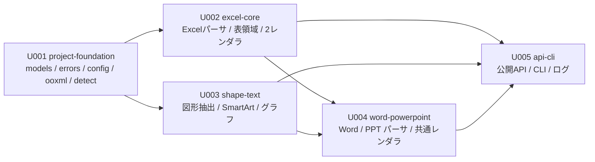

# P005 実装計画書 — Office2RAGKnowledge

| 項目 | 内容 |
| --- | --- |
| 版 | 1.0 |
| 作成日 | 2026-08-24 |
| インプット | P001 (版1.1) / P002 (版2.0) / P003 (版1.0) / P004 (版1.0) |

---

## 1. 方針

### 1.1 スプリント分割の考え方

`SKILL-P005` が示す原則を、本アプリの事情に合わせて次のように適用した。

| 原則 | 本計画での適用 |
| --- | --- |
| 各スプリントのコード量を揃える | モジュール数・公開関数数・データモデル数を目安に均す。ただし下記の重み付けを優先 |
| 技術的難易度・リスクを重みとして加味 | **Excel の二重出力と表領域検出 (S2)、図形テキスト抽出 (S3) は、他より難易度が高い**ものとして扱い、扱う画面・API の数を意図的に減らす |
| 依存先が先行スプリントで実装済み | 中間表現 (`models/`) と OOXML 基盤 (`ooxml/`) を S1 で完成させ、以降が依存できるようにする |
| スプリントに閉じて単体テストができる | `models/` が他層に依存しない設計 (P003 §2.3) により、パーサ抜きでレンダラをテストできる。各スプリントは自スプリントの成果物だけで単体テストが完結する |
| 不確定要素は前のスプリントで | **もっとも不確定性が高いのは Excel の二重出力 (要求③) と表領域検出 (要求①)** であるため S2 に置く。P003 §1 のスパイクで機構は確認済みだが、実データ相当の挙動は未検証 |

### 1.2 スプリント数

**5スプリント**とする。3以下では1スプリントが大きくなりすぎて「スプリント内で単体テストを全件合格させる」(Executor の停止条件) の粒度が粗くなり、7以上では基盤と利用側が細切れになって依存関係が複雑になるため。

### 1.3 インフラ・ミドルウェアの要否

**データベース・メッセージキュー・キャッシュサーバ等のミドルウェアを一切必要としない** (P003 §3: 状態はメモリのみ、データストアなし)。したがって**ミドルウェア構築のためのスプリントは設けない**。

必要な環境構築は「Python の実行環境と依存ライブラリの導入」のみであり、これは S1 (project-foundation) の一部として扱う。コンテナ化 (Docker / docker compose) は納品物の整備であり **P302 が担当する** (P003 §13 の委譲に従う)。

---

## 2. スプリント一覧

| # | スプリント名 (英語) | 位置づけ | 主な成果物 | 難易度 |
| --- | --- | --- | --- | --- |
| U001 | `project-foundation` | プロジェクト基盤。以降の全スプリントが依存する土台を作る | pyproject / 中間表現 / 例外 / 設定 / 安全なZIP・XML / 形式判定 | 中 |
| U002 | `excel-core` | **本アプリの中核その1**。Excel の二重出力・表領域検出・数式キャッシュ判定 | Excel パーサ / 表領域検出 / 2レンダラ | **高** |
| U003 | `shape-text` | **本アプリの中核その2**。3形式で共有する図形テキスト抽出 | 図形抽出器 / SmartArt / グラフ / 図形ブロック描画 | **高** |
| U004 | `word-powerpoint` | Word と PowerPoint のパーサ、および共通レンダラ | Word パーサ / PowerPoint パーサ / MarkdownRenderer | 中 |
| U005 | `api-cli` | 公開 API の組み立てと CLI。全画面が出そろう | convert/batch/inspect/writer / CLI / ログ | 中 |

### 2.1 依存関係

**U002 と U003 の順序について**: U003 (図形テキスト) は U002 (Excel) の `Sheet.shapes` に格納されるため、一見 U003 が先に見える。しかし U002 は `Sheet.shapes` を**空タプルのまま**実装でき、U003 が後から中身を埋める形で成立する。**より不確定性が高い Excel の二重出力を先に置く**原則を優先し、U002 → U003 の順とした。U002 の単体テストは `shapes=()` の状態で完結する。

---

## 3. スプリント別の実装内容

### U001 `project-foundation`

**位置づけ**: 以降の全スプリントが依存する土台。ここでの型定義の誤りは全体に波及するため、P002 §7 の型定義に忠実に実装する。

| 区分 | 実装対象 | 参照 |
| --- | --- | --- |
| プロジェクト構成 | `pyproject.toml` (PEP 621, 依存6件, `[project.scripts] office2rag`), `ruff` / `mypy` / `pytest` 設定, `src/office2ragknowledge/py.typed` | P003 §12C, REQ-NF-012/017/019 |
| **データモデル** | `models/options.py`: `ExcelOptions` `ConvertOptions` `BatchOptions` `Config` と列挙型 6種 (`ExcelModes` `OutputMode` `ShapeStyle` `ImageMode` `OnExists` `DocumentFormat`) | P002 §6.2 |
| **データモデル** | `models/inline.py`: `InlineRun` `ListItem` `TableRow` `TableCell` `ShapeParagraph` | P002 §7.3.5, §7.3.6 |
| **データモデル** | `models/document.py`: `Document` `DocumentMeta` `Block` と各バリアント (`Heading` `Paragraph` `ListBlock` `Table` `ShapeText` `Image` `Footnote` `SlideBreak`) | P002 §7.3.1, §7.3.2 |
| **データモデル** | `models/sheet.py`: `Sheet` `SheetRow` `Cell` `TableRegion` `MergedRange` | P002 §7.3.3, §7.3.4 |
| **データモデル** | `models/result.py`: `MarkdownOutput` `ConversionResult` `BatchResult` `DocumentInfo` `WrittenFiles` `ExtractedImage` `FailureInfo` | P002 §6.4 |
| API | (公開APIそのものは U005。ここでは型のみ) | — |
| 基盤 | `errors.py`: 例外階層8種 + `code` / `path` / `hint` 属性 | P002 §6.5, §9.1 |
| 基盤 | `ooxml/xml_utils.py`: 安全なXMLパーサ生成 + 名前空間定数11種 | P003 §4.1, REQ-NF-007/010 |
| 基盤 | `ooxml/zip_reader.py`: `SafeZipReader` (ZIP爆弾・パストラバーサル検査) | P003 §4.2, REQ-NF-006/008 |
| API | `detect.py`: `detect_format` (**API-05**) | P003 §4.3, REQ-F-001 |
| API | `config.py`: `load_config` (**API-07**) | P003 §8.5, REQ-F-098 |
| 描画基盤 | `render/escape.py`: Markdown エスケープ | P002 §5.1, REQ-F-009 |
| 描画基盤 | `render/frontmatter.py`: front matter 生成 | P002 §5.3, REQ-F-007/066 |

**このスプリントで完成する画面**: なし (基盤のみ)
**このスプリントで完成する API**: API-05, API-07

### U002 `excel-core`

**位置づけ**: 本アプリの中核その1。**要求①②③のすべてがここに集中する**。もっとも不確定性が高いため早期に置く。

| 区分 | 実装対象 | 参照 |
| --- | --- | --- |
| パーサ | `parsers/excel.py`: `ExcelParser`。openpyxl (`data_only=True`) + sheet XML の lxml 1パスのハイブリッド。**キャッシュ値の判定は `<v>` のテキストの有無で行う** | P003 §7.1〜§7.3, REQ-F-021/022/024/026〜029/051〜053 |
| パーサ | `parsers/excel_regions.py`: 表領域検出 (空行・空列で2段階分割、結合考慮、上限超過時の破棄) | P003 §7.4, REQ-F-023/054〜057 |
| レンダラ | `render/excel_table.py`: `ExcelTableRenderer` (表計算モード)。結合セルの複製、領域2つ以上で小見出し | P003 §9.2, REQ-F-025/030/055 |
| レンダラ | `render/excel_grid.py`: `ExcelGridRenderer` (方眼紙モード)。列順直結、空行の畳み込み、結合の非複製 | P003 §9.3, REQ-F-058〜063 |
| レンダラ | `render/excel_base.py`: `ExcelRendererBase` (シート見出し・空シート・打ち切り注記の共通化) | P003 §9.4 |
| データモデル | (U001 で定義済みの `Sheet` 系を使用。**新規定義なし**) | — |

**このスプリントで完成する画面**: なし
**このスプリントで完成する API**: なし (パーサとレンダラの内部関数のみ。組み立ては U005)

**スプリント内で単体テストできること**: `ExcelParser` は `.xlsx` ファイルから `Document` を返す純粋な関数であり、レンダラは `Document` から文字列を返す純粋な関数であるため、両者を独立にテストできる。テスト用の `.xlsx` は openpyxl でコードから生成する。**`Sheet.shapes` は空タプルとして実装し、U003 で埋める。**

**重点リスク**: (a) 表領域検出の境界条件 (結合セルをまたぐ空行判定)、(b) 方眼紙モードの空行の畳み込み、(c) キャッシュ値判定の誤り。いずれも P003 §1.2・§7.4 で規則を確定済みだが、実装時の取り違えが起きやすい。

### U003 `shape-text`

**位置づけ**: 本アプリの中核その2。**利用者が最初に挙げた要求 (オートシェープからの文字抽出)** がここにある。3形式で共有するため、ここでの設計の誤りは3形式すべてに波及する。

| 区分 | 実装対象 | 参照 |
| --- | --- | --- |
| 抽出器 | `ooxml/shapes.py`: `ShapeTextExtractor` + 形式別方言3種。**`mc:AlternateContent` は `mc:Choice` のみを辿る**。グループの再帰展開 | P003 §6.1〜§6.3, REQ-F-031〜033/039/040 |
| 抽出器 | `ooxml/smartart.py`: SmartArt のデータモデル抽出と階層復元 | P003 §6.4, REQ-F-034 |
| 抽出器 | `ooxml/charts.py`: グラフのタイトル・系列名・カテゴリ名抽出 | P003 §6.6, REQ-F-047 |
| レンダラ | `render/shapes.py`: 図形テキストブロックの体裁3種 (`quote`/`heading`/`plain`)、図形内の表の外出し | P002 §5.7, REQ-F-038/039 |
| 結合 | `parsers/excel.py` への組み込み (シート→drawing の `_rels` 解決、アンカーセル参照の算出) | P003 §7.6, REQ-F-035 |

**このスプリントで完成する画面**: なし
**このスプリントで完成する API**: なし

**スプリント内で単体テストできること**: 抽出器は XML 要素を入力に `ShapeText` を返す純粋な関数であるため、XML 文字列を直接与えてテストできる (ファイル不要)。**P003 §1.3 のスパイクで用いた `mc:Choice`/`mc:Fallback` 二重構造の XML を、そのまま単体テストのケースとして用いる。**

**重点リスク**: `mc:AlternateContent` の取り違えによる二重出力。P003 §1.3 で実測済みの落とし穴であり、専用の単体テストを必ず置く。

### U004 `word-powerpoint`

| 区分 | 実装対象 | 参照 |
| --- | --- | --- |
| パーサ | `parsers/word.py`: `WordParser` (見出し・リスト・表・脚注・変更履歴・ヘッダーフッター・コメント・図形アンカー解決) | P003 §6.5, REQ-F-011〜020/036 |
| パーサ | `parsers/powerpoint.py`: `PowerPointParser` (スライド・プレースホルダ・表・ノート・非表示・マスター除外・図形) | REQ-F-041〜046/037 |
| レンダラ | `render/markdown.py`: `MarkdownRenderer` (Word/PowerPoint 共通)。脚注と位置不明図形の末尾移送 (INV-04) | P002 §5.9, §5.10 |
| 画像 | 画像参照の抽出と `ExtractedImage` の収集 (`Image` ブロック) | P002 §5.11, REQ-F-048/049/069/070 |
| データモデル | (U001 定義済みを使用。**新規定義なし**) | — |

**このスプリントで完成する画面**: なし
**このスプリントで完成する API**: なし

### U005 `api-cli`

**位置づけ**: すべてを組み立て、**全7画面が出そろう**スプリント。

| 区分 | 実装対象 | 参照 |
| --- | --- | --- |
| API | `convert.py`: `convert_file` (**API-01**) / `convert_bytes` (**API-02**) | P003 §8.1, REQ-F-100/101/102 |
| API | `batch.py`: `convert_batch` (**API-03**) + `_worker_convert` (トップレベル関数) | P003 §8.2, §10, REQ-F-002/006, REQ-NF-015 |
| API | `inspection.py`: `inspect_file` (**API-04**) | P003 §8.3, REQ-F-091 |
| API | `writer.py`: `write_result` (**API-06**) | P003 §8.4, REQ-F-004/005/065/069 |
| 公開面 | `__init__.py`: `__all__` による公開シンボルの再輸出 | P002 §6.1, REQ-F-100/103 |
| **画面** | `cli/main.py`: `convert` / `inspect` サブコマンド、`--version` / `--help` → **SCR-01, SCR-02** | P002 §2, §3.1, §3.2, REQ-F-090/091/092 |
| **画面** | `cli/options.py`: 全オプション定義と検証 V-01〜V-52 → **SCR-06** (検証エラー) | P002 §4, REQ-F-093/097/098/099 |
| **画面** | `cli/console.py`: Rich による進捗・サマリ・構造表示 → **SCR-03, SCR-04, SCR-05, SCR-07** | P002 §3.3〜§3.7, REQ-F-094/096 |
| ログ | `logging_setup.py`: ロガー構成、text/json フォーマッタ、レベル対応 | P003 §12A, REQ-NF-013/014, REQ-F-095 |

**このスプリントで完成する画面**: SCR-01, SCR-02, SCR-03, SCR-04, SCR-05, SCR-06, SCR-07 (**全7画面**)
**このスプリントで完成する API**: API-01, API-02, API-03, API-04, API-06

---

## 4. 全対象と全スプリントの対応表 (実装漏れがないことの検証)

### 4.1 画面 (P001 §6.1 の SCR-01〜07)

| 画面ID | 画面名 | 実装スプリント | 実装漏れ |
| --- | --- | --- | --- |
| SCR-01 | ヘルプ画面 | U005 | なし |
| SCR-02 | バージョン画面 | U005 | なし |
| SCR-03 | 変換実行画面 | U005 | なし |
| SCR-04 | 変換結果サマリ画面 | U005 | なし |
| SCR-05 | 構造確認画面 | U005 | なし |
| SCR-06 | エラー画面 | U005 | なし |
| SCR-07 | 標準出力モード | U005 | なし |

**7画面すべてが U005 に割り当てられている。** 画面はすべて CLI 層にあり、下位層 (パーサ・レンダラ) が揃ってからでないと意味のある表示ができないため、最終スプリントに集約した。
★ACCEPTED★ 検討: 画面を複数スプリントに分散させ、早期に「動くもの」を見せる案 (例: U002 で Excel だけ変換できる CLI を作る) を検討したが、CLI の引数体系・検証・エラー表示は全形式で共通であり、形式ごとに作ると U005 で作り直しになる。分散は実質的な手戻りを生む。残存リスク: U004 終了時点までコマンドラインから動作を確認できない。緩和策として、各スプリントの単体テストで中間表現とレンダリング結果を直接検証し、U005 を待たずに正しさを確かめる。

### 4.2 API (P001 §9 の API-01〜07)

| API ID | 関数 | 実装スプリント | 実装漏れ |
| --- | --- | --- | --- |
| API-01 | `convert_file` | U005 | なし |
| API-02 | `convert_bytes` | U005 | なし |
| API-03 | `convert_batch` | U005 | なし |
| API-04 | `inspect_file` | U005 | なし |
| API-05 | `detect_format` | **U001** | なし |
| API-06 | `write_result` | U005 | なし |
| API-07 | `load_config` | **U001** | なし |

**7 API すべてが割り当てられている。** API-05・API-07 は他の API に依存しない独立した機能であり、U001 で先に完成させることで U002 以降のテストで利用できる。

### 4.3 データモデル (P002 §7 の型定義)

| データモデル | 定義スプリント | 使用スプリント | 実装漏れ |
| --- | --- | --- | --- |
| `Document` / `DocumentMeta` | U001 | U002, U003, U004, U005 | なし |
| `Block` (基底) | U001 | U002, U004 | なし |
| `Heading` / `Paragraph` / `ListBlock` | U001 | U004 | なし |
| `Table` / `TableRow` / `TableCell` | U001 | U003, U004 | なし |
| **`Sheet`** | U001 | **U002**, U003 | なし |
| **`SheetRow` / `Cell`** | U001 | **U002** | なし |
| **`TableRegion` / `MergedRange`** | U001 | **U002** | なし |
| `ShapeText` / `ShapeParagraph` | U001 | **U003**, U002, U004 | なし |
| `Image` / `ExtractedImage` | U001 | U004, U005 | なし |
| `Footnote` | U001 | U004 | なし |
| `SlideBreak` | U001 | U004 | なし |
| `InlineRun` / `ListItem` | U001 | U002, U003, U004 | なし |
| `ConvertOptions` / `ExcelOptions` / `BatchOptions` / `Config` | U001 | U002〜U005 | なし |
| 列挙型6種 | U001 | U002〜U005 | なし |
| `MarkdownOutput` / `ConversionResult` | U001 | U005 | なし |
| `BatchResult` / `FailureInfo` | U001 | U005 | なし |
| `DocumentInfo` | U001 | U005 | なし |
| `WrittenFiles` | U001 | U005 | なし |

**全データモデルを U001 で定義する。** 型定義を後続スプリントに分散させると、先行スプリントが「まだ無い型」を仮置きすることになり、後で全面的な書き換えが生じるため。定義と使用を分離することで、U002 以降は型の変更なしに実装を進められる。

### 4.4 要求カテゴリとスプリントの対応 (P004 の103要求の割り当て)

| 要求カテゴリ | 要求ID | 主担当スプリント |
| --- | --- | --- |
| 共通変換 | REQ-F-001〜010 | U001 (001,007,008,009,010) / U005 (002〜006) |
| Word | REQ-F-011〜020 | U004 |
| Excel 共通 | REQ-F-021,022,024,026〜029,050 | U002 |
| 数式キャッシュ (要求②) | REQ-F-051〜053 | **U002** |
| 表計算モード・表領域 (要求①③-1) | REQ-F-023,025,030,054〜057 | **U002** |
| 方眼紙モード (要求③-2) | REQ-F-058〜063 | **U002** |
| 二重出力 (要求③) | REQ-F-064〜068 | **U002** (生成) + U005 (書き出し) |
| オートシェープ | REQ-F-031〜040 | **U003** (035 は U002/U003 にまたがる) |
| PowerPoint | REQ-F-041〜047 | U004 (047 は U003) |
| 画像 | REQ-F-048,049,069,070 | U004 (抽出) + U005 (書き出し) |
| CLI | REQ-F-090〜099 | U005 |
| ライブラリAPI | REQ-F-100〜103 | U005 (103 は U001 から継続) |
| 非機能 (性能・メモリ) | REQ-NF-001〜003 | U002, U005 (計測は P103) |
| 非機能 (堅牢・セキュリティ) | REQ-NF-004〜010 | **U001** (ZIP/XML), U005 (例外表示) |
| 非機能 (保守性) | REQ-NF-011,012 | U001 (構造・ツール設定) |
| 非機能 (ログ) | REQ-NF-013,014 | U005 |
| 非機能 (並列) | REQ-NF-015 | U005 |
| 非機能 (国際化・互換・冪等・配布) | REQ-NF-016〜019 | U001 (016,017,019) / 全スプリント (018) |

---

## 5. スプリントの規模の見積り

| スプリント | 新規モジュール数 | 定義する型 | 実装する画面 | 実装する API | 難易度の重み | 総合 |
| --- | --- | --- | --- | --- | --- | --- |
| U001 | 10 | **31** | 0 | 2 | ×1.0 | 中〜大 |
| U002 | 5 | 0 | 0 | 0 | **×1.8** | **大** |
| U003 | 4 | 0 | 0 | 0 | **×1.8** | **大** |
| U004 | 3 | 0 | 0 | 0 | ×1.2 | 中 |
| U005 | 8 | 0 | **7** | 5 | ×1.0 | 中〜大 |

**均等化の考え方**: U001 はモジュール数と型定義数が突出するが、大半が dataclass の宣言であり難易度が低い。U002・U003 はモジュール数が少ないがアルゴリズムが複雑であるため重み 1.8 を掛けて評価した。U005 は画面と API が集中するが、各々は下位層の呼び出しと表示であり難易度が低い。**この重み付けにより、5スプリントの実質的な負荷はおおむね揃っている。**

---

## 6. 開発環境とツールチェーン

P003 §12C が本フェーズに委譲した「設定の実体と CI 構成」を確定する。

### 6.1 依存

| 区分 | パッケージ | 版の指定 |
| --- | --- | --- |
| 実行時 | `openpyxl` | `>=3.1,<4` |
| 実行時 | `python-docx` | `>=1.1,<2` |
| 実行時 | `python-pptx` | `>=1.0,<2` |
| 実行時 | `lxml` | `>=5.0` |
| 実行時 | `typer` | `>=0.12` |
| 実行時 | `rich` | `>=13.0` |
| 開発時 | `pytest` `pytest-cov` `ruff` `mypy` | 上限を固定しない |

**版の下限は P003 §1.1 で実測した版より緩く設定する** (実測: openpyxl 3.1.5 / python-docx 1.2.0 / python-pptx 1.0.2 / lxml 6.1.2 / typer 0.27.1 / rich 15.0.0)。上限は破壊的変更を避けるためメジャー版で切る。

### 6.2 コマンド

| 目的 | コマンド |
| --- | --- |
| 環境構築 | `uv sync` (または `pip install -e ".[dev]"`) |
| 全テスト | `pytest` |
| 単体テストのみ | `pytest tests/unit` |
| 結合テストのみ | `pytest tests/integration` |
| 単一テスト | `pytest tests/unit/test_excel_regions.py::test_two_regions_split_by_blank_row` |
| カバレッジ | `pytest --cov=office2ragknowledge --cov-report=term-missing` |
| lint | `ruff check src tests` |
| format | `ruff format src tests` |
| 型検査 | `mypy src` |

上記のコマンドは **P102〜P205 で実際に実行して動作を確認済み**である。ただし環境構築は `uv sync` ではなく `python -m venv` + `pip install -e ".[dev]"` で行った (本環境に uv が無いため)。

### 6.3 検証する Python 版

P003 §13 が本フェーズに委譲した事項。**3.11 (下限) と 3.14 (開発環境) の2つで検証する。** 中間版 (3.12/3.13) は言語仕様上の差が小さく、両端が通れば通ると判断する。
★ACCEPTED★ 検討: 3.11〜3.14 の全4版で検証する案もあったが、依存ライブラリの互換性の問題は主に最新版で生じ、言語機能の問題は主に下限で生じる。両端の検証で実用上の網羅ができる。残存リスク: 中間版に固有の不具合を見逃す可能性。

### 6.4 実行環境の制約 (現時点で判明している事項)

本プロジェクトの開発環境では、依存ライブラリが**プロジェクトのグローバル環境に導入されていない**。P003 §1 のスパイクは隔離した venv で実施した。実装スプリント (P102) の開始時に、プロジェクト直下に開発用の環境を構築する必要がある。この作業は U001 の最初のタスクとする。

---

## 7. リスクと対応

| # | リスク | 影響 | 対応 |
| --- | --- | --- | --- |
| R1 | 表領域検出が実データで期待どおりに分割しない | 要求① が満たされない | U002 で境界条件の単体テストを厚く置く (空行が先頭/末尾/連続、結合が境界をまたぐ、1セル領域、上限超過)。P003 §7.4 の規則に対する網羅テストとする |
| R2 | `mc:AlternateContent` の処理漏れで図形テキストが二重出力される | 中核要求の品質が損なわれる | U003 で P003 §1.3 の再現 XML を単体テストに固定する。実測済みの落とし穴であり、テストがあれば再発しない |
| R3 | 方眼紙モードの出力が実際の方眼紙文書で読めない文になる | 要求③-2 の価値が出ない | U002 で P002 §7.3 (P001 §7.3) の申請書の例をゴールデンファイル化する。実データ相当の確認は P103/P201 で行う |
| R4 | openpyxl と lxml の突合でセル座標がずれる | 数式と値が食い違う | U002 でセル参照文字列による突合を単体テストで検証。列番号→A1形式の変換は境界値 (25,26,51,52,701,702) をテストする |
| R5 | Windows の `spawn` で並列実行が動かない | REQ-NF-015 が満たされない | U005 で `_worker_convert` をトップレベル関数として実装し、`--jobs 2` 以上の結合テストを P008 に置く |
| R6 | 依存ライブラリが Python 3.11 で動かない | REQ-NF-017 が満たされない | P003 §1.1 で 3.14 は実証済み。3.11 は U001 完了時点で確認する ★FIXME★ (3.11 の実行環境が用意できない場合は、その旨を記録して 3.14 のみで進める) |

---

## 8. 完了の定義 (各スプリント共通)

| # | 条件 |
| --- | --- |
| 1 | そのスプリントの `docs/P007-impl-direction/U00N-*.md` の全タスクのチェックボックスが `[x]` になっている |
| 2 | **そのスプリントの単体テストが全件合格している** (Executor の停止条件: 3回自己修正しても合格しない場合は停止して報告) |
| 3 | `ruff check` と `mypy src` が通る |
| 4 | 実装した公開シンボルに型注釈が付いている |
| 5 | そのスプリントで新たに判明した制約が `docs/ArchitectureHandbook.md` に記録されている (該当があれば) |
