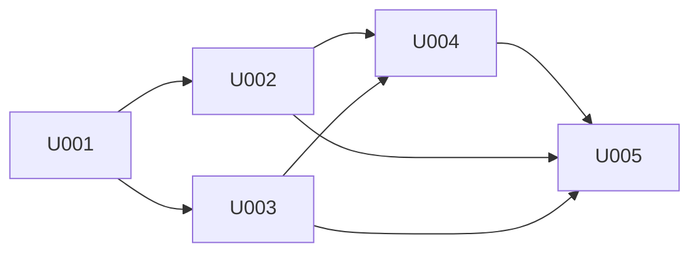

# P007 プログラム実装定義 兼 プログラミング指示書 — 目次 (OKF形式)

| 項目 | 内容 |
| --- | --- |
| 版 | 1.0 |
| 作成日 | 2026-08-24 |
| インプット | P002 (版2.0) / P003 (版1.0) / P005 (版1.0) / P006 (版1.0) |
| コード格納先 | `app/` (単一アプリ構成) |

---

## 1. 本書の使い方

* 本書は **Executor (実装担当Agent)** への指示書の目次である。各スプリントの実装指示は下記のリンク先にある。
* 1スプリント = 1ファイル。スプリント内は `U0NN-Txx` のタスクに分かれており、タスク単位の進捗は各スプリントファイル冒頭の「タスク一覧」で追跡する。
* **本書のチェックボックスは、そのスプリントの全タスクが完了して初めて `[x]` にする。**
* 単体テストは各タスクの【Unit Test内容】に含まれる。**スプリント内で全件合格させること。**
* スプリント内/モジュール間の結合テストは `docs/P008-test-direction.md`、スプリント横断・システム・受け入れテストは `docs/P009-acceptance-direction.md` で別途指示する。本書では扱わない。

## 2. 技術スタックについて

実装に用いる言語・ライブラリ・ツールは `docs/ADR.md` を参照すること (**ADR-001〜ADR-011**)。本書の目次・見出しには具体的なライブラリ名を書かない。各タスクの【実装内容】の中では、必要に応じて具体名に言及する。

**実装前に必ず読むべき ADR** (誤ると中核機能が壊れるもの):

| ADR | 内容 | 関係するスプリント |
| --- | --- | --- |
| ADR-002 | 数式キャッシュ値の判定はハイブリッド方式。**`<v>` の有無で判定してはならない** | U002 |
| ADR-003 | `mc:AlternateContent` は `mc:Choice` のみを辿る。**素朴な走査は図形テキストを2回出力する** | U003 |
| ADR-004 | 中間表現は結合セルを展開しない。複製はレンダラの責務 | U001, U002 |
| ADR-005 | 並列はファイル単位。ワーカー関数はトップレベル定義 | U005 |
| ADR-009 | `ConversionResult.markdown` は複数出力時に `ValueError` | U001, U005 |

(P021 により ADR 番号は確定済み。暫定番号の参照は残っていない。)

## 3. スプリント一覧 (OKF)

- [x] U001 [プロジェクト基盤の構築](./P007-impl-direction/U001-project-foundation.md) — ビルド構成・中間表現・例外・設定・安全なZIP/XML・形式判定・描画基盤
- [x] U002 [Excel変換の中核](./P007-impl-direction/U002-excel-core.md) — Excelパーサ・表領域検出・数式キャッシュ判定・表計算/方眼紙の2レンダラ
- [x] U003 [図形テキスト抽出](./P007-impl-direction/U003-shape-text.md) — 3形式共有の図形抽出器・SmartArt・グラフ・図形ブロック描画
- [x] U004 [WordとPowerPointの変換](./P007-impl-direction/U004-word-powerpoint.md) — Wordパーサ・PowerPointパーサ・共通レンダラ・画像抽出
- [x] U005 [公開APIとCLI](./P007-impl-direction/U005-api-cli.md) — convert/batch/inspect/writer・CLI全7画面・ログ

## 4. スプリント間の依存

**実行順序は U001 → U002 → U003 → U004 → U005 とする。** 上記の依存を満たす順序であり、かつ不確定性の高い U002・U003 を前方に置いている (P005 §1.1)。

## 5. 全スプリント共通の実装規約

Executor は、すべてのタスクで次を守ること。

| # | 規約 | 根拠 |
| --- | --- | --- |
| 1 | **中間表現 (`models/`) は他のどの層にも依存させない。** `models/` の中で `parsers/` `render/` `ooxml/` を import しない | P003 §2.3 |
| 2 | **`render/` から `parsers/` `ooxml/` を import しない。** レンダラは `models/` のみに依存する | P003 §2.3 |
| 3 | **`parsers/` から `render/` を import しない** | P003 §2.3 |
| 4 | **XML のパースは必ず `ooxml/xml_utils.py` の関数を経由する。** `lxml.etree.fromstring` を各モジュールが直接呼ばない | P003 §4.1, REQ-NF-007 |
| 5 | **ZIP を開くときは必ず `ooxml/zip_reader.py` の `SafeZipReader` を経由する** | P003 §4.2, REQ-NF-006/008 |
| 6 | **Markdown のエスケープはレンダラでのみ行う。** パーサはエスケープ前の生文字列を中間表現に格納する | P002 INV-02 |
| 7 | **データモデルは `@dataclass(frozen=True, slots=True)`、コレクションは `tuple`** | P003 §5.1 |
| 8 | **公開シンボルには型注釈を付ける。`Any` を戻り値に用いない** | REQ-F-103, REQ-NF-012 |
| 9 | **ログに本文テキスト (セル値・段落テキスト・図形テキスト・title・author) を渡さない** | REQ-NF-014, P003 §12A.3 |
| 10 | **ファイルの読み書きは `encoding="utf-8"`、書き込みは `newline="\n"` を明示する** | REQ-F-008, P003 §12B |
| 11 | **現在時刻の取得は `DocumentMeta` の生成箇所1箇所に限る。** パーサ・レンダラの関数内部で `datetime.now()` を呼ばない。時刻が必要な関数は引数で受け取る | 単体テストで時刻を固定するため。REQ-NF-018 |
| 12 | **出力順序を `set` や `dict` の反復順に依存させない。** 順序が出力に影響する箇所は明示的にソートするか、入力の出現順を保つ `list` で扱う | REQ-NF-018, P003 §11 |

## 6. 完了判定

* 各スプリントは、そのファイルの「タスク一覧」の全タスクが `[x]` になったら完了。
* 完了したら本書の該当行を `[x]` に更新する。
* **本フェーズ (P007) 全体の完了は、上記5行すべてが `[x]` になった時点**である。これは P102 (プログラム実装) の実行結果として、Plan Loop Step より後に確定する。
